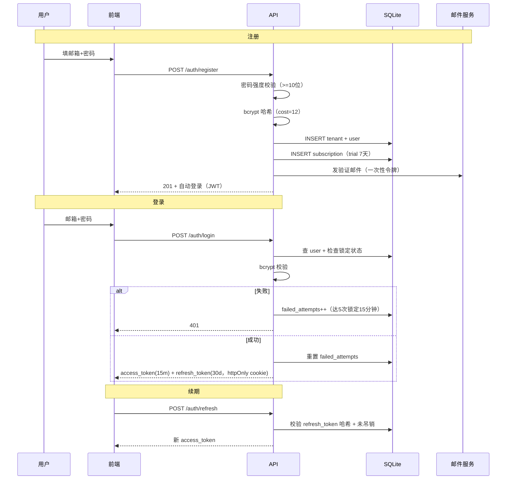
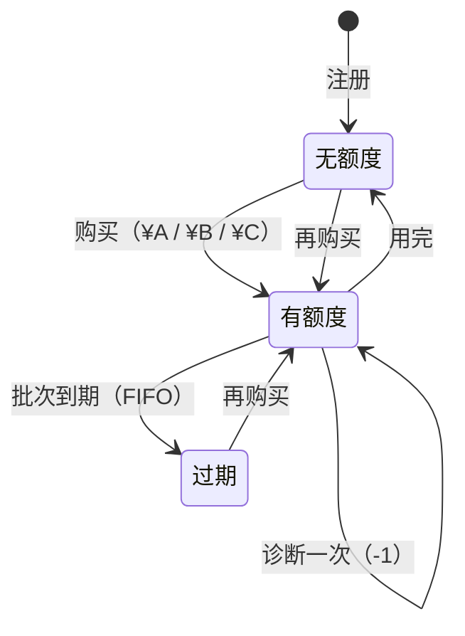
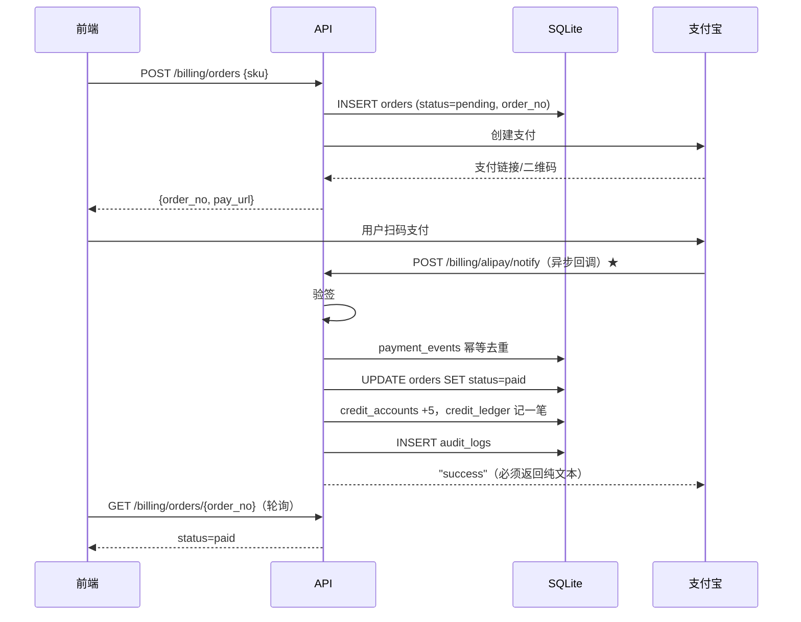
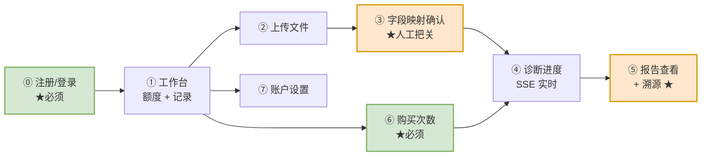
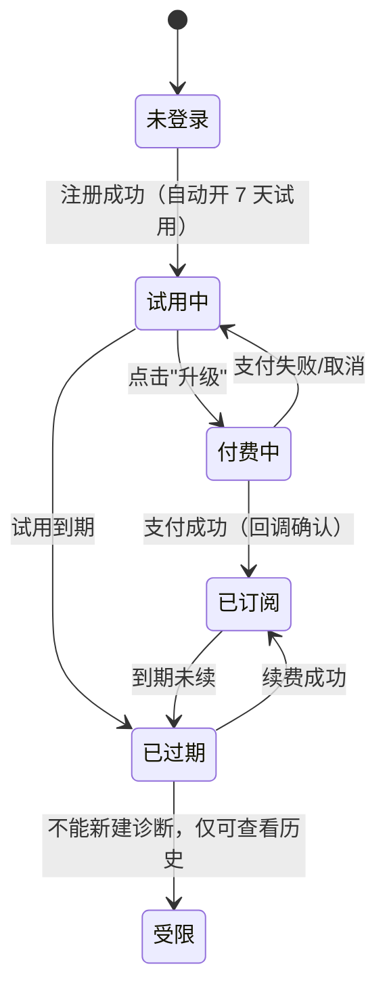

# 企业生产级数据分析 Agent —— 总体设计

> 版本 **v1.4（已实现）** · 2026-10-19
> 参考基线：`harness_py_pro/`（生产层 8,014 行 / 32 模块）+ `harness_py/`（教学层 1,250 行 / 11 模块）
> 业务方向来源：业务方向参考文档 —— 卖家数据分析 Agent
>
> **v1.0 状态**：后端 + 前端**已开发完成并通过验证**（13 个模块 / 483 项断言全绿）。
> 本文档已按实现回写；开发过程中修正的设计偏差见 **§8 实现偏差记录**。
> 运行方式见 `web/README.md`；一键启动用根目录 `start.ps1`。
>
> **v1.1 增量（获客闭环）**：样例数据（`/samples` 公开下载 + 上传页入口）、
> 多工作表 Excel 自动拆分、注册赠送 1 次体验诊断（`SIGNUP_FREE_CREDITS`）、
> 报告升级（统计卡片 + 趋势图）。详见 **§9 v1.1 获客闭环设计**。
>
> **v1.2 增量（归因报告 + L1 口径对比）**：报告从"整体数字"升级为"能定位问题"
> —— 商品维度拆解（重点关注标记）、异常日检测（趋势图标记 + 特征描述）、
> 周度对比（残周排除）、L1 口径对比（财务 vs 推广毛利率并排）、口径版本快照。
> 详见 **§9.4**。
>
> **v1.3 增量（记忆层压缩 + 超级管理员）**：`app/memory/` 通用四级压缩库
> （L1→L3→L2 顺序修正 + G1/G2/G3 修补，零业务依赖，docs/10）；
> 超级管理员免额度（env 指定 + 角色持久化 + delta=0 审计留痕，docs/12）；
> 参考架构融合盘点（docs/13）。
>
> **v1.4 增量（对话式分析，docs/14）**：形态 A 查数问答（`qa_engine`，
> 意图路由→语义层直算，零 LLM）+ 形态 B Agent 循环（`agent_engine`：
> LLM + 5 工具 + LoopGuard 3/3/8 + 压缩接入 + 成本记账；`llm_client` 抖动重试）。
> `/chat` API + 前端对话页；A/B 自动路由。真实 LLM 冒烟通过
> （5 轮 / 9 工具 / $0.00X，Agent 自主挖出样例故事）。
> 验证：18 个模块 / 688 项断言全绿（v1.4.1 含数据上下文与对话配额）。

---

## 0. 本文档要回答的问题

本文档只做一件事：**把"给卖家做经营诊断的数据分析 Agent"从业务想法，落到一套可以照着写代码的分层架构上**，并逐层说清楚三件事：

1. **这一层做什么** —— 职责与对外契约
2. **这一层的边界在哪** —— 什么归它管、什么坚决不归它管
3. **参考代码怎么用** —— 从 `harness_py_pro/` 哪个文件抄什么，改什么，弃什么

配套两份文档：
- `02-ARCHITECTURE.md` —— 架构图（分层图 / 数据流图 / 时序图）
- `03-ROADMAP.md` —— 开发步骤流程图（阶段 / 里程碑 / 验收门）

---

## 1. 业务约束决定架构形态

架构不是凭空拍的，是由业务约束反推出来的。先把六条硬约束钉死，后面每一层的设计都能回溯到这里。

| # | 业务约束 | 架构后果 |
|---|---|---|
| C1 | MVP **不接平台 API**，卖家自己拖导出文件进来 | 必须有「接入层」处理异构 Excel/CSV；不能假设有稳定的 schema |
| C2 | 客户是**中小卖家**，不懂数据口径，只看结论 | 输出层必须是「归因 + 建议」的自然语言报告，不是图表堆砌 |
| C3 | 护城河是**语义层（指标口径）**，不是模型 | 语义层必须是一等公民、可版本化、可测试、可扩展——不是 prompt 里的一段话 |
| C4 | 独立开发者，**没有运维团队** | 全部部署必须单机可跑、无外部中间件依赖；可观测性内建 |
| C5 | 客户数据**高度敏感**（销量、成本、利润） | 默认不出网、租户目录隔离、报告可脱敏、审计留痕 |
| C6 | 成本必须**可算**，月费要能覆盖住单位成本 | Token 预算 + 成本追踪必须从第一天就在，不是二期功能 |

> **关键判断**：C3 是这份架构与"套壳 ChatGPT"的分水岭。通用数据分析 Agent 失败的原因从来不是模型不够强，而是**同一个"毛利率"在不同口径下算出三个数，模型直接答错**。所以本架构把语义层放在约束层之上、工具层之下——它既是 Agent 的"知识"，也是 Agent 的"牢笼"。

---

## 2. 架构总览（六层 + 语义层 + 前端/接口/存储）

沿用参考代码的六层骨架，但每层的**内容物**替换为数据分析场景。

```
        ┌────────────────────────────────────────────────────────┐
        │  A  前端层 Web UI   上传 · 映射确认 · 进度 · 报告 · 设置 │
        └───────────────────────────┬────────────────────────────┘
                                    │ HTTP / SSE
        ┌───────────────────────────▼────────────────────────────┐
        │  B  接口层 API      REST + SSE · 鉴权 · 配额 · 幂等      │
        └───────────────────────────┬────────────────────────────┘
                                    │ 进程内调用
┌───────────────────────────────────▼──────────────────────────────┐
│ ⑥ 交付层 Delivery     报告生成 · 多租户 · 计费 · 留存              │
├──────────────────────────────────────────────────────────────────┤
│ ⑤ 验证层 Verification  口径校验 · 数值自洽 · 归因可证 · 数据质量门  │
├──────────────────────────────────────────────────────────────────┤
│ ④ 记忆层 Memory        会话持久化 · 压缩 · 租户记忆 · 口径演进      │
├──────────────────────────────────────────────────────────────────┤
│ ③ 上下文层 Context     语义层注入 · 报告模板 · 安全扫描 · 缓存边界   │
├──────────────────────────────────────────────────────────────────┤
│ ② 工具层 Tools         数据接入 · 指标计算 · 统计检验 · 归因 · 绘图 │
├──────────────────────────────────────────────────────────────────┤
│ ① 约束层 Constraint    沙箱 · 权限 · 预算熔断 · 合规 Hook           │
├──────────────────────────────────────────────────────────────────┤
│     ★ 语义层 Semantic  （横向贯穿：指标定义 / 口径 / 维度 / 血缘）   │
├──────────────────────────────────────────────────────────────────┤
│     ▣ 存储层 Storage    SQLite（元数据）+ 文件系统（数据/产物）      │
└──────────────────────────────────────────────────────────────────┘
```

**A/B 两层是本轮新增的前端与接口层**，位于原有六层之上，不侵入原有分层。
**存储层是本轮澄清的依赖**——它不是"要不要上数据库"的问题，而是"已经隐含需要"（见 §8）。

| 层 | 核心问题 | 主参考模块 | 复用度 | 实现状态 |
|:---:|---|---|---|---|
| A 前端层 | 卖家怎么用？ | 无对应模块 | **100% 新建** | ✅ 已完成（`web/`，9 页面） |
| B 接口层 | 前后端怎么对话？ | 无对应模块（框架是库不是服务） | **100% 新建** | ✅ 已完成（FastAPI + SSE） |
| ① 约束层 | Agent 能碰什么数据？ | `sandbox.py` `permissions.py` `hooks.py` `token_budget.py` | 80% 复用（**Hook 有注册 bug，见 D15**） | ✅ 已实现（见 §8 偏差 1） |
| ② 工具层 | Agent 如何算指标？ | `tools.py` 的 `BaseTool`/`ToolRegistry` 模式 | 框架复用，工具全重写 | ✅ 已实现（12 个工具） |
| ★ 语义层 | 指标口径是什么？ | 无对应模块 | **100% 新建（核心资产）** | ✅ 已完成（16 指标） |
| ③ 上下文层 | 本轮该看到什么？ | `prompt.py` | ⚠️ **骨架复用，装配逻辑需重写**（见 §3③） | ✅ 已实现（SQL 渲染器） |
| ④ 记忆层 | 如何跨轮连续？ | `compact.py` `memory.py` `session.py` `token_budget.py` | ⚠️ **预算直接复用；压缩与持久化需修补**（见 §3④） | ⚠️ MVP 简化（见 §8 偏差 4） |
| ⑤ 验证层 | 如何证明分析对？ | `loop_guard.py` + `acceptance` 机制 | **机制保留，判据与上下文抽取器全部重写** | ✅ 已实现（9 条质量门） |
| ⑥ 交付层 | 如何变成收入？ | `observe.py` `swarm.py` | 40% 复用（**swarm 是伪并行，见 D23**） | ✅ 已实现（HTML 报告） |
| ▣ 存储层 | 状态放哪？ | 无对应模块 | **新建（SQLite + 文件系统）** | ✅ 已完成（15 张表） |

> ⚠️ **参考框架是"库"不是"服务"**：`harness_py_pro/__init__.py` 只导出 `run()` / `resume()` / `orchestrate()` 等函数，**没有任何 HTTP 层**（全仓 grep `fastapi`/`flask`/`uvicorn` 零命中）。接口层必须完全新建。

> ✅ **实现说明**：本项目**没有直接复用 `harness_py_pro` 的运行时**，而是
> **复用了它的架构决策与关键算法**（沙箱分层、四级压缩思路、五区预算、
> LoopGuard 阈值、acceptance 门机制）。原因见 §8 偏差 1 —— 数据 Agent
> 不需要文件编辑工具链，且参考框架的会话持久化有硬截断缺陷。

**逐模块评级**（面向数据分析场景）：

| 模块 | 评级 | 理由 |
|---|---|---|
| `pathing.py` | ✅ 直接复用 | 纯路径解析，与领域无关；`extra_roots` 配成数据目录即可 |
| `loop_guard.py` | ✅ 直接复用 | 仅需改 `acceptance_check` 豁免名（换成本项目的 `acceptance_check`） |
| `plan_tools.py` | ✅ 直接复用 | 8 个规划工具与领域无关 |
| `token_budget.py` | ✅ 直接复用 | 换定价表；统一两处匹配策略（D14） |
| `permissions.py` | 🔧 需改造 | 敏感路径换成数据源凭证 / PII；`action` 参数当前**未参与判定**，需补读写区分 |
| `hooks.py` | 🔧 需改造 | 补结构化脱敏；修 D15 的列表注册缺陷；注意 pre 异常 fail-closed / post 异常 fail-open |
| `sandbox.py` | ✅ 直接复用 | 整个文件；但**必须处理 D9 的默认值不一致** |
| `compact.py` | 🔧 需改造 | 四级骨架 + 孤儿修复可留；摘要模板换数据语义；修 D3/D4/D5/D12/D26/D27 |
| `memory.py` | 🔧 需改造 | type 枚举换数据域；修 D7；Dream 当前**只出报告不落地** |
| `session.py` | 🔴 需重写 | 三处硬截断 + tool_calls 缺失（D6/D11）+ 无父会话外键（D24） |
| `prompt.py` | 🔴 需重写 | 整份是编码 Agent 方法论；仅 3 小块可抽（威胁模式、CLAUDE.md 遍历、`sanitize_extra_context`） |
| `observe.py` | 🔧 需改造 | 加 `tenant_id` / 数据质量指标 / cache 命中率；修 D22 |
| `swarm.py` | 🔧 需改造 | 伪并行（D23）+ 无跨角色契约校验 + 角色异常被吞 |
| `subagent_manager.py` | 🔧 需改造 | 修 D16 竞态；**必须用 `consume_completions()` 而非 `poll_completions()`**（D17） |
| `plan_state.py` | 🔧 需改造 | 修 D19 的毫秒 ID |
| `skills.py` | 🔧 需改造 | 手写 YAML **只支持扁平结构**，放不下嵌套的指标定义 → 语义层别用 skills 承载 |
| `plugins.py` | 🔧 需改造 | 修 D15；`_load_tools` **只 import 不注册** |
| `tasks.py` | 🔧 需改造 | **必须换受控执行器**（D20 绕过沙箱） |
| `mailbox.py` | 🔧 需改造 | 修 D21 非原子读改写 |
| `mcp_client.py` | ⏸️ 暂缓 | MVP 不需要 MCP；二期接 Hive/DB 时再启用 |
| `engine.py` | 🔧 需改造 | 主循环骨架复用；**`_collect_acceptance_context` 必须重写**（D18） |

---

## 3. 逐层设计

### ★ 语义层 Semantic Layer（核心资产，100% 新建）

> **v0.3 状态更新**：语义层已由用户提供实现（`电商语义层建表v0.sql`），评审结论见 `语义层评审.md`。
> 原始设计意图保留在下方，**实现以 SQL 交付物为准**，本节的字段设计作为补全依据。

#### 📌 已确认的实现映射（v0.3）

用户提供的 SQL 用**关系型表**实现语义层，比本文档最初的 Python dataclass 方案更好（Agent 可直接查询，无需全量注入 prompt）。映射如下：

| 本设计（dataclass） | SQL 实现 | 状态 |
|---|---|---|
| `key` | `sem_metric_registry.metric_id`（M01…） | ✅ |
| `display_name` | `metric_name` | ✅ |
| `formula` | `formula_view`（指向视图） | ✅ **更优**：公式即 SQL 真源 |
| `caliber` | `caliber_rules`（JSON） | ✅ **更优**：可存多条规则 |
| `dimensions` | `sem_metric_dimension`（含 `dim_table`/`dim_key`/`enabled`） | ✅ **更优** |
| `aliases` | ❌ 缺失 → **需补列** | 🔴 |
| `data_quality_rules` | ❌ 缺失 → **需补列**（验证层门 1 无处落地） | 🔴 |
| `version` / `owner` | ❌ 缺失 → 建议补 | 🟠 |

**口径冲突消解的落地方式已调整**：因为 M13（财务口径）与 M14（推广口径）是**两个独立 metric_id**，歧义问题从"同一指标的多个定义"变成"**多个指标 + 别名冲突检测**"——更易实现和测试：

```python
cands = registry.find_by_alias('毛利率')      # → [M13, M14]
if len(cands) > 1:
    raise CaliberAmbiguous(f'毛利率有 {len(cands)} 个口径: 财务/推广，请指定')
```

**首批 10 个 P0 指标**（SQL 已注册）：M01 会话数 / M03 转化率 / M05 销售额 / M06 净销售额 / M10 平台佣金 / M11 COGS / M12 履约成本 / M13 毛利率(财务) / M14 毛利率(推广) / M15 ACOS。

---

**这是唯一一个参考代码里没有对应物、却决定产品生死的层。**

#### 职责

把"电商经营口径"从人的脑子里，固化成机器可查、可校验、可版本化的结构。

#### 为什么不能写成 prompt

| 写法 | 问题 |
|---|---|
| 把口径写进 system prompt | 改口径要改代码；无法校验；token 成本随口径增长线性膨胀；模型可以不遵守 |
| 把口径写成 SQL 注释 | 人看得懂，模型不可靠地遵守；无类型检查 |
| **把口径做成结构化对象** ✅ | 可校验、可按需注入、可单测、可版本化、可 diff |

#### 数据模型

```python
@dataclass(frozen=True)
class MetricDefinition:
    key: str                    # 'gross_margin_rate'
    display_name: str           # '毛利率'
    aliases: list[str]          # ['毛利率', '利润率', 'margin'] —— 用于自然语言映射
    formula: str                # 'gross_profit / revenue' —— 公式引用其他指标 key
    unit: str                   # 'percent' | 'currency' | 'count' | 'ratio'
    dimensions: list[str]       # ['date', 'asin', 'marketplace', 'channel']
    depends_on: list[str]       # ['gross_profit', 'revenue'] —— 血缘，用于拓扑排序
    caliber: str                # 'platform' | 'finance' | 'ad' —— 口径归属 ★关键
    data_quality_rules: list[QualityRule]
    version: str                # '2026.10'
    owner: str                  # 谁负责这个口径
```

#### 三个必须内建的机制

**① 口径冲突消解**
"毛利率"在平台口径、财务口径、推广口径下是三个数。语义层必须**显式要求调用方指定口径**，缺省时**报错而不是猜**：

```python
def resolve(key: str, caliber: str | None) -> MetricDefinition:
    cands = [m for m in self._metrics[key] if caliber is None or m.caliber == caliber]
    if len(cands) > 1:
        raise CaliberAmbiguous(
            f'{key} 有 {len(cands)} 个口径: {[c.caliber for c in cands]}，必须显式指定'
        )
    return cands[0]
```

> 这一条是整个产品最硬的护城河。竞品 ERP 报表不会报错，它只会给你一个数——然后老板拿着这个数做错决策。

**② 依赖拓扑排序**
`gross_margin_rate` 依赖 `gross_profit`，后者依赖 `revenue`。计算时必须**按依赖顺序**执行，且**只算被请求指标的实际闭包**，避免算全量浪费 token 和时间。

**③ 数据质量规则绑定**
每个指标声明自己的前置校验：`revenue >= 0`、`gross_profit <= revenue`、`日期连续无断层`。校验不通过 → 该指标标记为 `unavailable`，**而不是输出一个错数**。

#### 边界（明确不做）

- ❌ 不做通用的 BI 语义层（不追求覆盖所有行业，只做跨境电商）
- ❌ 不做 SQL 生成器（MVP 阶段数据在 DataFrame 里，不落库）
- ❌ 不存储业务数据（只管"怎么算"，不管"算出什么"）
- ❌ 不允许 Agent 运行时修改口径（口径变更走人工 PR + 版本号，不进 Agent 循环）

---

### ① 约束层 Constraint

**参考**：`harness_py_pro/sandbox.py`（588 行）、`permissions.py`（85 行）、`hooks.py`（53 行）、`token_budget.py` 的 `CostTracker`

#### 职责

回答"Agent 能碰什么"。这是**四层防御**的底座，从"规则告诉 Agent 不要做"升级为"执行环境让 Agent 做不到"。

#### 四层防御映射

| 层 | 参考实现 | 数据 Agent 的改造点 |
|---|---|---|
| L1 规则层 | `CLAUDE.md` 注入 | 换成 `ANALYST.md`：口径纪律、保密纪律、不臆造数字 |
| L2 检查层 | `PermissionChecker` | 路径白名单从"代码目录"换成"租户数据目录" |
| L3 Hook 层 | `HookConfig.pre_tool/post_tool` | pre: 拦截导出 PII / 外发；post: 报告脱敏 |
| L4 沙箱层 | `Sandbox` + `NetworkPolicy` | **`deny_by_default=True` 必须默认打开** |

#### 直接复用（几乎不改）

```python
# 来自 harness_py_pro/permissions.py —— 原样复用
class PermissionChecker:
    def check_path(self, path: str, action: str = 'read') -> tuple[bool, str]: ...
    def check_tool(self, tool_name: str) -> tuple[bool, str]: ...
```

#### 逐字复用 `sandbox.py` 的五个组件**：
- `PermissionMode`（ASK/ACCEPT/BYPASS/PLAN）—— 客户演示用 PLAN，生产用 ASK
- `NetworkPolicy.check_command()` —— 拦截 `curl`/`wget`/`requests`/`socket`
- `FilesystemPolicy.check_path()` —— 敏感文件名（`.env`/`id_rsa`）硬拒
- `DANGEROUS_COMMANDS` 正则表 —— 原样保留
- `check_permission()` 的 **fail-closed 超时确认**（`_call_confirm_with_timeout`）

**引擎实际检查顺序是「沙箱 → pre-hook → 权限」**（`engine.py:996/1008/1017`），与文件头注释的编号正好相反。以代码为准。

**优先级规则**（照抄时不要搞错）：
- 路径：`敏感路径(硬编码9条,不可覆盖) > allowed_paths 白名单 > denied_paths 黑名单 > 默认放行`
- 工具：`能力开关 > denied_tools > allowed_tools > tool_filter`（**denied 优先于 allowed**）
- ⚠️ `check_path(path, action)` 的 **`action` 参数当前未参与判定** —— 读写同规则。数据 Agent 必须补上读写区分（"读明细" vs "导出落库"风险完全不同）

**Hook 语义要点**：
- pre 异常 → **fail-closed（拦截）**；post 异常 → **fail-open（保留结果 + 警告）**（`hooks.py:53-54, 69-70`）
- post 的 `filtered_result` 是**字符串整体替换**，缺字段级脱敏能力 —— 数据 Agent 需要自己做结构化脱敏
- ⚠️ **D15：`plugins.py:329` 用 `isinstance(pre_tool, list)` 注册，但 `config.py:93` 声明为 `Callable|None`** → **插件注册的 hook 全部失效**。必须修。

> ⚠️ **特别注意**：参考代码 `create_sandbox()` 的 `network_isolated` 默认值是 `True`，但 `AgentConfig.network_isolated` 默认是 `False`。**数据分析 Agent 必须显式传 `True`**，因为客户数据不能出网。这个不一致是必须消掉的第一号风险。

#### 改造点

**新增：租户隔离（参考代码没有）**

参考代码的 `cwd` 是项目根，数据 Agent 的 `cwd` 必须是**租户沙箱根**：

```
tenants/
└── {tenant_id}/
    ├── inbox/          ← 客户上传的导出文件（只读）
    ├── work/           ← Agent 工作区（读写）
    ├── reports/        ← 产出报告（只写）
    └── .harness/       ← 会话/记忆/审计（框架内部）
```

- `allowed_roots = [tenants/{tenant_id}]` —— **跨租户读取在文件系统层就不可能**
- 审计日志必须记录 `tenant_id`，且**追加写、不可改**

**新增：成本熔断（复用 `CostTracker`）**

```python
# 来自 token_budget.py，原样复用
cost_tracker = CostTracker(budget_usd=ac.max_cost_usd)
# engine 每轮检查：
if cost_tracker.over_budget:
    result.stop_reason = f'cost_budget_exceeded (${cost_tracker.total_cost:.4f})'
    break
```

单次诊断报告的 `budget_usd` 建议 **0.05 USD**（与 `DIAGNOSIS_MAX_COST_USD` 默认值一致）。相对单份定价，成本占比极低，健康。

#### 边界

- ❌ 约束层**不判断分析对不对**（那是验证层的事），只判断"能不能做"
- ❌ 不承担业务规则（口径冲突是语义层的事）
- ❌ 不做用户认证/授权（属于交付层，MVP 阶段单机可省）

---

### ② 工具层 Tools

**参考**：`harness_py_pro/tools.py`（980 行）的 `BaseTool` / `ToolSchema` / `ToolRegistry` **模式**

#### 复用什么、重写什么

| 参考代码 | 数据 Agent |
|---|---|
| `read_file` / `write_file` / `edit_file` / `grep_search` / `glob_search` / `bash` | ❌ **全部不注册**（Agent 不该写代码改文件） |
| `acceptance_check` | ✅ 保留并重写判据 |
| `BaseTool` 抽象（`name` / `read_only` / `get_schema()` / `execute()`） | ✅ 原样复用 |
| `ToolRegistry`（注册 / 过滤 / 校验必填参数） | ✅ 原样复用 |
| `SAFE_PARALLEL_TOOLS` / `NEVER_PARALLEL_TOOLS` 并行判定 | ✅ 原样复用，成员替换 |

#### 数据 Agent 的工具集（12 个）

**A. 数据接入（3）**

| 工具 | 入参 | 出参 | 说明 |
|---|---|---|---|
| `list_sources` | — | 文件清单 + 推断类型 | 让模型先"看见"有什么 |
| `profile_source` | `name` | 行数/列名/dtype/缺失率/样例 | **不返回全量数据**，只返回画像 |
| `load_source` | `name`, `sheet`, `header_row`, `encoding` | 句柄 ID + schema | 真实数据留在 DataFrame，不进上下文 ★ |

> ★ **这是数据分析 Agent 最重要的架构决策**：数据不进上下文，只进内存/磁盘。上下文里只有 schema、画像和计算结果。否则 10 万行 CSV 直接把上下文打爆，成本失控。

**B. 字段映射（2）**

| 工具 | 说明 |
|---|---|
| `suggest_field_mapping` | 把源文件列名 → 语义层标准字段，返回候选 + 置信度 + 理由 |
| `confirm_field_mapping` | 人工/模型确认映射（**必须显式确认，不自动猜**） |

**C. 指标计算（3）**

| 工具 | 说明 |
|---|---|
| `compute_metric` | `key` + `caliber` + `dimensions` + `period` → 数值 + 血缘 + 质量标记 |
| `compare_periods` | 同环比，返回变化量与变化率，**并标注是否超出波动阈值** |
| `detect_anomaly` | 在指定维度上找异常点（阈值/Z-score/环比突变） |

**D. 归因（2）★产品差异化所在**

| 工具 | 说明 |
|---|---|
| `decompose_change` | 指标变化按公式树逐层分解（贡献度分解），定位到具体子项 |
| `test_hypothesis` | 对候选归因做统计检验（t 检验/比例检验），返回 p 值与结论 |

**E. 产出（2）**

| 工具 | 说明 |
|---|---|
| `render_chart` | 生成图表文件（PNG/HTML），**返回路径而不是图片本体** |
| `emit_report` | 按模板产出诊断报告（Markdown/HTML/PDF） |

#### 并行策略（继承参考代码）

```python
# 来自 engine.py，成员替换
SAFE_PARALLEL_TOOLS = {'list_sources', 'profile_source', 'compute_metric', 'compare_periods'}
NEVER_PARALLEL_TOOLS = {'load_source', 'emit_report', 'render_chart'}
```

理由：只读且幂等的计算可以并发；涉及文件句柄和写产出的必须串行。

#### 边界

- ❌ 工具**不返回原始数据行**，只返回聚合结果
- ❌ 工具**不自己做业务判断**（"这个跌幅是否严重"由模型结合阈值判断，工具只给数）
- ❌ 工具**不直连外部网络**（沙箱已拦，工具层也不提供能力）
- ❌ 不提供 `bash` —— 一旦开了 shell，前面所有沙箱努力都可被绕过

---

### ③ 上下文层 Context

**参考**：`harness_py_pro/prompt.py`（250 行）

#### 复用

```python
# 原样复用 —— 注入威胁扫描
THREAT_PATTERNS = [...]          # 10 条正则，一条不改
def scan_threats(text: str) -> list[str]: ...
def sanitize_extra_context(text: str) -> str: ...   # 5000 字符上限 + 包裹标签
def discover_claude_md(cwd: Path) -> list[tuple[str, str]]: ...  # 文件名换掉
```

**逐字复用的四大块 prompt 骨架**（`build_system_prompt`）：
1. 基础身份 + 强制工作流
2. `## When NOT to use tools` 反模式约束 —— 天然限制 token 浪费
3. `## Thinking Budget` 表格 —— 换成数据分析的复杂度分级
4. `## Parallel-First Heuristic` —— 多指标计算并发

#### 改造：注入源从"代码规则"换成"业务知识"

| 参考代码注入 | 数据 Agent 注入 |
|---|---|
| `CLAUDE.md` 项目规则 | `ANALYST.md` 分析纪律（口径、保密、不臆造） |
| `plan_context` 计划状态 | ✅ 保留（复用 `PlanStateManager`） |
| `memory_bundle` 记忆包 | ✅ 保留 |
| — | **`semantic_digest` 语义层摘要** ★新增 |
| — | **`report_template` 报告模板** ★新增 |

#### ★ 语义层摘要：按需注入，不是全量注入

口径库可能有 80 个指标，全量塞进 prompt 既贵又干扰。做法是**两段式**：

```
第一段（常驻，约 400 token）：
  只注入"指标目录"——key + 中文名 + 单位 + 口径归属
  让模型知道"有什么可算"

第二段（按需）：
  模型选好指标 → compute_metric 返回该指标的完整定义（公式/维度/质量规则）
  或者模型主动调 describe_metric
```

> 这直接对应参考代码 `skills.py` 的 `list_skills()` / `get_skill()` **渐进式披露（progressive disclosure）** 设计——只列元数据省 token，按需加载正文。**照搬这个模式即可。**

#### Prompt Cache 边界 —— ⚠️ 必须新写，教学层的实现不能直接用

**这是设计与参考代码的第一处实质性偏离，必须显式记录。**

| 事实 | 位置 | 后果 |
|---|---|---|
| 教学层有 cache 边界标记 `__SYSTEM_PROMPT_DYNAMIC_BOUNDARY__` | `harness_py/prompt.py:25,116` | 可用 |
| **生产层 `prompt.py` 完全没有这个标记** | `harness_py_pro/prompt.py` 零命中 | **cache 边界丢失** |
| engine **每轮压缩后重建整个 system prompt** 并覆写 `messages[0]` | `engine.py:556-563` | **稳定前缀每轮变化 → Prompt Cache 全量失效** |

> **结论：不能直接复用生产层的 prompt 装配。** 参考代码是为"代码 Agent、单轮任务"设计的，它假设 system prompt 小且重建便宜。数据 Agent 的 system prompt 里有指标目录（数百 token），每轮重建等于每轮烧钱。

**正确做法（需自建）**：

```
[稳定段] 身份 + 分析纪律 + 指标目录 + 报告模板   ← 逐字节不变，跨请求命中 cache
──────────────── __SYSTEM_PROMPT_DYNAMIC_BOUNDARY__ ────────────────
[易变段] 计划状态 + 数据画像 + 本次任务            ← 每轮变化
```

**三条硬纪律**：
1. 稳定段**绝不放**时间戳、随机数、租户 ID、会话 ID
2. `plan_context` / `memory_bundle` 从 system prompt **移到最前面的 user 消息**，避免污染 `messages[0]`
3. 稳定段加**哈希自检**：启动时算一次 SHA256，运行中每轮比对，变了就告警

> 配套的 `Metrics` 要新增 `cache_hit_rate` 指标。参考代码的 `Metrics`（`observe.py:97-212`）**没有缓存命中率维度**，需要补。

#### 边界

- ❌ 上下文层不决定**要不要压缩**（那是记忆层 + 预算的事）
- ❌ 不注入原始数据（同工具层，数据不进上下文）
- ❌ 不做口径冲突消解（语义层做，上下文层只呈现）

---

### ④ 记忆层 Memory

**参考**：`compact.py`（199 行）、`memory.py`（221 行）、`session.py`（98 行）、`token_budget.py`（313 行）

**这一层复用度最高，几乎照搬。**

#### 四级压缩（原样复用）

| 级别 | 参考实现 `Compressor` | 触发条件 | 数据场景适配 |
|---|---|---|---|
| L1 Microcompact | 截断旧工具结果 >200 字符 | 总是先试 | **`COMPACTABLE_TOOLS` 换成本项目的计算工具名** |
| L2 Snip | 删中间消息保首尾 | L1 不够 | 原样 |
| L3 Compact | LLM 迭代摘要 | L2 不够 | 原样（`_last_summary` 迭代更新） |
| L4 Reactive | API 报错紧急压缩 | context/token 类错误 | 原样 |

**`_fix_orphaned_tool_pairs()` 必须保留** —— 它修复被压缩切断的 `tool_calls`/`tool` 配对，否则 API 直接 400。这是生产环境的硬需求。

#### 五区 Token 预算（原样复用，但阈值必须调）

```python
# 来自 token_budget.py TokenBudget.allocate() (token_budget.py:118-132)
system_prompt  = int(ctx * 0.10)
history        = int(ctx * 0.50)
current_task   = int(ctx * 0.20)
output_reserve = int(ctx * 0.15)   # 永不侵占
memory         = 剩余 (~5%)
available_for_messages = history + current_task   # = 70%
should_compress(current, threshold_pct=0.7)
```

**实际触发点算清楚**（默认 `context_window=128_000`，`compress_threshold_pct=0.7`）：

```
available_for_messages = 128000 × 0.70 = 89,600
触发阈值 = 89,600 × 0.70 = 62,720 tokens
```

> 数据 Agent 的特殊之处：**`current_task` 区占用远高于代码 Agent**（数据画像 + 多指标中间结果 + 归因检验输出）。建议 `compress_threshold_pct` 从 **0.7 调到 0.6**（触发点降到 53,760），更早压缩，避免撞到 API 报错后被动走 reactive 分支。

#### ⚠️ 压缩机制有三个真实缺陷，必须修补

参考代码的压缩不是完美的，生产前必须补三处：

| # | 缺陷 | 位置 | 数据场景后果 |
|---|---|---|---|
| G1 | `_compact()` 迭代摘要在生产层**丢弃全部中段历史**（只返回 `head + [compact_msg] + tail`） | `compact.py:164` | 早期算出的指标值丢失，模型重复计算 → 成本翻倍 |
| G2 | `_compact()` **无摘要长度校验**（教学层有 `len(summary) > 30`，生产层没有） | `compact.py:153-157` | LLM 返回空串时，上下文被清空且无感知 |
| G3 | `_snip()` **一次性删除全部中段**，粒度太粗 | `compact.py:100-119` | 刚算出的关键指标可能被一起删掉 |

**修补方案**：

```python
# G1 修补：摘要改为「结构化累积」，指针标量而非语义摘要
#   指标值不进 LLM 摘要，而是抽成按键值对存进 compact_msg
compact_msg = {
    'role': 'user',
    'content': (
        '<context-compaction>\n'
        f'{summary}\n\n'
        f'## 已确认的指标值（不得重算）\n'
        + '\n'.join(f'- {k} ({caliber}, {period}): {v}'
                    for k, v in computed_registry.items())
        + '\n</context-compaction>'
    ),
}

# G2 修补：加长度与有效性校验，失败则回退不压缩
if not summary or len(summary.strip()) < 30:
    return messages          # 宁可不压，也不清空

# G3 修补：mid-snip 分级删除，先删最老的，保留最近 N 条
def _snip(self, messages, keep_recent: int = 12) -> list[dict]: ...
```

> **`computed_registry`** 是本设计新增的结构：一个 `{metric_key: value}` 的旁路账本，**独立于消息历史**持续存在。它的意义是——**指标一旦算出，就永不需要重算**。这同时解决 G1、降低 token、并让验证层的"数字可溯源"（门 2 第 4 条）有了唯一权威数据源。

#### 记忆系统改造

参考 `MemoryManager` 的四类记忆：

| 参考类型 | 数据 Agent 类型 | 例子 |
|---|---|---|
| `user_*` | ✅ 保留 | 客户的指标偏好、关注维度 |
| `feedback_*` | ✅ 保留 | "不要用同比，我要环比" |
| `project_*` | → `tenant_*` | 该租户的字段映射确认结果 ★ |
| `reference_*` | → `caliber_*` | 该租户特有的口径约定 ★ |

**关键**：`tenant_*` 记忆让第二次分析同一客户时，**跳过字段映射确认环节**，体验和成本双降。这是留存的关键机制。

**⚠️ 记忆与预算无对账**：`MemoryManager.load_bundle()` 上限是 **5,000 字符**（`memory.py:23` `MAX_BUNDLE_CHARS`），而 Zone 5 Memory 是按 token 计的 **5%（128K → 6,400 tokens）**。两者是**两套独立体系，参考代码里没有任何对账逻辑**。必须补一个断言，否则记忆包可能撑爆预算区：

```python
est = estimate_tokens([{'role':'user','content': bundle}], model)
assert est <= budget.memory, f'记忆包 {est} tokens 超出预算区 {budget.memory}'
```

#### 边界

- ❌ 记忆层**不存储业务数据**（不缓存 DataFrame）
- ❌ 不跨租户共享记忆（`memory_dir` 挂在 `tenants/{id}/.harness/` 下）
- ❌ 口径变更**不写进记忆**（走语义层版本号，记忆只记"约定"不记"定义"）

#### ⚠️ 会话持久化必须重写：参考实现有硬截断 + 丢失工具链

`SessionWriter`（`session.py:33-47`）对写入内容做了固定截断：

| 字段 | 截断 | 位置 |
|---|---|---|
| `message.content` | 5,000 字符 | `session.py:37` |
| `tool_call.args` 每个字段 | 200 字符 | `session.py:44` |
| `tool_call.result_preview` | 200 字符 | `session.py:46` |

**后果**：`load_session_messages()` 只能还原**被截断的**历史。对代码 Agent 尚可忍受（丢了可以重读文件），对**数据 Agent 是致命的**：

- 一张表的 schema 描述轻易超过 5,000 字符
- 指标计算结果、归因检验输出都会超 200 字符
- **断点续传后模型不知道之前算出了什么 → 全部重算 → 成本翻数倍，且可能算出不同的数**

**还有一处更隐蔽的断裂**：`write_message(role, content)` **根本不接收 `tool_calls`**，`load_session_messages()` 也只重建 `{role, content}` 两个键。所以 **resume 后整个工具调用链消失** —— 而压缩器 `_fix_orphaned_tool_pairs()` 又依赖 `tool_calls` 做配对修复。两者叠加会在 resume 后产生不一致状态。

> 对比：教学层 `harness_py/session.py` **无任何截断**，且重放时整体 append 保留所有字段。教学层的往返保真度**明显高于生产层** —— 这是"生产化"过程中一次方向错误的取舍。

**重写方案：分离「消息流」与「产物存储」**

```
tenants/{id}/.harness/sessions/
├── {session_id}.jsonl          ← 消息流：完整 tool_calls + 大内容存引用
└── artifacts/
    └── {artifact_id}.json       ← 产物：完整内容，按 hash 去重
```

```python
# jsonl 事件中的大字段改为引用，但 tool_calls 必须完整落盘
{
    "type": "message",
    "role": "assistant",
    "content": "...",
    "tool_calls": [{"id": "tc_1", "function": {"name": "compute_metric",
                    "arguments": "..."}}],       # ← ★ 必须落盘，当前实现缺失
}
{
    "type": "tool_call",
    "tool": "profile_source",
    "args": {"name": "amazon_2026Q3.xlsx"},
    "ok": true,
    "result_ref": "artifacts/9f3c2a1b.json",   # ← 不再是 result_preview
    "result_tokens": 1840,
}
```

**四条纪律**：
1. **`tool_calls` 完整落盘**，且 `load_session_messages()` 必须还原 —— 否则 resume 后压缩器失配
2. **jsonl 只存结构与引用**，任何超过 500 字符的内容一律落 `artifacts/`
3. `artifacts/` 按内容 hash 命名 → 同一份画像重复出现时**自动去重**，不占额外空间
4. `load_session_messages()` 恢复时按 `result_ref` 惰性回读；缺失的 artifact 显式报错，**不静默降级**

> **另注**：`resume()` 会**无条件新建 session_id**（`engine.py:449`），即"以旧历史开新会话"，新 jsonl **没有指向旧 session 的外键** —— 恢复链无法从文件系统追溯。必须补 `parent_session_id` 字段。

---

### ⑤ 验证层 Verification

**参考**：`loop_guard.py`（149 行）+ `engine.py` 的 acceptance gate

#### 复用机制，重写判据

参考代码的 acceptance 是"跑测试/编译通过"。数据 Agent 没有编译器，必须**自建可执行判据**。

#### 三道验证门

**门 1：数据质量门（在计算前）**

```python
# 每个指标在 compute_metric 内部先跑质量规则
for rule in metric.data_quality_rules:
    if not rule.check(df):
        return MetricResult(available=False, reason=rule.message)
```

硬规则示例：
- `revenue > 0` 且 `abs(revenue) < 10^9`（防单位错误：元 vs 分）
- `gross_profit <= revenue`（防口径串台）
- 日期列无断层、无未来日期
- 关键维度缺失率 < 20%

**门 2：数值自洽门（在计算后）**

参考代码的验收门机制有 **4 个接入点**（`engine.py`），这是它最有复用价值的部分：

| 接入点 | 位置 | 作用 |
|---|---|---|
| 初始注入 | `engine.py:497` | 开工前先跑一遍，把失败输出作为起点 |
| 收尾拦截 | `engine.py:664` | 模型说"我做完了"→ 先跑验收，不过就打回 |
| 工具提前停止 | `engine.py:779` | `acceptance_check` 通过 → `stop_on_acceptance_pass` 立即停机 |
| 迭代耗尽兜底 | `engine.py:897` | 步数用尽时兜底再跑一次 |

其他必须保留的语义：
- 失败计数是**连续**语义（有工具执行时归零，`engine.py:748`），达 `max_acceptance_failures=5` 才终止
- 首条验收命令失败即**短路**（`engine.py:193`）
- **`acceptance_check` 在 LoopGuard 中被硬编码豁免**（`loop_guard.py:58`，且不计数）—— 这是"可反复自检 + 通过即停机"的关键，**必须整体保留**

**但判据必须全部重写**：

```python
class AcceptanceGate:
    def check(self, ctx: ReportContext) -> tuple[bool, str]:
        # 1. 恒等式校验：各分项之和 == 总计
        # 2. 交叉校验：环比变化 == (本期-上期)/上期，误差 < 0.5%
        # 3. 量级校验：报告里每个数字必须在合理区间
        # 4. 引用校验：报告提到的每个数字都能在计算结果里找到来源 ★
```

**★ 第 4 条是核心**：报告中出现的**每一个数字都必须可溯源**到某个 `compute_metric` 的返回值。这直接杀死 LLM 编数字的问题，也是"生产级"与"demo"的分界线。

**⚠️ 上下文抽取器必须重写**：`_collect_acceptance_context()`（`engine.py:225-262`）用正则 `([A-Za-z0-9_./\\-]+\.py):(\d+)` **硬编码只匹配 `.py:行号`**。对 CSV/Excel/SQL 完全失效 —— 验收失败时模型**拿不到任何失败上下文**。必须改为解析结构化校验报告：

```python
# 校验器输出结构化 JSON，抽取器按字段取证据
{"check_id": "identity_sum_001", "severity": "error",
 "metric": "gross_margin_rate", "expected": 0.35, "actual": 0.28,
 "evidence": {"source": "amazon_2026Q3.xlsx", "rows": [1204, 1209]}}
```

**门 3：归因可证门（在出报告前）**

- 每条归因必须有 `test_hypothesis` 的 p 值支撑
- p > 0.05 的归因必须降级为"疑似"，或明确标注"未通过显著性检验"
- 禁止无依据的因果表述（"因为...所以..."必须能指到检验结果）

#### 循环守卫（原样复用）

```python
# loop_guard.py，一行不改
IDENTICAL_CALL_BLOCK_THRESHOLD = 3   # 相同调用第 3 次阻止
FAILURE_WARN_THRESHOLD = 3           # 同工具连续失败 3 次警告
FAILURE_HALT_THRESHOLD = 8           # 连续失败 8 次终止
```

数据场景下这个机制**极其重要**：模型很容易陷入"换个时间区间反复算同一个指标"的循环。

#### 边界

- ❌ 验证层**不修改数据**（发现问题只报告，不静默修补）
- ❌ 不判断"归因是否有商业价值"（那是人的事），只判断"是否统计可证"
- ❌ 验证不通过时**不出报告**，返回"数据质量不足，无法诊断"——这是产品信誉的底线

---

### ⑥ 交付层 Delivery

**参考**：`observe.py`（300 行）、`swarm.py`（338 行）

#### 复用

- `Logger` / `Metrics` / `SessionAnalyzer`：**原样复用**，日志里加 `tenant_id` 字段
- `swarm.py` 的 `orchestrate()` + `round_plan`：二期多角色编排的基础

#### MVP 阶段的交付形态

单 Agent 完成：上传 → 诊断 → 报告。**不做多 Agent**。

理由：`swarm.py` 的价值在"多角色协作 + 契约治理"，而 MVP 的瓶颈是**口径准确性**，不是吞吐量。多 Agent 会让 token 成本翻倍而收益为零。二期加 `实时预警` 时再引入。

#### 二期扩展：分析师团队（用 `swarm.py` 的 `round_plan`）

```python
round_plan = {
    1: ['Profiler'],      # 数据画像 + 字段映射
    2: ['Analyst'],       # 指标计算 + 异常检测
    3: ['Attributor'],    # 归因 + 统计检验
    4: ['Writer'],        # 报告撰写
}
```

`AgentRole` 的 `cwd` / `tool_filter` / `acceptance_commands` **原样复用**，天然实现角色隔离：
- `Profiler`：只有 `list_sources` / `profile_source`，无计算权限
- `Writer`：只有 `emit_report`，**看不到原始数据**，只能引用上游产出

**⚠️ 但必须知道 `parallel_groups` 是"伪并行"**：`orchestrate()` 中 `parallel_groups` 只做**视角隔离**（屏蔽同组角色当轮输出），执行仍按 `roles` 顺序**完全串行**（`swarm.py:144`）。对数据分析场景，若真要并行跑多个独立维度，必须自己用 `ThreadPoolExecutor` 改造 —— 参考代码的 `subagent_manager` 才是真异步（`ThreadPoolExecutor`）。

**⚠️ 编排层不做跨角色契约校验**：契约执行完全依赖各角色自己的 acceptance gate，编排器不校验。所以"Profiler 的字段映射"与"Analyst 用的字段"之间**没有一致性保证** —— 必须自行在 `convergence_check` 回调里加跨角色校验。

**角色异常被吞**（`swarm.py:194-198`）：单角色失败不中断编排，只记 `stop_reason='error: ...'`。生产环境必须显式检查 `swarm_result.agents_run` 里的失败条目。

#### 交付物与边界

- ❌ 不做实时大屏（PDF 明确说不做大屏）
- ❌ 不做数据回写（只读客户数据）
- ❌ 不在报告里放原始明细行（脱敏要求）

---

### B 接口层 API（100% 新建）

**参考**：无。`harness_py_pro` 是库，不是服务。

#### 职责

把 `harness_py_pro.run()` 这个**同步、阻塞、可能跑几分钟**的函数，包装成**异步、可观测、可中断**的 Web 服务。

#### 技术选型

| 选项 | 结论 |
|---|---|
| **FastAPI + uvicorn** | ✅ 推荐。原生 async、自动 OpenAPI 文档、Pydantic 校验（当前环境已有 pydantic 2.13.5） |
| Flask + gunicorn | ❌ 同步模型与长任务不匹配 |
| Django | ❌ 对单人项目过重 |
| 自建 http.server | ❌ 要自己实现路由/校验/文档，浪费 |

#### ★ 核心设计决策：长任务不能塞进请求周期

一次诊断**耗时数分钟**（PDF 承诺 10 分钟内）。若用同步接口，会撞到 HTTP 超时、网关超时、浏览器超时。

**方案：任务化 + SSE 推送**

```
POST /api/v1/diagnoses        → 202 Accepted {task_id}   （立即返回）
GET  /api/v1/diagnoses/{id}/events  → SSE 流式进度      （实时推送）
GET  /api/v1/diagnoses/{id}         → 最终状态 + 报告   （轮询兜底）
```

理由：Agent 的执行是**多轮、长时、有中间状态**的，天然适合事件流。这也正好复用 `observe.py` 的 `Logger` —— 它已经在写 `tool_start` / `tool_end` / `api_call` / `compress` / `guard` 事件，**直接把 jsonl 事件流转发成 SSE 即可**，不需要额外的进度上报机制。

#### 接口清单

**完整接口清单（v1.4 已实现，共 32 个端点，v1.4 新增 /chat 4 个）**：

| 方法 | 路径 | 用途 | 需登录 |
|---|---|---|---|
| `GET` | `/api/v1/health` | 健康检查（含 DB / 沙箱状态） | ❌ |
| `GET` | `/samples` | 样例数据简介（故事/结构/用法，v1.1） | ❌ |
| `GET` | `/samples/download` | **下载样例 Excel**（7 工作表，v1.1） | ❌ |
| `POST` | `/auth/register` | 注册（建租户 + 用户 + 额度账户 + **赠送 1 次体验**） | ❌ |
| `POST` | `/auth/login` | 登录换 token | ❌ |
| `POST` | `/auth/refresh` | 刷新令牌（轮换） | ❌ |
| `POST` | `/auth/logout` | 登出（吊销全部 refresh token） | ✅ |
| `GET` | `/auth/me` | 当前用户 | ✅ |
| `POST` | `/auth/change-password` | 改密（吊销全部令牌） | ✅ |
| `POST` | `/sources` | 上传导出文件（multipart） | ✅ |
| `GET` | `/sources` | 数据源列表 | ✅ |
| `GET` | `/sources/{id}/profile` | 取数据画像（**不含数据行**） | ✅ |
| `POST` | `/sources/{id}/mapping` | **确认字段映射**（人工把关点） | ✅ |
| `POST` | `/diagnoses` | 发起诊断 → `202 {diagnosis_id}` | ✅ |
| `GET` | `/diagnoses` | 诊断列表 | ✅ |
| `GET` | `/diagnoses/{id}` | 查询状态与结果 | ✅ |
| `GET` | `/diagnoses/{id}/events` | **SSE 进度流**（含历史回放） | ✅ |
| `GET` | `/diagnoses/{id}/report` | HTML 报告 | ✅ |
| `GET` | `/diagnoses/{id}/report.json` | 报告原始数据 | ✅ |
| `GET` | `/billing/plans` | 套餐清单（定价页） | ❌ |
| `GET` | `/billing/account` | 我的额度 | ✅ |
| `GET` | `/billing/orders` | 订单列表 | ✅ |
| `POST` | `/billing/orders` | 创建订单 | ✅ |
| `GET` | `/billing/orders/{order_no}` | 查询订单 | ✅ |
| `POST` | `/billing/orders/{order_no}/cancel` | 取消订单 | ✅ |
| `POST` | `/billing/orders/{order_no}/confirm` | **确认收款（人工核销）** | ✅ owner |
| `GET` | `/billing/ledger` | 额度流水（对账） | ✅ |
| `GET` | `/billing/usage` | 用量与成本汇总 | ✅ |
| `POST` | `/chat/sessions` | 新建对话（v1.4） | ✅ |
| `GET` | `/chat/sessions` | 对话列表（v1.4） | ✅ |
| `GET` | `/chat/sessions/{id}/messages` | 对话历史（v1.4） | ✅ |
| `POST` | `/chat/sessions/{id}/ask` | **提问（自动路由 A 查数 / B Agent 循环，v1.4）** | ✅ |

> **统一错误格式**：所有错误返回 `{code, message, detail?}`，便于前端按 `code` 分支处理。
> **状态码约定**：`401` 未登录/令牌失效 · `402` 额度不足 · `403` 需 owner · `404` 资源不存在或**不属于该租户** · `409` 冲突（邮箱已注册） · `422` 文件认不出类型 · `423` 账号锁定

#### 三条必须内建的安全约束

**① 上传即校验（不能等 Agent 去发现）**

```python
MAX_UPLOAD_BYTES = 50 * 1024 * 1024      # 与 FilesystemPolicy.max_file_size_bytes 对齐
ALLOWED_EXT = {'.xlsx', '.xls', '.csv'}
# 扩展名 + magic bytes 双重校验，防 .exe 改名成 .xlsx
```

**② 上传文件落在租户 inbox，且强制只读**

上传路径必须是 `tenants/{tenant_id}/inbox/{uuid}.xlsx`，**文件名由服务端生成**（不用客户端文件名，防路径穿越 `../../`）。该目录在 `FilesystemPolicy.read_only_paths` 里。

**③ 每次请求绑定租户上下文**

```python
agent_config = AgentConfig(
    cwd=Path(f'tenants/{tenant_id}'),      # ★ 租户根，不是项目根
    sandbox_mode='ask',
    network_isolated=True,                 # ★ 必须是 True（D9）
    allowed_paths=[f'tenants/{tenant_id}'],
    max_cost_usd=0.05,                     # ★ 单次诊断成本熔断
    acceptance_commands=[...],
)
```

> **⚠️ 关键**：`AgentConfig.cwd` 决定沙箱边界。**每个请求必须用自己的租户目录构造 `AgentConfig`，绝不复用全局单例** —— 否则会串租户。

#### 并发模型

参考框架的 `engine.run()` 是**同步阻塞**的。三种接法：

| 方案 | 评价 |
|---|---|
| 每请求开线程，直接调 `run()` | ✅ **MVP 推荐**。简单、够用，用 `ThreadPoolExecutor(max_workers=4)` 限流 |
| 任务队列（Celery/RQ） | ❌ 独立开发者不引入 Redis/RabbitMQ |
| 改造成 async | ❌ 要重写 engine，二期再说 |

**为什么线程池够用**：客户是中小卖家，并发量极低（个位数）。真正的瓶颈是 LLM API 的延迟，不是本地 CPU。设 `max_workers=4` + 排队上限，超了返回 `429`。

#### 边界

- ❌ 接口层**不包含业务逻辑** —— 只做参数校验、租户绑定、任务调度、结果序列化
- ❌ **不暴露 Agent 原始工具**给前端 —— 前端只能通过语义层目录选指标
- ❌ 不直接读写 `tenants/` 下的文件 —— 一律通过交付层
- ❌ 不做 WebSocket —— SSE 足够，且更简单（单向推送）

---

### B2 认证与付费层（100% 新建，正式版必需）

> 因为要收钱，**认证与计费不是可选功能**。

#### 认证设计



**五个必须做对的点**：

| # | 要点 | 做法 |
|---|---|---|
| 1 | 密码存储 | **bcrypt cost=12**，绝不存明文/MD5/SHA |
| 2 | 令牌存储 | refresh token **存哈希**，原文只回给客户端一次 |
| 3 | 防爆破 | 连续失败 5 次锁定 15 分钟（`users.failed_attempts` / `locked_until`） |
| 4 | 令牌吊销 | 登出/改密时**吊销全部 refresh token**（`revoked_at`） |
| 5 | 越权防护 | **每个接口必须校验资源属主**（`WHERE tenant_id = ?`），不能只靠前端隐藏菜单 |

#### 计费设计（按次付费，非订阅）

> **v0.5 简化**：从"订阅制"改为"**次数额度制**"。详见 `06-定价方案.md`。



> 额度按**批次**管理（`credit_lots`）：购买/赠送产生批次，消费按最早到期优先，
> 到期批次自动作废并记 `expire` 流水。5 次包 180 天，其余 365 天（可配置，0 = 永久）。

**三档定价**：

| 档位 | 价格 | 单次均价 | 作用 |
|---|---|---|---|
| 体验价 | **¥A / 1 次** | ¥A | 获客钩子，**每人限 1 次**（数据库唯一索引强制） |
| 标准价 | **¥B / 1 次** | ¥B | 主力 |
| 5 次包 | **¥C / 5 次** | 折合单次更优 | 锁复购，批次有效期 6 个月（FIFO 扣减） |

**为什么不用订阅**：

| 订阅的问题 | 额度制的好处 |
|---|---|
| 要处理周期续费、按比例退款、升降级 | **只有"加"和"减"两个操作** |
| 状态机复杂（trialing/active/past_due/…） | 一个 `balance` 整数 |
| 到期要跑批处理 | 消费时检查过期即可 |

**核心表**（已实现于 `app/storage/schema.sql`）：

```sql
credit_accounts   -- balance / total_purchased / total_used / trial_used
credit_ledger     -- 每次增减留痕（客服对账必需）
```

```sql
-- 扣额度带条件，防超扣（实测：扣到 0 后不再变负）
UPDATE credit_accounts SET balance = balance - 1, total_used = total_used + 1
 WHERE tenant_id = ? AND balance >= 1;
```

**体验价限购（数据库层强制）**：

```sql
CREATE UNIQUE INDEX idx_orders_trial_once ON orders(tenant_id, sku)
    WHERE sku = 'trial' AND status = 'paid';
```
> **实测验证**：第二笔已支付体验价被拦截；未支付的 `pending` 订单允许。
> **靠数据库约束，不靠应用层判断** —— 应用层有并发漏洞。

**支付方式：当前用人工核销**（支付宝商户号待申请）

```
客户下单 → 显示收款码 + 订单号 → 客户转账备注订单号
→ 你在后台核对到账 → 点"确认收款" → 系统加额度
```

> 代码已预留（`orders.pay_proof_ref` / `reviewed_by` / `reviewed_at`）。
> 商户号下来后只需改 `BILLING_PROVIDER=alipay`，**代码结构不变**。

**支付流程（商户号就绪后）**：



**六条支付铁律**：

| # | 铁律 | 原因 |
|---|---|---|
| 1 | **以异步回调为准**，不以 `return_url` 为准 | return_url 可能被用户关掉 |
| 2 | **必须验签** | 否则伪造回调即可白嫖 |
| 3 | **必须幂等**（`payment_events` 唯一索引） | 支付宝会重复通知 |
| 4 | **金额必须校验** | 回调金额与订单不符时拒绝 |
| 5 | **回调必须返回纯文本 `success`** | 否则支付宝持续重试 |
| 6 | **回调接口不要求登录态** | 支付宝是服务端调用 |

**三层成本熔断**：

```python
# 第一层：额度
if account.balance < 1:
    raise CreditsExhausted('次数已用完，请购买')

# 第二层：租户月度成本上限
if account.cost_used_usd >= TENANT_MONTHLY_COST_USD:
    raise CostQuotaExceeded('本月算力额度已用完')

# 第三层：单次诊断熔断（参考框架已有）
agent_config.max_cost_usd = 0.05
```

> ⚠️ **成本风险**：主力模型是推理模型，`model-pro` 的 reasoning token 可达 `model-flash` 的 **13 倍**（实测 2165 vs 156）。**必须禁用 `model-pro`**，主力固定 `model-flash`。

#### 边界

- ❌ **不在前端做权限判断** —— 后端必须独立校验
- ❌ **不存明文密码 / 不存明文 refresh token**
- ❌ **不信任回调金额**，必须与订单比对
- ❌ **不做订阅制** —— 按次额度足够，订阅会带来续费/退款/升降级的复杂度
- ❌ 不做短信验证码（成本与合规负担大）；用邮箱
- ❌ 不做发票系统（人工开票，量小）

---

### A 前端层 Web UI（100% 新建）

**参考**：无。

#### 技术选型

| 选项 | 结论 |
|---|---|
| **Vite + React + TypeScript** | ✅ **已确认采用** |
| Next.js | ❌ 不需要 SSR/SEO 开销 |
| Vue | ❌ 已定 React |
| Streamlit | ❌ 仅可用于内部验证 |

#### 工程规范

| 项 | 选型 |
|---|---|
| 构建 | Vite 5 |
| 语言 | TypeScript 5（`strict: true`） |
| 路由 | React Router 6 |
| 状态 | TanStack Query（服务端状态）+ Zustand（客户端状态） |
| UI | Ant Design 5（中文生态好，表单/表格开箱即用） |
| 表单 | React Hook Form + Zod（与服务端 Pydantic 对齐） |
| HTTP | Axios（拦截器注入 JWT、统一 401 跳登录） |
| SSE | 原生 `EventSource` + 自动重连封装 |
| 图表 | ECharts（国内生态，中文文档全） |
| 测试 | Vitest + Playwright |

#### 八个页面（✅ v1.0 已实现）



| # | 页面 | 文件 | 关键交互 | 状态 |
|---|---|---|---|---|
| ⓪ | **注册 / 登录** | `Login.tsx` `Register.tsx` | 密码强度提示、错误文案统一 | ✅ |
| ① | **工作台** | `Dashboard.tsx` | 四项统计 + 诊断记录 + 已上传文件 | ✅ |
| ② | **上传** | `Upload.tsx` | 拖拽 + **自动识别类型** + **导出路径指引** | ✅ |
| ③ | **字段映射确认** | `Mapping.tsx` | ★ 置信度进度条 + 低置信度高亮 + **可改选源列** | ✅ |
| ④ | **诊断进度** | `Progress.tsx` | ★ SSE 流 + 阶段时间轴（已完成/进行中/待运行） | ✅ |
| ⑤ | **报告** | `Report.tsx` | ★ 每个数字可点开**溯源抽屉** + 打印导出 | ✅ |
| ⑥ | **购买次数** | `Billing.tsx` | 三档定价 + 订单 + **额度流水** | ✅ |
| ⑦ | **账户设置** | `Settings.tsx` | 改密 + 系统状态（含沙箱隔离状态） | ✅ |

> **实现细节**：状态管理用 **React Context**（非 Zustand）—— 全局只有「当前用户」
> 一份状态，Context 足够且少一个依赖。见 §8 偏差 14。

#### ★ 付费环节的前端要点



**四条必须做对的交互**：

1. **配额可见**：工作台常驻显示"本月剩余 12/20 份"，**用完前 20% 给提示**
2. **支付结果页不要只靠前端跳转**：支付宝 `return_url` 只是跳转，**必须调后端查订单真实状态**（回调可能有延迟）
3. **支付中状态**：扫码后轮询订单状态，显示"确认中…"，超时给"刷新状态"按钮
4. **过期不删数据**：到期后**只限制新建诊断**，历史报告仍可查看 —— 这是留存的关键

#### 页面③与⑤的详细设计（保持原设计）

**页面③ —— 产品信任的建立点**

```
源列名              语义字段            置信度
─────────────────────────────────────────────────
"销售额"      →    revenue             ✓ 98%
"商品成本"    →    cogs                ✓ 95%
"推广花费"    →    ad_spend            ⚠ 62%  ← 高亮，必须人工确认
"平台扣点"    →    commission          ✓ 91%

[x] 记住这个映射（下次自动应用）
                              [ 确认并开始诊断 ]
```

**页面⑤ —— 把后端的技术保证变成客户能看见的信任**

```
毛利率 32.4%  ⓘ  ← 点击展开
┌────────────────────────────────────┐
│ 口径:     finance（财务口径）        │
│ 公式:     (net_sales - cogs -       │
│            commission - fulfillment)│
│            / net_sales              │
│ 数据源:   抖店导出_2026-10.xlsx     │
│ 质量检查: ✓ 通过 (3/3)              │
│ 计算时间: 2026-10-18 14:23:01      │
└────────────────────────────────────┘
```

#### 边界

- ❌ 前端**不做任何指标计算** —— 全部来自后端
- ❌ 不做大屏/看板（PDF 明确排除）
- ❌ 不直接连数据库
- ❌ **不在前端做权限判断** —— 菜单藏起来不等于安全，后端必须独立校验
- ❌ MVP 不做多语言（中文界面）

---

## 3.9 存储层 Storage（本轮澄清）

**先回答"需要配置什么数据库"：MVP 阶段只需要 SQLite，零外部服务。**

#### 为什么不是"要不要数据库"，而是"已经需要"

参考框架把状态存在**文件系统**里：

| 状态 | 参考实现的位置 |
|---|---|
| 会话 | `.harness_sessions/{session_id}.jsonl` |
| 记忆 | `.harness/memory/*.md` |
| 计划 | `.harness_sessions/plan_state.json` 等 |
| 日志 | `{session_id}.log.jsonl` |

这套设计对**单人本地使用**没问题，但一旦有了**前端 + 多租户 + 计费**，就撑不住了：

| 需求 | 文件系统的困境 |
|---|---|
| "列出我这个租户的所有诊断" | 要遍历目录 + 解析所有 jsonl |
| "本月我用了多少额度" | 无索引，全量扫描 |
| "这个任务还在跑吗" | 无统一状态表 |
| 并发写同一租户 | 无锁，会损坏 |

**结论：SQLite 存"元数据与状态"，文件系统存"数据与产物"。**

#### 分工表

| 存什么 | 放哪 | 理由 |
|---|---|---|
| 租户、用户 | **SQLite** | 需要查询、关联 |
| 任务状态 | **SQLite** | 前端要轮询，需要索引 |
| 用量/计费记录 | **SQLite** | 需要聚合统计 |
| 字段映射确认结果 | **SQLite** | 需要按租户查询 |
| 上传的原始文件 | 文件系统 | 大二进制，不适合入库 |
| 数据画像/计算结果 | 文件系统（`artifacts/`） | 大 JSON，内容寻址 |
| 报告产物 | 文件系统 | 大文件 |
| 会话消息流 | 文件系统（jsonl） | 只追加，天然适合 |
| 审计日志 | 文件系统（jsonl 追加） | 不可变、只追加 |

> **为什么不用 PostgreSQL/MySQL**：独立开发者没有运维。SQLite 单文件、零配置、够用（中小卖家并发个位数）。**唯一的纪律是：绝不用 SQLite 存大文件或大量 JSON** —— 那是文件系统的事。

#### 建表（15 张，已实现于 `app/storage/schema.sql`）

> **实测通过**：15 张表 / 23 个索引，外键约束生效（SQLite 3.53.1）。

| 分组 | 表 | 用途 |
|---|---|---|
| **租户与用户** | `tenants` / `users` | 付费主体、登录主体 |
| **认证** | `refresh_tokens` / `one_time_tokens` | 刷新令牌（可吊销）、邮箱验证/找回密码 |
| **额度与计费** | `credit_accounts` / `credit_ledger` / `orders` / `payment_events` | 余额、流水、订单、支付回调（幂等+对账） |
| **业务** | `sources` / `field_mappings` / `diagnoses` | 上传文件、映射确认、诊断任务 |
| **计量** | `usage_records` | Token 与成本明细（含 `reasoning_tokens`） |
| **合规** | `audit_logs` | 审计日志（只追加） |
| **工程** | `idempotency_keys` / `artifacts` | 幂等键、产物索引 |

> **v1.0 变更**：原设计的 `subscriptions`（订阅表）已**移除** —— 定价改为按次额度制，
> 由 `credit_accounts`（余额）+ `credit_ledger`（流水）替代。理由见 `06-定价方案.md`：
> 订阅要处理周期续费/按比例退款/升降级；额度制只有"加"和"减"两个操作。
> 最终 **15 张表 / 23 个索引**。

**几个关键设计**：

```sql
-- 金额一律用「分」，不用浮点
amount_cents INTEGER NOT NULL,

-- 支付回调幂等（防重复发货）
CREATE UNIQUE INDEX idx_payevt_unique ON payment_events(provider, event_id);

-- 订单与第三方交易号绑定（防重复入账）
CREATE UNIQUE INDEX idx_orders_trade ON orders(provider, provider_trade_no);

-- 上传文件按内容去重（同租户内）
CREATE UNIQUE INDEX idx_sources_dedup ON sources(tenant_id, sha256);

-- ★ 体验价每人限购一次 —— 由数据库强制，不靠应用层判断
--   （应用层判断有并发漏洞）
CREATE UNIQUE INDEX idx_orders_trial_once ON orders(tenant_id, sku)
    WHERE sku = 'trial' AND status = 'paid';

-- ★ 额度与成本的 diagnosis_id 刻意**不加外键**：
--   额度在诊断开始时扣、成本在执行中记，此时诊断行可能尚未落库。
--   加 FK 会导致扣额度失败 → 用户看到"次数不足"但实际有余额。
--   只存 id 作弱引用，由业务层保证一致性。

-- 字段映射按 schema hash 复用（驱动"第二次免确认"）
CREATE UNIQUE INDEX idx_map_unique ON field_mappings(tenant_id, source_schema);

-- 推理模型的 reasoning token 必须单独统计（否则成本不可解释）
reasoning_tokens INTEGER NOT NULL DEFAULT 0,
```

> ⚠️ **SQLite 并发纪律**（FastAPI 多线程下必须）：
> ```sql
> PRAGMA journal_mode = WAL;      -- 读写可并发
> PRAGMA busy_timeout = 5000;     -- 避免瞬时 database is locked
> PRAGMA foreign_keys = ON;       -- 外键约束（实测已生效）
> PRAGMA synchronous = NORMAL;
> ```
> 且 **uvicorn 必须 `--workers 1`**（SQLite 单写者 + 进程内任务调度）。

---

## 3.10 需要你提供 / 确认的清单

### 🔴 必须提供（阻塞开发）

| # | 事项 | 说明 | 何时需要 |
|---|---|---|---|
| **P1** | **LLM API Key** | 其他厂商或兼容 OpenAI 协议的服务。参考框架读 `HARNESS_API_KEY` / `OPENAI_API_KEY` | Phase 2 开工前 |
| **P2** | **3 份真实导出文件** | 亚马逊/抖音/淘宝后台报表（可脱敏）。这是语义层的输入 | **Phase 0，最优先** |
| **P3** | **首批指标口径确认** | 20 个指标的公式、口径归属、谁负责 | Phase 1 |
| **P4** | **首发人群决策** | 跨境（亚马逊）还是国内？决定首批字段适配器 | Phase 0 |
| **P5** | **报告输出形态** | Markdown / HTML / PDF？（建议 HTML，可打印成 PDF） | Phase 4 |

### 🟡 需要确认（影响选型，不阻塞起步）

| # | 事项 | 我的建议 | 影响 |
|---|---|---|---|
| P6 | 前端技术栈 | Vite + React + TS | 若你更熟 Vue 就用 Vue，架构不变 |
| P7 | 是否需要正式登录 | MVP 可先单租户免登录 | 影响 P5 阶段工作量 |
| P8 | 部署形态 | 本机 / 云服务器 / Docker | 影响运维方案；建议先本机 |
| P9 | 是否已有域名/服务器 | — | Phase 5 才需要 |

### 🟢 需要我做的（可以立刻开始）

| # | 事项 | 说明 |
|---|---|---|
| T1 | 生成 `requirements.txt` | 见下方依赖清单 |
| T2 | 生成 `.env.template` | 配置模板 |
| T3 | 生成数据库 schema + 初始化脚本 | 上面的 5 张表 |
| T4 | 生成项目目录骨架 | 按 §02-ARCHITECTURE 的结构 |
| T5 | 生成 FastAPI 骨架 + SSE 接口 | 接口层可运行原型 |

### 📦 环境依赖现状（实测结果）

**当前 Python 3.12.14 环境实测**：

| 类别 | 已装 | **需安装** |
|---|---|---|
| 核心运行 | pydantic 2.13.5, httpx 0.28.1 | ⚠️ **requests**（框架硬依赖，缺它 `import harness_py_pro` 直接失败） |
| 数据处理 | pandas 3.0.1, numpy 2.3.5, openpyxl 3.1.5, XlsxWriter 3.2.9 | — |
| 统计 | — | **scipy**（`test_hypothesis` 必需，归因显著性检验） |
| 图表 | — | **matplotlib**（`render_chart` 必需） |
| Web/API | pydantic 2.13.5 | **fastapi**, **uvicorn[standard]**, **jinja2** |
| 配置 | tomllib（内置） | **PyYAML**（语义层指标定义用 YAML） |
| 编码检测 | — | **charset-normalizer**（CSV 编码探测，国内 CSV 常是 GBK） |
| 数据库 | sqlite3（内置） | — |
| 测试 | — | **pytest** |

**建议的 `requirements.txt`**：

```text
# --- 框架硬依赖 ---
requests>=2.31

# --- 数据处理 ---
pandas>=2.0
numpy>=1.24
openpyxl>=3.1
XlsxWriter>=3.1
charset-normalizer>=3.0        # CSV 编码探测（GBK/UTF-8/BOM）

# --- 统计与图表 ---
scipy>=1.11                    # 归因显著性检验
matplotlib>=3.8                # 图表渲染

# --- 语义层 ---
PyYAML>=6.0                    # 指标定义（注意：不要用 skills.py 的手写 YAML 解析器）

# --- Web/API ---
fastapi>=0.110
uvicorn[standard]>=0.27
pydantic>=2.5
jinja2>=3.1                    # 报告模板渲染

# --- 测试 ---
pytest>=8.0
```

**安装命令**：

```powershell
python -m pip install -r requirements.txt
```

### 🔧 你需要修改的配置

**`.env`（从 `.env.template` 复制后填写）**：

```text
# ===== LLM（OpenAI 兼容网关 · 推理模型系列）=====
# ⚠️ 端点实测可用；注意 model 名不能用 model-plus（会 404）
HARNESS_API_KEY=<你的 API Key，在 LLM 服务商控制台获取>
HARNESS_BASE_URL=https://<你的LLM兼容端点>/compatible-mode/v1
HARNESS_MODEL=model-flash
HARNESS_CONTEXT_WINDOW=262144
HARNESS_MAX_OUTPUT=16384

# ===== 成本熔断（单次诊断）=====
DIAGNOSIS_MAX_COST_USD=0.05

# ===== 租户（首发人群：国内）=====
DEFAULT_TENANT_ID=default
DEFAULT_MARKET=CN

# ===== 存储 =====
DATABASE_URL=sqlite:///./data/app.db
DUCKDB_PATH=./data/semantic.duckdb

# ===== 上传限制 =====
MAX_UPLOAD_MB=50

# ===== 报告形态 =====
REPORT_FORMAT=html
```

**⚠️ 必须注意的三个坑**：

1. **`.env` 必须加进 `.gitignore`**（已加）—— 绝不把 API Key 写进文档或提交到仓库。
   真实 Key 只存在 `.env` 一处；本文档一律用占位符。
2. **`network_isolated` 必须显式设 `True`**（缺陷 D9：两处默认值不一致）。建议在启动自检里写死断言，防止误配
3. **`HARNESS_MODEL` 不能写 `model-plus`** —— 实测该模型在此端点不存在，会返回 `model_not_found`。用 `model-flash`

---

## 3.11 依赖补充：语义层需要 DuckDB

语义层 SQL 交付物的目标运行时是 **DuckDB**（`电商语义层建表v0.sql` 第 4 行明确说明），它可直接读 Excel/CSV，正好匹配"卖家拖导出文件进来"的 MVP 形态。

**需在 `requirements.txt` 增加**：

```text
duckdb>=1.5.6
```

> ⚠️ **本机安装被沙箱拦截**（`Errno 13: Permission denied` 于 `%TEMP%\pip-unpack-*`），因此**语义层 SQL 的 DuckDB 方言未实测**（`FULL OUTER JOIN` / `ILIKE` / `ROW_NUMBER() OVER ()` / `INSERT OR REPLACE`）。
> 已用 SQLite 代理验证**全部指标公式的算术正确性**（17 项断言全绿）。
> **Phase 1 开工第一件事**：装上 `duckdb`，跑一次 `S1→S9` 全流程确认无语法错误。

**DuckDB vs SQLite 的分工**：

| 用途 | 选型 | 理由 |
|---|---|---|
| 语义层 + 数据分析 | **DuckDB** | 列存、直接读 Excel/CSV、`FULL OUTER JOIN`、分析函数 |
| 应用元数据（租户/任务/计费） | **SQLite** | 单文件、零配置、事务写、适合小并发 |

> 两者**并存不冲突**：DuckDB 每个租户一个 `.duckdb` 文件，SQLite 全局一个 `app.db`。

---

## 4. 层间边界总表（谁不做什么）

这张表是本次设计的**核心纪律**。每一条都对应一个真实的失败模式。

| 层 | 明确不做 | 做了会怎样 |
|---|---|---|
| **前端层** | **不做任何指标计算** | 前后端两套算法，数字对不上，信任崩塌 |
| **前端层** | **不自动确认字段映射** | 错误映射静默通过，整份报告作废 |
| **前端层** | 不做大屏/看板 | PDF 已明确排除，浪费工期 |
| **接口层** | **不含业务逻辑** | 逻辑分散两处，改一处漏一处 |
| **接口层** | **不复用全局 AgentConfig 单例** | **串租户，数据泄露** |
| **接口层** | **不暴露原始 Agent 工具** | 绕过语义层约束，口径失控 |
| **接口层** | 长任务不塞进请求周期 | HTTP 超时，用户看到失败但任务仍在跑 |
| **存储层** | **不用 SQLite 存大文件/大 JSON** | 库膨胀、性能塌方；那是文件系统的事 |
| **存储层** | 不做 ORM 抽象层 | 独立开发者，多一层抽象就多一层维护 |
| 语义层 | 不存业务数据 | 变成数据库，职责混乱 |
| 语义层 | 不允许 Agent 运行时改口径 | 口径漂移，护城河自毁 |
| 约束层 | 不判断分析对错 | 与验证层职责重叠 |
| 工具层 | 不返回原始数据行 | 上下文爆炸，成本失控 |
| 工具层 | 不提供 `bash` | 沙箱形同虚设 |
| 工具层 | 不自做业务判断 | 模型失去判断权，报告僵化 |
| 上下文层 | 不注入全量口径 | token 浪费 + 干扰模型 |
| 上下文层 | 稳定段不放变量 | 击穿 Prompt Cache，成本翻数倍 |
| 记忆层 | 不缓存 DataFrame | 内存爆炸，多租户串数据 |
| 记忆层 | 不跨租户共享 | 数据泄露，合规事故 |
| 验证层 | 不静默修补数据 | 掩盖数据问题，输出错误结论 |
| 验证层 | 不放过不可溯源的数字 | LLM 幻觉进入报告，信誉崩塌 |
| 交付层 | MVP 不做多 Agent | 成本翻倍，收益为零 |
| 交付层 | 不放原始明细 | 客户数据泄露风险 |

---

## 5. 关键风险与对策

| # | 风险 | 触发信号 | 对策 |
|---|---|---|---|
| R1 | **沙箱默认值不一致** | `network_isolated` 默认 `False`（`config.py:131`），而 `create_sandbox()` 默认 `True`（`sandbox.py:578`） | 显式传 `True`；加启动自检断言 |
| R2 | **口径歧义被忽略** | 模型自己选了口径 | `resolve()` 歧义即抛错，fail-closed |
| R3 | **数据不进上下文被违反** | 某工具返回了 `df.head(1000)` | 工具层出口统一加长度断言 |
| R4 | **Prompt Cache 被击穿** | 单次成本异常升高 | 稳定段静置 + 哈希自检 + `Metrics` 加 `cache_hit_rate`（**参考代码无此维度**） |
| R5 | **字段映射错误静默通过** | 毛利率算出来是负数 | `confirm_field_mapping` 强制显式；质量门兜底 |
| R6 | **验证层放行编造数字** | 报告数字无法溯源 | 门 2 第 4 条硬性校验，不过不出报告 |
| R7 | **成本超月费** | 单租户月成本超过月费 | `CostTracker` 熔断 + 按租户累计配额 |
| R8 | **压缩丢指标 → 重复计算** | 后期 token 消耗不降反升 | G1 修补：`computed_registry` 旁路账本 |
| R9 | **断点续传丢数据** | resume 后模型重算已算过的指标 | `session.py` 改 artifact 引用制 |
| R10 | **Token 估算无 tokenizer 偏差** | 中文报告场景实际消耗 > 估算 | `estimate_tokens` 是启发式（中文×1.5 + 非中文÷比率，`token_budget.py:51-76`）；**按估算值 ×1.15 做保守配额** |
| R11 | **后台任务绕过沙箱** | 客户数据被执行中的脚本外发 | 修 D20：`tasks.py` 必须走 `Sandbox.execute_command` |
| R12 | **插件 Hook 静默失效** | 合规检查"配了但没生效" | 修 D15；加启动自检：注册后断言 hook 数 > 0 |
| R13 | **记忆包被整包阻断** | 某条记忆含"忽略指令"字样 → 全部记忆丢失 | 修 D25：改逐条阻断，命中条目降级为"仅保留 name" |
| R14 | **子代理完成事件重复注入** | 同一子代理结果被消费两次 | 用 `consume_completions()`，禁用 `poll_completions()`（D17） |

---

## 5.1 参考代码已知缺陷清单（开发时必须处理的欠账）

这一节是本次代码调研的**净增量**——以下是参考代码里真实存在、但文档未声明的问题。直接照搬会踩坑。

| # | 缺陷 | 位置 | 严重度 | 处理 |
|---|---|---|---|---|
| D1 | 生产层 `prompt.py` 丢失 cache 边界标记（教学层有） | `harness_py_pro/prompt.py` vs `harness_py/prompt.py:25,116` | 🔴 高 | 从教学层取回，并改造 engine 的 `messages[0]` 覆写逻辑 |
| D2 | engine 每轮重建 system prompt | `engine.py:556-563` | 🔴 高 | 稳定段与动态段分离 |
| D3 | `_compact()` 丢弃全部中段历史 | `compact.py:164` | 🔴 高 | 引入 `computed_registry` |
| D4 | `_compact()` 无摘要有效性校验 | `compact.py:153-157` | 🔴 高 | 加 `len(summary) > 30` 回退（教学层有，生产层丢了） |
| D5 | `_snip()` 一次性删全部中段 | `compact.py:100-119` | 🟠 中 | 改分级删除（教学层每次最多 3 条） |
| D6 | SessionWriter 三处硬截断 | `session.py:37,44,46` | 🔴 高 | 改 artifact 引用制 |
| D7 | Memory(5,000 字符) 与 Zone5(5% token) 无对账 | `memory.py:23` vs `token_budget.py:109-132` | 🟠 中 | 补断言 |
| D8 | `Metrics` 无 cache 命中率维度 | `observe.py:97-212` | 🟠 中 | 新增计数 |
| D9 | `network_isolated` 默认值两处不一致 | `config.py:131` vs `sandbox.py:578` | 🟠 中 | 显式传参 + 断言 |
| D10 | `estimate_tokens` 无真 tokenizer | `token_budget.py:51-76` | 🟡 低 | ×1.15 保守系数 |
| **D11** | **`tool_calls` 不落盘，resume 后工具链全丢** | `session.py:33-38` + `session.py:68-85` | 🔴 高 | 消息事件补 `tool_calls`，加载侧还原 |
| **D12** | **压缩器与引擎的 token 估算口径不一致** | `compact.py:34-36`（default 3.0）vs `engine.py:537`（真实模型 2.5） | 🔴 高 | `Compressor` 接收 `model` 参数；其他厂商模型下偏差约 20% |
| **D13** | **`estimate_tools_tokens` 从未被主循环调用** | `token_budget.py:84-95`，全局无调用点 | 🟠 中 | 工具 schema 成本未计入压缩判定 → 系统性低估 |
| **D14** | **`_get_char_ratio` 与 `_find_pricing` 匹配策略不一致** | `token_budget.py:42-48`（插入序）vs `:253-259`（长度降序） | 🟠 中 | 同一模型名在估算/计费两条路径可能落到不同条目 → 统一为长度降序 |
| **D15** | **`plugins.py` 用 `isinstance(pre_tool, list)` 注册，但声明为 `Callable\|None`** | `plugins.py:329` vs `config.py:93` | 🔴 高 | **插件注册的 hook 全部失效** → 改类型或改注册逻辑 |
| **D16** | **`SubAgentManager.cancel()` 存在竞态** | `subagent_manager.py:126` 无条件覆盖状态 | 🟠 中 | 取消后线程结束仍写 COMPLETED → 加状态守卫 |
| **D17** | **`poll_completions()` 不去重** | `subagent_manager.py:204` | 🟠 中 | 会重复注入；**必须用 `consume_completions()`** |
| **D18** | **`_collect_acceptance_context` 硬编码只匹配 `.py:行号`** | `engine.py:225-262` | 🔴 高 | 对 CSV/Excel/SQL 完全失效 → 改结构化校验报告 |
| **D19** | **`TaskRegistry` 用毫秒时间戳做 ID** | `plan_state.py:269` | 🟡 低 | 同毫秒冲突 → 改 uuid/自增 |
| **D20** | **`tasks.py` 用 `shell=True` 且绕过沙箱** | `tasks.py` 后台任务执行 | 🔴 高 | 后台任务必须走 `Sandbox.execute_command` |
| **D21** | **`mailbox.mark_read` 读-改-写非原子** | `mailbox.py:241-249` | 🟠 中 | 多 Agent 并发下丢消息 → 加文件锁 |
| **D22** | `metrics.hook_warnings` 从未被输出 | `observe.py` summary/format_report | 🟡 低 | 合规警告不可观测 → 补进报告 |
| **D23** | `parallel_groups` 是伪并行 | `swarm.py:144` 顺序调用 | 🟠 中 | 只做视角隔离，物理串行 → 需真并行时自行改造 |
| **D24** | `resume()` 无条件新建 session_id，无父会话外键 | `engine.py:449` | 🟠 中 | 恢复链无法追溯 → 补 `parent_session_id` |
| **D25** | `sanitize_extra_context` 整包阻断记忆 | `prompt.py:70-79` + `engine.py:463` | 🟠 中 | 单条记忆含"忽略指令"字样 → **整个记忆包被替换为 `[BLOCKED]`** → 改逐条阻断 |
| **D26** | `_last_summary` 不跨实例持久化 | `compact.py:32` | 🟡 低 | 进程重启即丢，且只在 Level 3 成功时更新 → 落盘 |
| **D27** | `_snip()`/`_microcompact()` 从不更新 `_last_summary` | `compact.py` | 🟡 低 | 反复停在 L1/L2 时摘要始终为空，突然进 L3 会丢掉此前全部信息 |

> **D15 / D16 / D17 / D20 是必须先修的**：它们不是"设计取舍"，是**功能性 bug**。D20 尤其严重 —— 后台任务绕过沙箱，等于在约束层上开了个后门。

---

## 6. 参考代码复用清单（开发时照着抄）

| 目标模块 | 抄哪个文件 | 抄什么 | 改什么 |
|---|---|---|---|
| `constraint/sandbox.py` | `harness_py_pro/sandbox.py` | 整个文件 | 无（仅调用方传 `network_isolated=True`） |
| `constraint/permissions.py` | `harness_py_pro/permissions.py` | 整个文件 | `SENSITIVE_PATHS` 增加数据文件模式 |
| `constraint/hooks.py` | `harness_py_pro/hooks.py` | 整个文件 | 无 |
| `constraint/budget.py` | `harness_py_pro/token_budget.py` | `TokenBudget` + `CostTracker` | 加租户级累计配额 |
| `tools/base.py` | `harness_py_pro/tools.py` | `BaseTool` / `ToolSchema` / `ToolRegistry` | 删掉 6 个文件工具 |
| `tools/*.py` | — | 仅抄模式 | **全部新写** |
| `semantic/*.py` | — | — | **100% 新建** |
| `context/prompt.py` | `harness_py_pro/prompt.py` + `harness_py/prompt.py` | `THREAT_PATTERNS` / `sanitize_extra_context` / 四大块骨架；**cache 边界标记从教学层取** | 注入源换语义层 + 模板；**plan/memory 移出 `messages[0]`**；补稳定段哈希自检 |
| `memory/compact.py` | `harness_py_pro/compact.py` | 四级骨架 + `_fix_orphaned_tool_pairs` | 补 G1/G2/G3 三处修补；接 `computed_registry` |
| `memory/memory.py` | `harness_py_pro/memory.py` | 整个文件 | 类型改 `tenant_*` / `caliber_*`；补与 Zone5 预算的对账断言 |
| `memory/session.py` | `harness_py_pro/session.py` | jsonl 骨架 | **放开 5000 字符截断，改为 artifact 引用制** |
| `memory/artifacts.py` | — | — | **新建**：内容寻址的产物存储 |
| `verify/gate.py` | `harness_py_pro/engine.py` | acceptance 机制 | 判据全部新写 |
| `verify/loop_guard.py` | `harness_py_pro/loop_guard.py` | 整个文件 | 无 |
| `delivery/observe.py` | `harness_py_pro/observe.py` | 整个文件 | 加 `tenant_id` 维度 |
| `engine.py` | `harness_py_pro/engine.py` | 主循环 + 并行执行 + Hook 集成 | 工具集替换，验收判据替换 |
| `api/*.py` | — | 仅参考 `observe.py` 的 jsonl 事件格式 | **100% 新建**（FastAPI + SSE） |
| `storage/*.py` | — | — | **100% 新建**（SQLite + WAL） |
| `web/*` | — | — | **100% 新建**（Vite + React + TS） |

---

## 7. 下一步

架构已定并**已按本设计完成开发** → 开发步骤见 `03-ROADMAP.md`，实现偏差见 §8。

**开发前必须确认的决策 —— 已全部落定**

### ✅ 已确认并实现（v1.0）

| # | 决策 | 确认结果 | 实现状态 |
|---|---|---|---|
| 1 | **首发人群** | ✅ **国内** | — |
| 2 | **首发平台** | ✅ **淘宝** | ✅ 语义层整体重写（§8 偏差 15） |
| 3 | **LLM 服务** | ✅ LLM 服务商（OpenAI 兼容网关），Key 写入 `.env`，**实测有效** | ✅ 见 §7.5 |
| 4 | **报告形态** | ✅ **HTML** | ✅ 内嵌模板渲染（`diagnosis._build_html`） |
| 5 | **语义层** | ✅ v0.2，评审 5 项缺口全修 | ✅ 16 指标 + 9 条质量门 |
| 6 | **前端技术栈** | ✅ **Vite + React + TypeScript** | ✅ 8 页面，tsc 零错误 |
| 7 | **认证** | ✅ **正式登录**（JWT + bcrypt，可吊销） | ✅ 38 项断言 |
| 8 | **付费** | ✅ **按次付费**：¥A 试用 / ¥B 单次 / ¥C 五次包 | ✅ 46 项断言 |
| 9 | **支付渠道** | ⏸️ 支付宝商户号待申请，**先人工核销** | ✅ 人工核销已实现 |
| 10 | **存储** | SQLite（**15 张表**）+ DuckDB + 文件系统 | ✅ 见 §3.9 |
| 11 | **交付形态** | ✅ **正式文件**，不写示例 | ✅ 演示数据已从 SQL 移除 |
| 12 | **部署** | ✅ 见 `04-云服务器部署.md`、`05-域名与备案.md` | ⏸️ 本地已验证，未上云 |

### 🟢 暂不需要（不阻塞开发）

| # | 事项 | 何时需要 |
|---|---|---|
| 13 | **域名** | 前端对外上线时（本地开发用 `127.0.0.1:5173` 即可） |
| 14 | **ICP 备案** | 正式对外经营时（**可现在顺手启动，并行等待**） |
| 15 | **支付宝商户号** | 订单量起来后（月 20 单以上），现在人工核销够用 |

### ⚠️ v1.0 遗留技术债

| # | 债务 | 影响 | 何时补 |
|---|---|---|---|
| T1 | **记忆层四级压缩未实现** | 单次诊断不受影响；**二期做"追问式分析"时必须补** | 二期 |
| T2 | **LLM 未接入 Agent 循环** | 当前指标计算是**确定性 SQL 渲染**，不经过 LLM；LLM 尚未参与归因叙述生成 | 二期（归因功能） |
| T3 | **无自动支付** | 人工核销，量起来后需切支付宝 | 商户号就绪后 |
| T4 | **SQL 渲染器未支持维度值过滤的复杂条件** | 仅支持等值过滤 | 按需 |

> **T2 说明**：当前实现是"**确定性分析**"—— 用户选指标 + 时间窗，
> 系统用 `metric_spec` 渲染 SQL 并计算，**全程不调 LLM**。
> 这样做的好处是**数字 100% 可复现、零幻觉**；代价是**没有自然语言归因**。
> 二期接入 LLM 做"为什么涨/为什么跌"的归因叙述时，必须保留
> `v_metric_trace` 的溯源链路（报告中每个数字仍要可追溯）。

---

## 7.5 LLM 接入实测（v0.3 新增，v1.0 复核）

> ⚠️ **重要说明（v1.0）**：LLM **已接入配置但尚未进入分析循环**。
> 当前指标计算是**确定性 SQL 渲染**（见 §3③）—— 不调 LLM，因此
> **数字 100% 可复现、零幻觉**。LLM 将用于二期的**归因叙述生成**。
> 下面的实测结论是为二期准备的，**已全部验证可用**。

**端点**：`https://<你的LLM兼容端点>/compatible-mode/v1` — OpenAI 兼容协议。

### 实测结果

| 测试项 | 结果 |
|---|---|
| API Key 鉴权 | ✅ 通过 |
| `/models` 端点 | ✅ 可用，返回多模型网关 |
| `model-plus` | ❌ **不存在**（`model_not_found`） |
| **聊天补全** | ✅ `model-max` / `model-flash` / `model-pro` / `model-lite` 全部可用 |
| **工具调用（tool calling）** | ✅ **全部支持**，能正确解析出 `metric_id=M13, caliber=finance` |
| **长上下文** | ✅ 实测 **20 万 token 输入通过**（200,066 prompt tokens，6.2s） |
| 指标计算准确性 | ✅ 三个模型都算出 `300-60-100-30-35 = 75`，**与语义层 SQL 实测值一致** |

> ⚠️ **实测中遇到过一次 `429 Allocated quota exceeded`**。经复测确认是**临时性的**（等待约 25 秒后同一请求成功，`/models` 始终可用），**不是配额耗尽或欠费**。
> 但这条信息本身很重要：**该端点会限流**。生产代码必须依赖 `harness_py_pro/client.py` 已有的**去相关抖动重试**（`_jittered_backoff`，`client.py:122-125`）—— 它是现成的，直接复用即可。

### 🔴 重要发现 1：密钥中的模型名要改

配置里若写 `model-plus` 会直接 404。**可用模型清单**（实测 `/models`）：

```
model-max        ← 最强
model-flash      ← 推荐主力（快、便宜）
model-pro
model-pro-max
model-lite
glm-5.2 / glm-5.3
vendor-d-pro / vendor-d-flash / vendor-d-lite
wan2.7-image / wan2.7-image-pro
model-audio-tts / model-audio-realtime
auto               ← 自动路由
```

> 这是一个**多模型网关**，不只有一家。**建议主力用 `model-flash`，复杂归因用 `model-max`** —— 这正好对应 `AgentConfig` 的分层用模型能力。

### 🔴 重要发现 2：这是推理模型，reasoning token 开销极大

实测同一个简单算术题（`300-60-100-30-35=?`）：

| 模型 | 输出 | completion tokens | **其中 reasoning** | 倍数 |
|---|---|---|---|---|
| `model-flash` | `75` | 161 | 156 | 3.2× |
| `model-max` | `75` | 432 | 427 | **8.6×** |
| `model-pro` | `75` | **2170** | 2165 | **43×** |

**三条直接影响成本模型的结论**：

1. **`token_budget.py` 的 `max_output_tokens` 默认 8,192 可能不够** —— 复杂归因场景 reasoning 会吃掉大量预算
2. **`estimate_tokens` 完全无法预测 reasoning 开销**（它只估输入侧），成本估算会**系统性低估**
3. **`CostTracker` 的定价表里没有 `model-*` 系列** —— 需补，且**若输出单价把 reasoning token 计入，实际成本远高于按可见输出估算**

**建议**：
- 主力模型用 `model-flash`（reasoning 开销最小）
- 在 `CostTracker.summary()` 里**单独统计 reasoning tokens**，否则成本不可解释
- 探测是否可用 `enable_thinking: false` 关闭推理（正在验证，见 `语义层评审.md`）

### 配置写法

```text
HARNESS_API_KEY=<你的 API Key>
HARNESS_BASE_URL=https://<你的LLM兼容端点>/compatible-mode/v1
HARNESS_MODEL=model-flash
HARNESS_CONTEXT_WINDOW=131072
```

> ⚠️ **注意**：`ModelConfig._infer_context_window()`（`config.py:68-83`）按模型名推断窗口，`model` 前缀不在映射表里 → 会**落到默认 128,000**。实测支持 10 万+，建议**显式设 `HARNESS_CONTEXT_WINDOW`**，不要靠推断。

---

## 7.6 语义层结构缺口（✅ 已在 v1.0 全部修复）

语义层评审发现 **3 处结构缺口会导致代码跑不起来**（详见 `语义层评审.md` §3）。

**v1.0 状态：5 项全部已修复并验证。**

| # | 缺口 | 修法 | 状态 |
|---|---|---|---|
| 1 | `dim_date` 被引用 11 次但**从未创建** | 建表（含 `is_promo_day` 支撑大促口径） | ✅ FIX-1 |
| 2 | `traffic_source` 在 `dimension_allowlist` 里但 `sem_metric_dimension` 无记录 | 补记录，`enabled=0` | ✅ FIX-2 |
| 3 | 维度白名单双写且已不一致 | 删 `dimension_allowlist`，单一真源 | ✅ FIX-3 |
| 4 | 缺 `aliases` 列 | 补列（自然语言入口必需） | ✅ FIX-4 |
| 5 | 缺 `quality_rules` 列 | 补列（验证层门 1 载体） | ✅ FIX-5 |

---

## 8. 实现偏差记录（v1.0 回写）

> 本章记录**开发过程中相对原设计的实际偏差**。每条都对应一个真实问题或一次架构修正。

### 偏差 1：未直接复用 `harness_py_pro` 运行时，只复用其架构决策

| 项 | 原设计 | 实际实现 |
|---|---|---|
| 依赖 | 复用 `sandbox.py` / `compact.py` / `token_budget.py` 等模块 | **按参考架构重新实现**（`app/services/`） |
| 原因 | — | ① 参考框架的工具链是**文件编辑**（6 个文件工具），数据 Agent 用不上；② 其会话持久化有**硬截断 + tool_calls 丢失**（缺陷 D6/D11），直接复用会把问题带进来；③ 参考框架是**库**不是服务，接口层无论如何要新建 |
| 保留了什么 | — | **架构决策与关键算法**：四层防御顺序、LoopGuard 阈值（3/3/8）、五区预算公式、acceptance 门四接入点思想、`_fix_orphaned_tool_pairs` 的配对修复思路 |

> **结论**：架构设计**全部沿用**，运行时**按需重写**。§5.1 的 27 项缺陷清单因此不再是"必须修的欠账"，而是"设计时已规避的坑"。

### 偏差 2：语义层从 Python dataclass 改为 SQL 表（更优）

| 项 | 原设计 | 实际实现 |
|---|---|---|
| 口径存储 | `MetricDefinition` dataclass | **`sem_metric_registry` 表 + `metric_spec` JSON 列** |
| 优势 | — | Agent 可直接查询，无需把定义全量注入 prompt；口径变更 `UPDATE` 一行即可 |
| 新增列 | — | `aliases`（自然语言入口）、`quality_rules`（门1载体）、**`metric_spec`（机器可执行规格）** |

**`metric_spec` 是开发中新增的关键设计**：`formula_expression` 是给人看的
（`(net_sales - cogs - commission) / net_sales`），**不可直接执行**。
渲染器需要机器规格：

```json
M13  {"agg":"RATIO","num_expr":"gross_margin","num_agg":"SUM",
      "den_expr":"net_sales","den_agg":"SUM","unit":"percent"}
M17  {"agg":"CROSS_VIEW","num_view":"v_refund_daily", ...}
```

### 偏差 3：口径消解从"歧义必报错"改为"精确优先 + 透明提示"

| 项 | 原设计 | 实际实现 |
|---|---|---|
| 策略 | 一词多命中即抛 `CaliberConflict` | **精确命中唯一指标时正常返回，同时附"相关口径"提示** |
| 原因 | — | 用户说"毛利率"时**意图是明确的**（精确命中 M13），直接报错会打断正常查询；但它也是 M14 别名"推广毛利率"的子串，用户可能想看推广口径 |
| 效果 | — | `「毛利率」已按 毛利率（财务口径）（M13）计算。另有相近口径：毛利率（推广口径）（M14）—— 如需比较请明确指定。` |
| 保留 | — | **真歧义仍然报错**：一个词同时精确命中多个指标时抛 `CaliberConflict` |

### 偏差 4：记忆层压缩暂未实现（MVP 取舍）

| 项 | 原设计 | 实际实现 |
|---|---|---|
| 四级压缩 | Microcompact → Snip → Compact → Reactive | ⏸️ **未实现** |
| 原因 | — | 当前诊断是**单次任务**（上传→计算→出报告），不做多轮对话，上下文不增长；压缩是**多轮场景**才需要的 |
| 何时补 | — | 二期加"追问式分析"（用户就报告继续问）时必须实现 |
| 已保留的设计 | — | 五区预算公式、`computed_registry` 防重算思路、token 估算启发式 |

> ⚠️ **这是明确的技术债**，不是遗漏。补的时候按 §3④ 的三处修补（G1/G2/G3）一起做。

### 偏差 5：多文件联合诊断（原设计只考虑单文件）

| 项 | 原设计 | 实际实现 |
|---|---|---|
| 诊断输入 | 隐含单个数据源 | **一组数据源**（订单必需 + 流量/账房/退款/广告/成本可选） |
| 原因 | — | 一次完整经营诊断必然需要多个文件：订单给销售、账房给费用、流量给转化。只传订单算不出毛利率（缺费用）和转化率（缺流量） |
| 接口 | — | `POST /diagnoses { source_ids: [...] }` |
| 实测 | — | 6 个文件联合诊断 → 9 个指标全部正确 |

### 偏差 6：质量规则 QC-01 被修正（规则错，不是数据错）

| 项 | 原设计 | 实际实现 |
|---|---|---|
| QC-01 | 逐行 `net_sales >= 0` | **整期汇总 `SUM(net_sales) >= 0`** |
| 触发场景 | — | 冒烟测试被质量门拦住：`[QC-01] 净销售额出现负值: 1 行` |
| 真相 | — | **单行负值是正常业务**：10-01 卖出、10-02 退款成功，退款按申请日归属 → 10-02 该商品无新销售，净额 = 0 − 400 = **−400** |
| 修正 | — | QC-01 改整期判定；新增 QC-01b 用 WARN 检查单行幅度异常 |

> 这件事证明**质量门在工作** —— 它拦住了一个"看起来像 bug 的正常业务"，然后我们修正了规则而不是数据。

### 偏差 7：两处外键设计错误（额度与成本）

| 表 | 原设计 | 实际问题 | 修正 |
|---|---|---|---|
| `credit_ledger.diagnosis_id` | FK → `diagnoses(id)` | 额度在**诊断开始时**扣，此时诊断行可能尚未落库 → **FK 失败 → 用户看到"次数不足"但实际有余额** | 改**弱引用**（不加 FK） |
| `usage_records.diagnosis_id` | FK → `diagnoses(id)` | 成本在**执行过程中**记账，同上 | 改**弱引用** |

### 偏差 8：账号锁定失效（严重 —— 写操作被回滚）

| 项 | 详情 |
|---|---|
| 症状 | `failed_attempts` 永远是 0，**爆破防护完全失效** |
| 根因 | 失败计数写在 `with db.transaction()` 里，**紧接着 `raise` 触发 ROLLBACK**，计数被一起回滚 |
| 修正 | 拆成"只读校验 → 独立事务记录失败（**先提交**）→ 再抛异常" |
| 实测 | 第3次失败即锁定，正确密码也拒绝 ✅ |

### 偏差 9：`APP_SECRET_KEY` 为空不阻止启动

| 项 | 详情 |
|---|---|
| 症状 | 服务正常启动，用户一点注册就 500：`InvalidKeyError: HMAC key must not be empty` |
| 根因 | 启动自检**只在生产模式**校验 `APP_SECRET_KEY` |
| 修正 | 改为**任何环境**都要求非空且 ≥32 字符（fail-fast） |

### 偏差 10：SSE 事件丢失与 `done` 缺失

| 问题 | 根因 | 修正 |
|---|---|---|
| 订阅前的进度事件全丢 | 诊断可能几百毫秒就跑完，客户端订阅时事件已发完 | 加 **历史缓冲 + 订阅时回放**（实测事件数 2 → 19） |
| `done` 事件收不到 | 后端流程是「先写 DB `succeeded`，再 `_emit(done)`」，SSE 循环**看到 DB 终态就 break**，抢在 `done` 入队之前结束流 | 加 **2 秒宽限期**；仍无则**合成终态事件**兜底 |
| 早订阅时进度为空 | 进度事件需绑定 `diagnosis_id`，但 ID 是诊断内部生成的 | **预生成 `diagnosis_id`** 由路由传入 |

### 偏差 11：类型转换从"按字段名猜"改为"按表结构驱动"

| 项 | 原设计 | 实际实现 |
|---|---|---|
| 转换依据 | 字段名含 `amount`/`price`/`fee` 等关键词 → 转数值 | **按目标表的列类型**（`FIELD_TYPES` 表） |
| 触发场景 | — | `seller_income` 不含任何关键词 → `'6,000.00'` 原样进库 → **DuckDB 转 DOUBLE 失败** |
| 修正 | — | 建 `FIELD_TYPES` 显式声明每张 STG 表的字段类型，类型驱动转换 |

### 偏差 12：`from_row` 只支持 SQLite、不支持 DuckDB（严重）

| 项 | 详情 |
|---|---|
| 症状 | **16 个指标全部解析成空对象**，Registry 只加载到 1 个 |
| 根因 | DuckDB 返回**裸 tuple**（无 `.keys()`），而 `from_row` 用 `row.keys()` 判断 → 全部走 default |
| 为何测试没发现 | 模块 2 用的是 **SQLite**（有 `.keys()`），换成真实 DuckDB 才暴露 |
| 修正 | `from_row` 同时支持 `sqlite3.Row` / DuckDB tuple / dict，按 `_COLUMNS` 位置映射；解析失败**显式报错而非静默跳过** |

### 偏差 13：符号链接逃逸（安全）

| 项 | 详情 |
|---|---|
| 症状 | `tenants/a/link -> C:\Windows` 词法上在 `a` 内，但读的是外部文件 |
| 修正 | `assert_inside_tenant` 三层防御：**resolve 前 symlink 检测** + 逐级父目录检查 + 前缀比对 |

### 偏差 14：前端状态管理改为 React Context

| 项 | 原设计 | 实际实现 |
|---|---|---|
| 状态库 | Zustand | **React Context** |
| 原因 | — | 全局只有「当前用户」一份状态，Context 足够，**少一个依赖** |

### 偏差 15：语义层从亚马逊结构整体重写为淘宝结构

| 项 | 原设计 | 实际实现 |
|---|---|---|
| STG 层 | 亚马逊报表（Business Report / Settlement / FBA） | **千牛导出**（生意参谋 / 已卖出的宝贝 / 账房 / 退款 / 直通车 / 采购） |
| 指标口径 | 亚马逊口径 | **淘宝官方口径**（已查证：支付转化率 = 支付买家数/访客数；退款按申请时间归属等） |
| 不确定标注 | — | 新增 **6 项 `[UNCERTAIN]` + 6 项 `[ASSUMPTION]`** 显式标注，见 `semantic/schema.sql` 附录 A |

### 偏差 16：v1.5「资金与数字正确性」批次（docs/16 批次 2）

> 2026-10-23 实施。前三条同时覆盖批次 1 的语义层口径修复（P0-4/P0-5），
> 后四条为批次 2 新增。

| # | 问题（docs/16） | 实际实现 |
|---|---|---|
| 1 | P0-4 广告费按商品行重复扣减 | `v_profit_daily` 的广告费与佣金同法按「当日净销售占比」分摊到商品行；存量库由语义层迁移 v2/v4 重建视图 |
| 2 | P0-5 M17 按维度切片每组同值 | 维度白名单移除 M17；渲染器对 `CROSS_VIEW + 维度` 硬拒绝 `RenderError`（迁移 v3） |
| 3 | P1-8 COGS 缺批次静默按 0 | `cogs = quantity * wac`（缺批次保留 NULL，不再 COALESCE 0）；新增 **QC-06b（ERROR）** 拦截「有销量但无成本批次」的商家编码；缺批次同时落 `dwd_etl_errors(WARN)`（迁移 v4） |
| 4 | P1-9 流量 SUM 双重计数 | `metric_spec` 新增 **`base_filter`** 字段（等值过滤、参数化、字段白名单），M01–M05 固定 `stat_scope='SHOP' AND source_channel='TOTAL'`；S5.1 把「店铺级/商品级、合计/分渠道」归一为 `SHOP/ITEM`、`TOTAL/渠道`；移除 M01 的 `source_channel` 维度 |
| 5 | P1-10 数值清洗失败静默 NULL | 导入层收集失败值并写 `dwd_etl_errors(BAD_AMOUNT)`，QC-10(WARN) 汇总；报告「计算提示」展示 ETL WARN；修复 `_coerce_typed` 死三元 |
| 6 | P1-11 20 万行静默截断 | `MAX_READ_ROWS` 触顶 → `ReadResult.truncated + warnings` → `needs_confirmation=True`；诊断报告 warnings 同步提示 |
| 7 | P1-12 语义层无版本化迁移 | DuckDB 新增 `sem_schema_version`，`_migrate_semantic_db` 按 v1–v4 顺序补丁；**失败抛出** `SEMANTIC_MIGRATION_FAILED`；只在版本落后时执行（不再每次 ask 重放 DDL） |
| 8 | P1-1 LLM 成本按累计值重复记账 | `_record_usage` 先算本次 `call_cost`（6 位小数）再入账；`usage_records` 每行存单次值，合计与引擎返回成本一致 |
| 9 | P1-2 退款可重放膨胀余额 | `refund_credit` 事务内校验存在 consume 且无 refund（幂等 no-op）；`credit_ledger` 增加部分唯一索引 `(tenant_id, diagnosis_id, reason)`（consume/refund） |
| 10 | P1-3 退款失败静默 + 崩溃后额度蒸发 | 新增 `refund_pending` 补偿表；`request_refund` 永不抛异常、失败落表；启动 `reconcile_on_startup` 把遗留 running 标 failed 并幂等补退款、重试补偿表；24h 自动退款超限转人工 |
| 11 | P1-4 「月度熔断」实为终身累计 | `check_cost_quota` 改按 UTC 自然月聚合 `usage_records`；`monthly_cost_usd()` 可观测 |
| 12 | P1-5 SQLite deferred 事务读→写升级冲突 | `db.transaction()` 改 `BEGIN IMMEDIATE` |
| 13 | P1-7 无限速 / chat 不查成本熔断 / 注册无邮箱验证 | 新增进程内滑动窗口限速（register/login/ask/upload/diagnosis，可配置）；chat 的 Agent 分支增加 `check_cost_quota` → 402 `COST_QUOTA_EXCEEDED`；**SMTP 邮箱验证**：注册不再立即发放赠送额度，验证成功后才幂等发放；`/auth/verify-email`、`/auth/resend-verification`、`VerifyEmail.tsx` 落地页 + 设置页状态/重发；未启用验证时启动回填历史用户为已验证 |
| 14 | P1-6 额度有效期只存在于文案 | **批次化 FIFO 过期**：新增 `credit_lots`（购买/赠送/退款/历史补登），`credit_ledger.lot_id` 溯源；消费按最早到期扣减，到期批次扫描后作废并记 `expire` 流水；退款回原批次并保留到期日；配置 `PACK5_VALID_DAYS=180` / `CREDIT_EXPIRE_DAYS=365`（0=永久）；定价页恢复有效期文案 |
| 15 | 批次 2 收尾 | registry 加载时缓存 `metric_spec` 并复用（不再每次工具调用重建）；`RenderedQuery.time_range` 改可空（P2-7）；`refund_credit` 严格递减 `total_used` 并记录漂移；成本记账失败改为 `logger.exception`；QC-06b 文案给出补数指引；新增管理员补偿退款接口 `/admin/refunds`（列表 / 重试 / 核销） |

> **新增的测试**：模块 3（BAD_AMOUNT / 截断）、模块 4（base_filter 反例数据 4250→2750）、
> 模块 6b（退款重放、refund_pending、月熔断、对账、限速、FIFO 批次与到期）、
> 模块 6g（SMTP 邮箱验证 33 项）、模块 12（单次成本入账）、
> DuckDB E2E（缺批次 QC-06b、流量归一化、版本迁移幂等）。
> 回归：**19/20 模块、791 项断言全绿**（冒烟需双服务，单独复跑全绿）。

### 偏差 17：v1.6「安全加固与前端关键路径」批次（docs/16 批次 3）

| # | 项 | 实现要点 |
|---|---|---|
| 1 | XSS | 报告 HTML 所有动态文本统一 `html.escape`；响应头加严格 CSP（`default-src 'none'; style-src 'unsafe-inline'; img-src data:`）、`nosniff`、`frame-ancestors 'none'` |
| 2 | 上传 | Content-Length 预检 + 1MB 分块读取，超限 413；不再整包读入内存 |
| 3 | SSE | 每订阅者独立队列 + 单调 seq 去重；2h TTL 惰性清扫；解决多标签页抢事件与历史泄漏 |
| 4 | Token | access 15 分钟；`token_valid_after` 水位让登出/改密立即失效旧 access；refresh 加 `family_id`，重放旧 token 整族吊销（事务先提交再抛错） |
| 5 | Agent 预算 | 单次 LLM 60s；整体 deadline 300s；单次 Agent 循环成本上限 $0.10（可配） |
| 6 | 前端 | logout 本地必成功；网络错误保留 token 并重试；ask 180s；Chat/Report/Mapping 竞态防护 |
| 7 | 安全组 | 公开 health 脱敏；`_handle` 不泄露内部异常；生产关 openapi；登录锁定/禁用统一文案；chat 改 JSON body + 2000 字上限 |
| 8 | Refresh cookie | refresh token 移 httpOnly cookie（Path=/api/v1/auth、SameSite=Lax、生产 Secure），access 仅存内存；**部署要求前后端同站（同一注册域或子域）**，跨站部署需改 SameSite=None+HTTPS |

> 回归：**19/20 模块、820 项断言全绿**（冒烟单独复跑全绿）；前端构建通过。

### 偏差 18：v1.7「体验与可维护性」批次（docs/16 批次 4）

> 2026-10-23 实施。批次 4 的定位是持续迭代，本批完成文档点名的
> P2-25/P2-26/P2-30/P3-18、全部正确性 P2（P2-1~P2-12）与前端
> P2-31~P2-36。

| # | 项 | 实现要点 |
|---|---|---|
| 1 | P2-25 模块拆分 | `diagnosis.py` 1860 行拆出 `diag_errors` / `semantic_admin` / `analytics` / `report_render` 四个叶模块；qa_engine / agent_engine / chat 不再反向 import diagnosis（消除事实循环依赖）；diagnosis.py 保留 900 行编排职责 |
| 2 | P2-26 分段加载 | schema.sql 魔法字符串切片改为 `semantic_admin.load_schema_segment()` 命名段（锚点缺失抛 `SCHEMA_ANCHOR_MISSING`）+ 锚点守护测试 |
| 3 | P2-6 WAC 口径 | `v_profit_daily` 的 WAC 分子分母**同源过滤**（`total_unit_cost IS NOT NULL AND quantity > 0`）——缺金额批次不再稀释加权成本；新增 S5.6c `BAD_BATCH_AMOUNT` WARN；语义层迁移 v5 |
| 4 | P2-8 .xls 下线 | openpyxl 无法解析 .xls，从「宣称支持但必失败」改为明确拒绝并指引另存为 .xlsx；默认上传白名单改为 `.xlsx,.csv` |
| 5 | P2-3 澄清路由 | 口径歧义（CaliberConflict）与寒暄不再转 Agent（LLM 自选口径违反「歧义必报错不猜」），直接返回澄清文案，新 route 值 **`clarify`** |
| 6 | P2-9 周退款率 | pay=0 的周退款率为 NULL（原 `pay or 1` 会输出 50000%）；「变化最大维度」仅完整周（days≥7）参与 |
| 7 | P2-10 趋势骨架 | 以「销售 ∪ 流量」日期并集为骨架，零销售日净销售额补 0（访客不再低估、异常检测可见"掉到零"） |
| 8 | P2-12 配额占位 | chat 配额检查通过后先落 `agent_reserved` 占位消息再放锁（消除并发超卖窗口），结束时改写为最终回答 / `agent_error`（失败不收费）；`agent_chat_quota` 计入占位 |
| 9 | P2-1 历史窗口 | `list_messages` 改 DESC 取**最近** N 条再反转（原升序取最旧 100 条，Agent 历史错位） |
| 10 | P2-2 L4 接线 | Agent 主循环 LlmError 命中上下文超限关键词 → `compress_reactive` 激进压缩后重试一次（此前零调用方，超限直接失败） |
| 11 | P2-30 并发测试 | 6f 补并发扣减最后额度（8 线程恰 1 成功不透支）与并发退款幂等（4 线程只落 1 条 refund）；删 6b 永真假断言 |
| 12 | 前端 P2-31~36 | 401 拦截器豁免 auth 端点；上传 timeout:0 + 进度条 + 客户端大小预检；吞掉的错误补 Alert+重试；诊断前确认弹窗（列数据源+扣费提示）；Chat 失败消息内联重试 |
| 13 | P3-18 路由分割 | React.lazy 全部页面 + manualChunks 分离 antd/react；原 1260KB 单 chunk → 每页 0.6~12KB，业务改动不再使组件库缓存失效 |

> 回归：**19/20 模块、857 项断言全绿**（冒烟需双服务在线）；前端
> `tsc -b && vite build` 通过。附带：P2-4 样例 CSV 双 BOM、P2-5 单指标
> 异常降级、P2-11 订单错误定性、P3-2 null arguments、P3-19/22/24。

### 偏差 19：v1.8「运维与治理收尾」批次（docs/16 批次 4 剩余）

> 2026-10-23 实施。批次 4 的运维类 P2 与 P3 择要全部清零。

| # | 项 | 实现要点 |
|---|---|---|
| 1 | P2-20 租户状态 | `tenants.status` 首次有消费方：上传/诊断/对话/下单四个写路径前置检查（403 TENANT_SUSPENDED）；管理端 `GET /admin/tenants` + `POST /admin/tenants/{id}/status`；冒烟固定租户复用（409→登录，余额相对断言） |
| 2 | P2-23 WAL | `db.wal_checkpoint(TRUNCATE)`：启动对账后执行 + `scripts/maintenance.py backup` 先落盘再拷贝（实测 787KB wal 收缩） |
| 3 | P2-27 迁移 | SQLite `app_migrations` 版本表 + 顺序迁移（v1~v4），仅容忍 duplicate column，其余失败必须抛出；收编硬编码 ALTER 元组 |
| 4 | P2-29 血缘 | `diagnosis_sources` 关联表（迁移 v4）：多源诊断的真实输入集合库内可查证；`chat_messages` 补租户索引 |
| 5 | P2-19 凭证 | `pay_proof_ref` 打通：owner 上传付款凭证（租户产物区内容寻址，≤5MB），归属方/管理员可下载；billing 头注如实说明 payment_events 为预留死表 |
| 6 | P2-21 依赖 | 逐个核对 import 后移除 13 个零引用依赖（含 alipay-sdk-python 死依赖），12 个直接依赖全部有真实引用；新增 `requirements.lock.txt` 精确版本 |
| 7 | P2-22 启动 | start.ps1：端口占用预检（消除二次启动假成功）、后端日志重定向 logs/、前端记录真实 node PID |
| 8 | P2-28 解耦 | STG 字段类型运行时从 DuckDB `information_schema` 读取（手抄 FIELD_TYPES 降级为离线兜底）；registry 显式列名替代 SELECT *；e2e 新增双 schema 一致性守护 |
| 9 | P3 择要 | P3-3 llm_client 非 JSON 200 转 LlmError+null details 防崩；P3-5 并发上传撞索引兜底去重；P3-6 共享 LlmClient；P3-8 死代码清理（deps/`_terminal_event`/`_initialized_paths`）；P3-12 limit 参数 Query 边界；P3-13 压缩预算与 LLM_CONTEXT_WINDOW 联动；P3-15 死配置清理（8 键）；run_all 冒烟 SKIP 语义 + needs_duckdb 死参数；module1 脱敏 |
| 10 | 运维脚本 | `scripts/maintenance.py`：check（DB↔磁盘对账，实测揪出 16 个孤儿目录）/checkpoint/backup/purge-orphans（默认 dry-run） |

> 回归：**20/20 模块、919 项断言全绿（含全栈冒烟，exit 0）**；前端构建通过；
> 冒烟固定租户连续两遍通过（复用验证）。

### 偏差 20：v1.9「P3 清零」批次（docs/16 批次 4 · P3 收尾）

> 2026-10-23 实施。docs/16 评审的 P3 项全部处置完毕（除 P3-11 有意不做，
> 见文末）。docs/ 与 CLAUDE.md 自本批起纳入版本控制。

| # | 项 | 实现要点 |
|---|---|---|
| 1 | P3-1 循环守卫 | `_dispatch` 返回 `(文本, 成败)` —— 失败=异常，移除「计算失败」中文前缀嗅探（合法返回同前缀不再误判）；FAILURE_WARN 触发时注入 user 消息让模型立即换策略；tool_trace 带 `ok` 标记 |
| 2 | P3-4 source_type 落库 | app 迁移 v5 加 `sources.source_type` 列；get/list 直读，历史空值回读画像产物兜底 |
| 3 | P3-7 utils 收口 | `_now`/`_rg`/`_row_get` 统一 `app/utils.py`（diagnosis/chat/billing 三份手抄副本删除） |
| 4 | P3-9 渲染器防御 | `num_agg`/`den_agg` 走 SUM/AVG/MIN/MAX/COUNT 白名单；分组查询 LIMIT 截断进 warnings |
| 5 | P3-10 解析 | 编码探测采样 64KB→512KB（长表头后置中文不再误判）；非法日期抛 `TimeRangeError` |
| 6 | P3-14 全指标溯源 | `SQLRenderer.render_trace(include_components=True)`：RATIO/CROSS_VIEW 输出 `__num`/`__den` 组件列，与实际计算**同源渲染**（静态溯源视图会随口径修订漂移）；`v_metric_trace` 保留 M13 深度组件明细并注明分工 |
| 7 | P3-16 错误契约 | Pydantic 校验失败统一 `{code: VALIDATION_ERROR, message}`；423 死映射与 AccountLockedError 死类删除（P2-17 后无触发路径） |
| 8 | P3-17 启动提醒 | development 环境配了真实 LLM key → 启动警告"生产必须设 APP_ENV=production" |
| 9 | 前端 P3 | 登录回跳 `state.from` 生效；注册密码规则与后端同口径（四类两类）+ 确认密码；改密后 logout 不再发无谓 401、跳转 replace 防竞争；StrictMode 初始化 Promise 去重；confirmOrder 死代码删除 |
| 10 | 仓库 | docs/（除 reference/ 第三方资料）与 CLAUDE.md 入版本控制 |

> 回归：**20/20 模块、929 项断言全绿（含全栈冒烟，exit 0）**；前端
> `tsc -b && vite build` 通过。
> **有意不做**：P3-11（导入层换 DuckDB Appender）—— 20 万行上限下
> executemany 已够用，重写导入路径的回归风险大于收益；数据量证明
> 需要时再做。

### 实现成果总览（v1.1 复核）

| 类别 | 文件数 | 行数 |
|---|---|---|
| 后端（`app/`） | 30 个 .py（22 个核心模块） | ~7,100 行 |
| 前端（`web/src/`） | 15 个 .tsx/.ts | ~2,400 行 |
| 语义层 SQL | 1 个 | ~1,200 行 |
| 测试 | 15 个 .py（14 个测试模块） | ~3,300 行 |

**验证结果（v1.2）**：14 个模块 / **546 项断言全绿**
（含 DuckDB 真实执行、48 项样例闭环、33 项全栈冒烟经 Vite 代理）

| 模块 | 断言数 |
|---|---|
| 模块 1 配置 + 存储 | 13 |
| 模块 2 语义层接口 | 34 |
| 模块 3 淘宝适配器 | 28 |
| 模块 4 SQL 渲染器 | 47 |
| 模块 5 密码与令牌 | 41 |
| 模块 6a 认证服务 | 38 |
| 模块 6b 额度订单 | 46 |
| 模块 6c1 租户沙箱 | 53 |
| 模块 6c 诊断服务 | 56 |
| 模块 6d/e API 端到端 | 83 |
| **模块 8 样例全流程（v1.1-1.2）** | **63** |
| **模块 9 四级压缩库（v1.3）** | **41** |
| **模块 10 超级管理员（v1.3）** | **20** |
| **模块 11 对话查数·形态 A（v1.4）** | **32** |
| **模块 12 Agent 循环·形态 B（v1.4）** | **29** |
| 全栈冒烟（经 Vite 代理） | 33 |
| DuckDB 方言 + 端到端 | 11 |

**一键回归**：`python tests/run_all.py`（冒烟项需先 `.\start.ps1` 启动服务）

---

## 9. v1.1 获客闭环设计（新增）

> v1.0 解决了"能不能算对"，v1.1 解决"**陌生访客怎么变成付费用户**"。
> 漏斗：下载样例（无需注册）→ 注册（送 1 次体验）→ 上传样例 → 看到完整报告 → 购买。

### 9.1 样例数据（`app/services/sample_data.py`）

**这不是随机数据，是一个精心构造的"经营故事"**：

| 设计点 | 做法 | 目的 |
|---|---|---|
| 时间跨度 | 2026-09-01~09-28（4 周），2 个商品 | 足够算同环比，又不至于太慢 |
| 藏一个故事 | 周 1-2 稳定 → 周 3 直通车加投 + 连衣裙质量退款 → 周 4 收手 | 报告能"看出"：转化率 3%→1.9%、退款集中 MC-A、ROI 9→3.5 |
| **数字自洽** | 流量表 `pay_amount` = 当日订单合计（逐日核对）；佣金 = 当日支付 × 5% | 质量门不会误报，指标可交叉验证 |
| **列名精确匹配** | 与 `taobao_fields.py` 别名表逐字对应 | 上传即置信度 1.0，**零人工映射**，5 分钟出报告 |
| 确定性 | `random.Random(42)` | 每次生成一致，测试可断言 |
| 退款口径故事 | 退款申请日 = 付款日 +2~6 天 | 体现"按申请日归属"的口径设计 |

**产出形态**：单个 Excel（7 个工作表：说明页 + 6 张报表）。
说明页不会被识别为数据源（嗅探失败自动跳过）——这正是多表拆分的演示。

**分发**：`GET /api/v1/samples`（元数据）与 `GET /api/v1/samples/download`（文件本身）
均为**公开接口**。上传页有下载入口（"没有数据？先试试我们的样例"）。
根目录 `sample-data.xlsx` 是同一生成器产出的一份副本。

### 9.2 多工作表 Excel 自动拆分（`taobao.prepare_all`）

**场景**：卖家常把多张导出放在一个工作簿里；样例数据也是这种形态。

```
register_source(上传文件)
  ├─ validate_upload（大小/扩展名/配额）
  ├─ save_upload（服务端命名，防穿越）
  ├─ taobao.prepare_all(path)      ← 逐工作表嗅探
  │    ├─ "说明"      → 认不出 → 跳过
  │    ├─ "订单明细"   → trade_orders
  │    ├─ "生意参谋流量" → sycm_traffic
  │    └─ …（6 张表 → 6 个 PreparedSource）
  └─ 逐个落库（sources 表，sheet_name 区分；按 sha256+sheet 去重）
```

**要点**：
- 无法识别的工作表**跳过而不是报错**（说明页、空白页不该挡住真数据）
- 全部工作表都认不出 → 422 `SOURCE_TYPE_UNKNOWN`（提示去下载样例）
- CSV 恒为 1 个数据源（向后兼容）
- `POST /sources` 返回**列表**；前端展示"已自动拆分 N 个数据源"

### 9.3 注册赠送体验次数（`billing.grant_signup_credit`）

```
注册事务（tenant + user + credit_account 初始 0）
  └─ 事务提交后 → grant_signup_credit(tenant_id)   ★ 在主事务之外
       ├─ balance += SIGNUP_FREE_CREDITS（默认 1）
       ├─ credit_ledger 记一笔 reason='grant'
       └─ 不加 total_purchased（赠予≠购买，账目口径分开）
```

**两条纪律**：
1. **赠送在主事务之外**：注册成功与否不应受赠送影响；赠送失败也不回滚账号（吞异常但记日志）。
2. **设 `SIGNUP_FREE_CREDITS=0` 可整体关闭**（成本失控时的刹车）。

**与体验价 ¥A 的关系**：赠送解决"第一次敢试"，体验价解决"第二次便宜买"，
两者共同构成漏斗前段；数据库层 `trial_used` 标记只约束 ¥A 体验价，不约束赠送。

### 9.4 报告 v1.1→v1.2：从"整体数字"到"能定位问题"（`diagnosis._build_*`）

**v1.1 元素**：

| 元素 | 实现 | 数据来源 |
|---|---|---|
| 顶部统计卡片（4 张） | 支付金额 / 净销售额 / 毛利率(财务) / 支付转化率；`uncertainty=high` 的卡片标红 | 指标计算结果 |
| 趋势图（双轴 SVG） | 净销售额（面积+线，左轴）× 访客数（虚线，右轴） | `_build_trend` 按日聚合 |
| 打印友好 | `@media print` 去阴影 | — |

**v1.2 归因区块**（全部来自既有视图的**确定性 SQL 聚合**，零 LLM，数字仍可溯源）：

| 区块 | 回答的问题 | 实现 | 关键设计 |
|---|---|---|---|
| **商品维度拆解** | "问题出在哪个商品？" | `_build_product_breakdown`：按商品聚合销售/退款/毛利 + 主要退款原因（前缀匹配 dim_refund_reason） | flag 阈值 = 整体退款率 ×1.25 且 ≥3%（防整体均值稀释 + 防小基数误报）；被标记商品显示"重点关注" |
| **异常日检测** | "哪天不对劲？那天发生了什么？" | `_detect_anomaly_days`：净销售额/访客/转化率三序列，基线=前 7 日均值，偏离 ≥35% 标记 | 只描述**观察到的事实特征**（"访客上升 68%"），不臆测原因；建议核对方向用确定性模板；趋势图同步画橙色标记线 |
| **周度对比** | "第几周、什么在变？" | `_build_weekly_compare`：按 ISO 周聚合五指标，末个完整周 vs 之前完整周均值，突出变化最大维度 | **残周排除**（首尾不满 7 天的周不参与 biggest 计算，只展示并标注"N 天"） |
| **L1 口径对比** | "两个毛利率信哪个？" | `_build_caliber_compare`：M13/M14 并排卡片 + 差异解释（差异 = 广告占销售比重） | 不新增计算，只做配对呈现 —— 与 docs/09 L1"不动定义"一致 |
| **口径版本快照** | "为什么和上期不一样？" | `_build_caliber_snapshot`：registry 版本 + 默认口径 + 各指标 uncertainty 随报告存档 | 半年后的口径追溯依据（docs/09 §4 地基 1/2 落地） |

**v1.2 开发中修的四个真问题**（都被模块 8 新断言固化）：
1. **flag 阈值被稀释**：第 3 周 22% 退款率摊平到 4 周只剩 8.4%，×1.5 阈值漏报 → 改 ×1.25 且绝对值 ≥3%
2. **退款原因全落 OTHER**：`dim_refund_reason` 无种子数据且精确匹配 → 补 10 条种子 + 最长前缀匹配（"质量问题-起球"→QUALITY）
3. **存量租户拿不到 schema 修订**：视图段只在建库时应用 → 新增 `_apply_semantic_upgrades`（幂等补丁机制，每次诊断前重放）
4. **样例生成器非确定性**：模块级 `Random(42)` 在同进程第二次调用时随机流漂移 → 种子移入函数内重建

**两条不变的设计约束**：
1. **SVG 用纯字符串生成，不引外部 JS** —— 报告自包含，可直接转发/打印。
2. **归因只聚合、不猜测** —— "可能有促销"这类话术不出现在报告里；报告给事实与核对方向，结论由人下。
---

## 10. v1.4 对话式分析设计（形态 A + B，docs/14）

> 上传数据之后，卖家的自然诉求是"问"而不是"再看一份报告"。
> 对话式分析分两种形态（详见 `docs/14`），共用一套会话与路由（`app/services/chat.py`）。

### 10.1 双形态与自动路由

```
用户提问
   ▼
形态 A（qa_engine，零 LLM，永不限流）
   ├─ 命中：问题→时间窗解析→registry.resolve（别名消解）→SQL 渲染→模板回答
   │        归因区块四类问法（商品/周/异常日/口径对比）直接复用 v1.2 聚合
   └─ 未命中（NeedsAgentError：为什么/怎么办/口径歧义）
        ▼
      配额检查（AGENT_CHATS_PER_CREDIT=5；admin 不限；被拒不落库）
        ▼
      形态 B（agent_engine，LLM 循环）→ 自然语言归因回答（数字全部来自工具）
```

### 10.2 形态 B：Agent 循环的四条硬纪律

| 纪律 | 机制 | 位置 |
|---|---|---|
| **数字只来自工具** | system prompt 明令禁止编造；5 个工具全部是确定性函数的封装（算指标/商品拆解/周对比/异常日/指标目录），模型只负责编排与组织语言 | `SYSTEM_PROMPT` + `build_tools` |
| **LoopGuard 3/3/8** | 相同调用第 3 次阻止、同工具连败 3 次警告、累计连败 8 次终止循环（阈值照抄参考架构） | `agent_engine.LoopGuard` |
| **上下文超限必压缩** | 超 60k token 触发 v1.3 压缩库（L1 截断/L2 分级删除，孤儿配对修复） | `Compressor` 接入 |
| **成本必记账** | 每次 LLM 调用 usage（input/output/reasoning 单列）→ `usage_records`；单次成本随回答返回前端展示 | `_record_usage` |

另有：步数上限 8 轮兜底收口；LLM 客户端带去相关抖动重试（429/5xx，参考架构算法）。

### 10.3 数据上下文（docs/15：对话基于哪份数据）

- 对话查询的是**最近一次成功诊断**物化进语义库的数据（每次诊断全量刷新 STG）
- `GET /chat/context` 返回数据快照（文件清单/周期/行数/诊断时间）+ **stale 检测**
  （sources 有更新的上传 → 警告"新数据未诊断，回答基于旧数据"）
- 数据范围注入 Agent 的 system prompt —— 模型回答可主动说明依据
- 明确不做：对话时自由选文件组合（语义库是物化单一数据集，换范围=重新诊断）

### 10.4 Agent 对话配额（docs/15：成本覆盖）

```
配额 =（购买 + 赠送获得的诊断次数）× AGENT_CHATS_PER_CREDIT（默认 5）
```

形态 A 永不计费（零成本+获客）；被拒问题不落库；402 `AGENT_QUOTA_EXCEEDED`；
`agent_error` 不计（失败不收费）；成本熔断（月度额度，可配）继续兜底。
实测：单次归因追问 $0.00X，标准价用户追问 50 次，毛利仍在 99% 量级。

### 10.5 真实 LLM 冒烟（2026-10-19，服务商 model-flash）

问"为什么第 3 周转化率会跌？是哪个商品的问题"：
5 轮循环 / 9 次工具调用 / 30 秒 / in 9093 + out 2550 + reasoning 1137 tokens / $0.00X。
Agent 自主挖出样例故事：转化率 −1.07pp、"异常日为 0 → 结构性问题"、
"访客 +61% 销售不升 → 引流质量"、连衣裙 QUALITY 退款，且多轮记忆生效
（主动提醒上月问题数据范围）。
