# 企业生产级数据分析 Agent —— 架构图

> 版本 **v1.0（已实现）** · 2026-10-19 · 配套 `01-DESIGN.md`、`语义层评审.md`
> 所有图使用 Mermaid，可在支持 Mermaid 的 Markdown 渲染器中直接查看
>
> **v0.2 新增**：前端层、接口层、存储层
> **v0.3 新增**：语义层实体关系、运行时选型（DuckDB + SQLite）、LLM 接入链路
> **v1.0 更新**：全部图为**已实现形态**；新增「实际目录结构」与「按次付费额度模型」；
> 开发中的架构修正见 `01-DESIGN.md` §8
> **v1.1 新增**：§15.5 样例数据与多工作表拆分（获客漏斗）；验证更新为 18 模块 / 688 断言（v1.4 对话式分析 + v1.4.1 上下文/配额）

---

## 0. 全景图（含前端与存储）

> ✅ **v1.0 已实现**：图中每个组件都已落地，标注了对应代码文件。

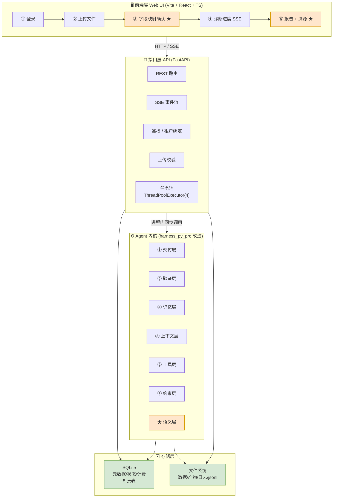

---

## 1. 六层总架构（含横向语义层）

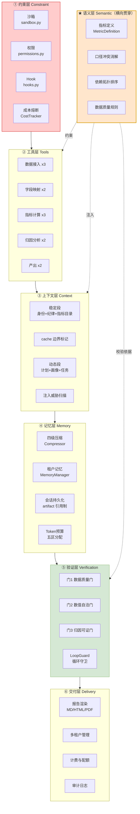

---

## 2. 运行时数据流（一次诊断的完整链路）

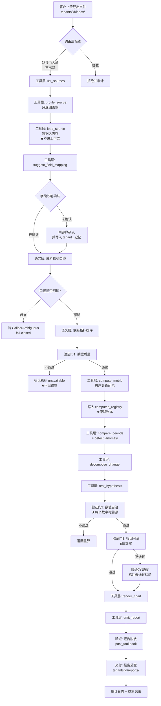

---

## 3. 上下文装配：Prompt Cache 边界（关键设计）

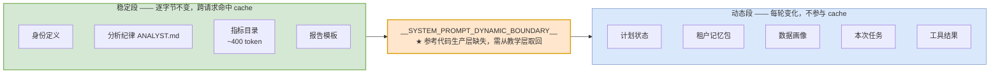

**装配位置对比（这是与参考代码的关键偏离）**：

| 内容 | 参考代码 | 本设计 |
|---|---|---|
| 身份+纪律+指标目录 | `messages[0]` system | `messages[0]` system（稳定段） |
| plan_context | `messages[0]` system（**每轮重建**） | 首条 user 消息（动态段） |
| memory_bundle | `messages[0]` system（**每轮重建**） | 首条 user 消息（动态段） |

> 参考代码 `engine.py:556-563` 每轮压缩后重建整个 system prompt，把 plan/memory 塞在 `messages[0]` —— 这会让**稳定前缀每轮变化，cache 全量失效**。本设计必须把这两项移出去。

---

## 4. 四级压缩与 computed_registry 旁路账本

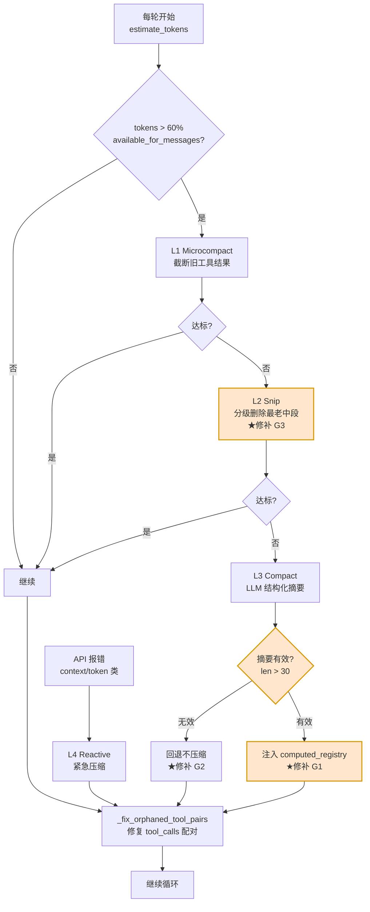

**computed_registry 的作用**：

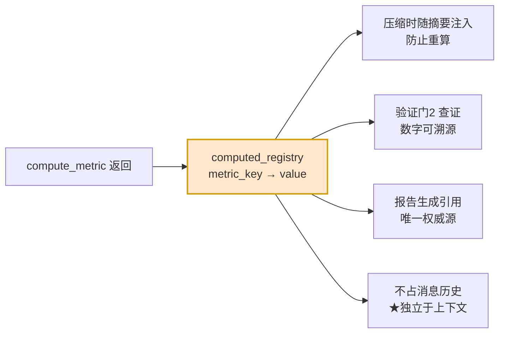

---

## 5. 三段验证门

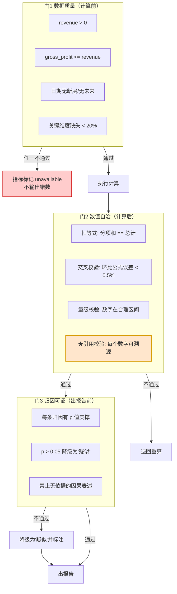

> **门 2 第 4 条是整个架构的"生产级"标志**：报告中每个数字都必须能在 `computed_registry` 里找到来源。这一条直接杀死 LLM 编数字。

---

## 6. 多租户目录隔离

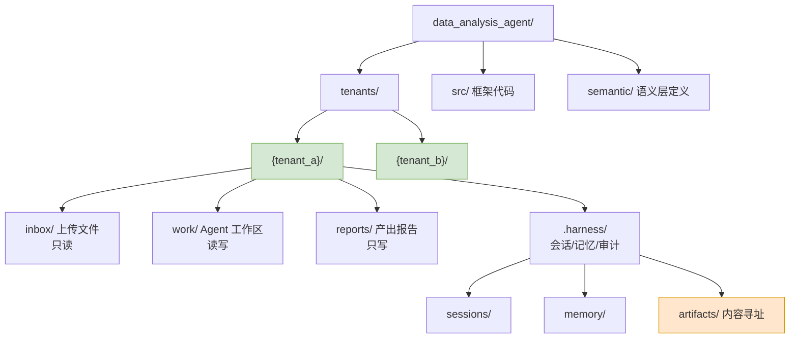

**隔离强度**：`allowed_roots = [tenants/{tenant_id}]` —— 跨租户读取在**文件系统层**就不可能，不依赖 prompt 约束。

---

## 7. 二期：多角色编排（swarm.py 复用）

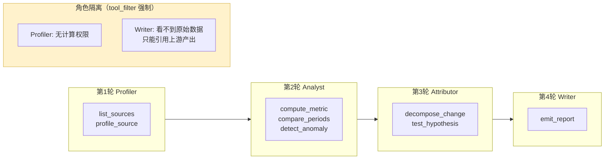

对应 `swarm.py` 的 `round_plan`：

```python
round_plan = {
    1: ['Profiler'],
    2: ['Analyst'],
    3: ['Attributor'],
    4: ['Writer'],
}
```

`AgentRole` 的 `cwd` / `tool_filter` / `acceptance_commands` **原样复用**，天然实现隔离。

---

## 8. 模块目录结构（✅ v1.0 实际实现）

> 下图是**已落地的真实结构**（非目标态）。数字为实际行数。

```mermaid
graph TD
    ROOT["data_analysis_agent/"]

    ROOT --> SEM["semantic/ ★核心资产"]
    SEM --> SE1["schema.sql<br/>1,200 行<br/>STG→DWD→DIM→SEM + 16 指标 + 9 质量门"]

    ROOT --> APP["app/ 后端 4,400 行"]
    APP --> CFG["config.py 277<br/>三层配置 + 启动自检"]
    APP --> MAIN["main.py 112<br/>FastAPI 入口 + 统一错误"]
    APP --> ADP["adapters/ 889<br/>淘宝适配器 + 字段映射表"]
    APP --> SVC["services/ 1,717<br/>auth/billing/diagnosis/tenant/security"]
    APP --> APID["api/ 808<br/>deps/schemas/routes×4"]
    APP --> SEMD["semantic/ 1,126<br/>models/registry/renderer/timerange"]
    APP --> STO["storage/ 105<br/>db.py + schema.sql"]

    ROOT --> WEB["web/ 前端 2,100 行"]
    WEB --> W1["src/api/ 357<br/>client.ts + types.ts"]
    WEB --> W2["src/pages/ 1,404<br/>8 个页面"]
    WEB --> W3["src/components/ 91<br/>AppLayout"]
    WEB --> W4["src/stores/ 80<br/>auth.tsx (Context)"]

    ROOT --> TST["tests/ 3,300 行<br/>19 个测试文件 / 688 断言"]
    ROOT --> DOCS["docs/ 9 份文档 + 架构讲解.html"]

    style SEM fill:#ffe6cc,stroke:#d79b00,stroke-width:3px
    style APP fill:#dae8fc,stroke:#6c8ebf
    style WEB fill:#d5e8d4,stroke:#82b366
    style TST fill:#e1d5e7,stroke:#9673a6
```

### 后端模块职责表

| 模块 | 行数 | 职责 |
|---|---|---|
| `config.py` | 277 | 三层配置 + **启动自检**（密钥非空、沙箱隔离） |
| `main.py` | 112 | FastAPI 入口、lifespan、CORS、统一错误格式 |
| `storage/db.py` | 105 | SQLite 连接（**WAL + busy_timeout + 外键**）、事务上下文 |
| `storage/schema.sql` | — | **19 张表**（含 `refund_pending` / `credit_lots`）/ 26 索引 |
| `adapters/taobao_fields.py` | 302 | **7 种数据源**的字段映射规格（别名 + 置信度 + 类型） |
| `adapters/taobao.py` | 587 | 识别 / 读取 / 编码探测 / 表头定位 / 类型驱动转换 |
| `semantic/models.py` | 301 | `MetricDefinition` / `Uncertainty` / `CaliberConflict` |
| `semantic/registry.py` | 272 | 加载 / 别名解析 / **口径歧义** / 维度白名单 / 质量门 |
| `semantic/renderer.py` | 342 | **指标 + 维度 + 时间窗 → 参数化 SQL**（含注入防护） |
| `semantic/timerange.py` | 211 | 中文时间表达 → 日期区间 + 同环比 |
| `services/security.py` | 106 | **bcrypt 直用**（弃 passlib）+ 令牌 + 密码强度 |
| `services/auth.py` | 289 | 注册 / 登录 / **账号锁定** / 令牌轮换 / 吊销 |
| `services/billing.py` | 700 | 额度账户 / **订单** / 支付幂等 / 成本记录 / **退款幂等 + refund_pending + 月度熔断** |
| `services/locks.py` | 45 | **每租户 RLock**（DuckDB 写路径串行化） |
| `services/ratelimit.py` | 95 | 进程内滑动窗口限速（register/login/ask/upload/diagnosis） |
| `services/email.py` | 120 | **SMTP 邮件**（465 SSL / 587 STARTTLS）+ 验证邮件模板 |
| `services/tenant.py` | 216 | **租户沙箱**（三层路径防御）/ 产物寻址 |
| `services/diagnosis.py` | 1,100+ | **诊断编排**：上传→画像→映射→导入→ETL→门→报告；**启动对账 + 语义层版本迁移** |
| `api/deps.py` | 110 | 认证依赖 / 租户绑定 / 额度校验 / **限速入口（429）** |
| `api/routes/*.py` | 640 | auth / sources / diagnoses(**SSE**) / billing / chat / **admin（补偿退款）** |

### 前端页面

| 页面 | 文件 | 行数 |
|---|---|---|
| 登录 / 注册 | `Login.tsx` `Register.tsx` | 111 |
| 工作台 | `Dashboard.tsx` | 206 |
| 上传 | `Upload.tsx` | 198 |
| **字段映射确认** | `Mapping.tsx` | 176 |
| **诊断进度（SSE）** | `Progress.tsx` | 156 |
| **报告 + 溯源** | `Report.tsx` | 193 |
| 购买次数 | `Billing.tsx` | 248 |
| 账户设置 | `Settings.tsx` | 117 |

> **注**：原设计的 `src/` 顶层结构（`constraint/` `tools/` `context/` `memory/`
> `verify/` `delivery/` `engine.py`）**未按原样落地** —— 数据 Agent 不需要
> 文件编辑工具链，因此按职责合并进了 `app/services/` 与 `app/semantic/`。
> 架构分层**保留**，目录划分**按实际需要重组**。详见 `01-DESIGN.md` §8 偏差 1。

**另需 `web/` 前端工程**（独立于 `src/`）：

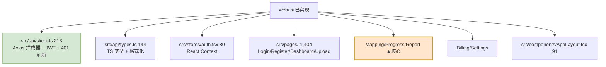

---

## 9. 关键时序：从上传到报告（✅ 已实现）

> 该时序已在**全栈冒烟测试**中逐步骤验证（经 Vite 代理，33 项断言）。

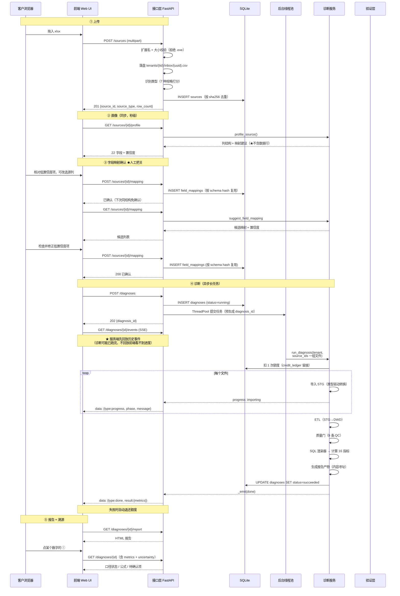

> **实现差异**：原设计的溯源是单独的 `/trace` 端点；实际实现复用
> `GET /diagnoses/{id}`（已在报告中返回 `metric_spec` 与 `uncertainty`），
> 少一次往返。完整的 `v_metric_trace` 视图留在语义层备用。

### 9.1 为什么长任务必须任务化 + SSE

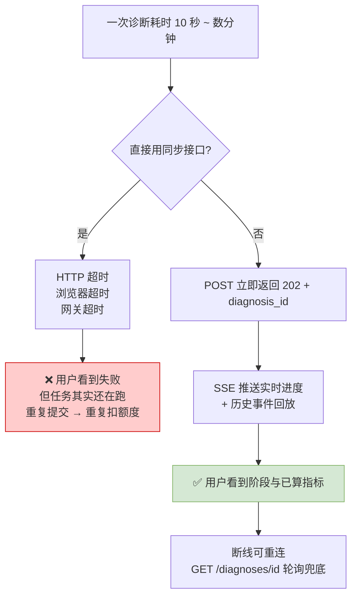

### 9.2 SSE 事件时序的两个坑（实测踩过）

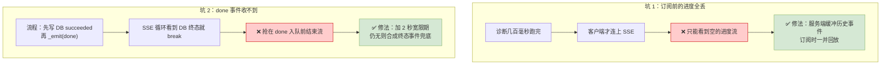

---

## 10. 存储分工与 SQLite 并发（✅ 已实现）

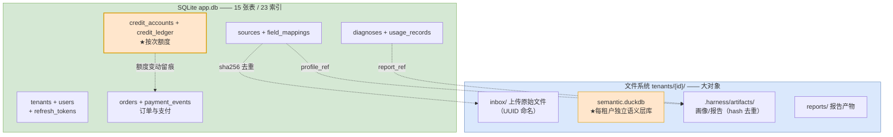

**两处 v1.0 的关键变更**：

| 变更 | 原设计 | 实际实现 | 原因 |
|---|---|---|---|
| **计费模型** | `subscriptions` 订阅表 | **`credit_accounts` + `credit_ledger`** | 按次付费只需"加/减"两个操作，订阅要处理续费/退款/升降级 |
| **语义层位置** | DuckDB 全局一个库 | **每租户一个 `semantic.duckdb`** | 租户数据隔离在**文件系统层**，不靠 WHERE 条件 |

### ★ 两处刻意的外键缺失（不是遗漏）

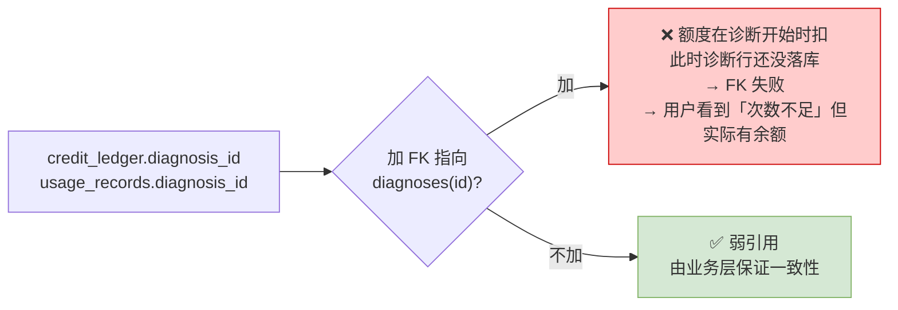

**SQLite 并发纪律**（FastAPI 多线程下必须遵守）：

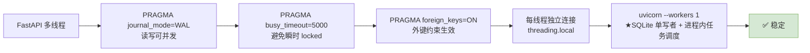

### 额度扣减的原子性（防超扣）

```sql
-- ★ 条件 UPDATE：余额不足时影响 0 行 —— 从根上杜绝负余额
UPDATE credit_accounts SET balance = balance - 1, total_used = total_used + 1
 WHERE tenant_id = ? AND balance >= 1;
```

**实测验证**：余额扣到 0 后继续扣，仍保持 0（不出现负数）。

---

## 11. 关键时序：从上传到报告（引擎内部细节）

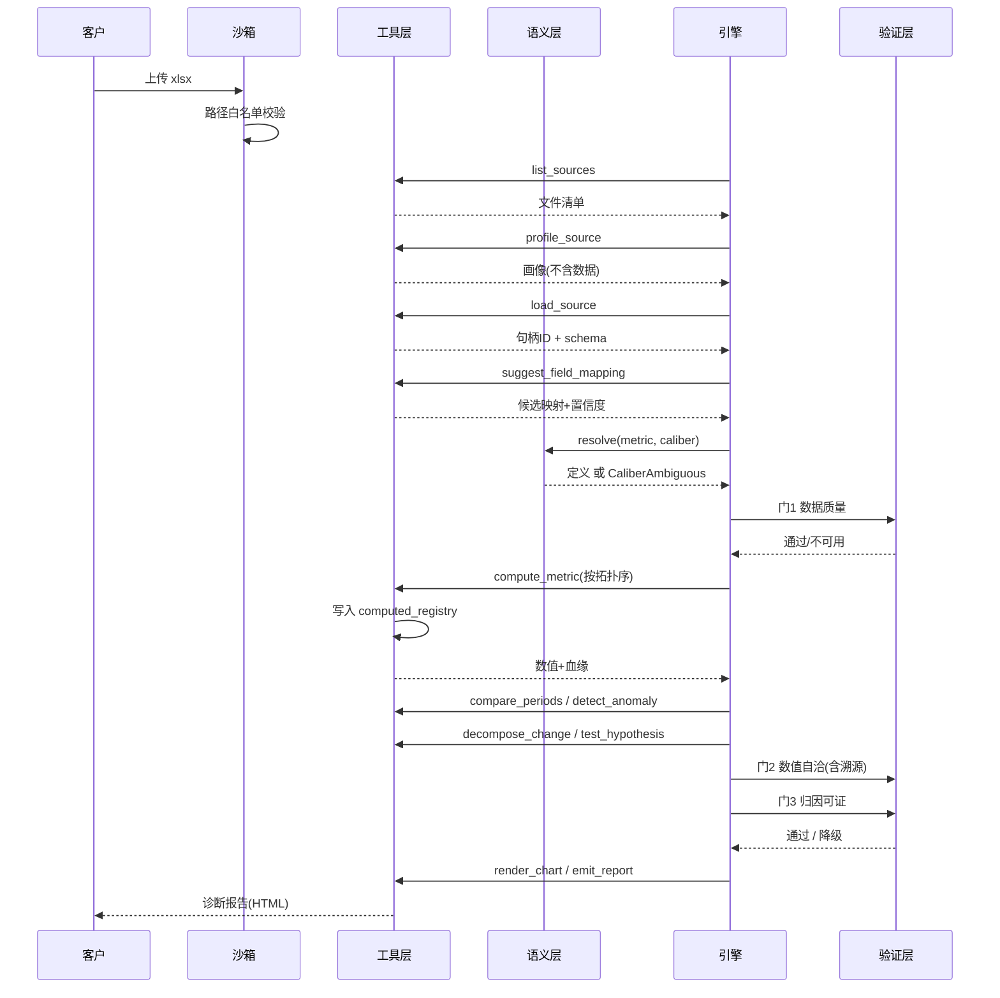

---

## 12. 语义层实体关系（v0.3 新增，来自用户提供的 SQL）

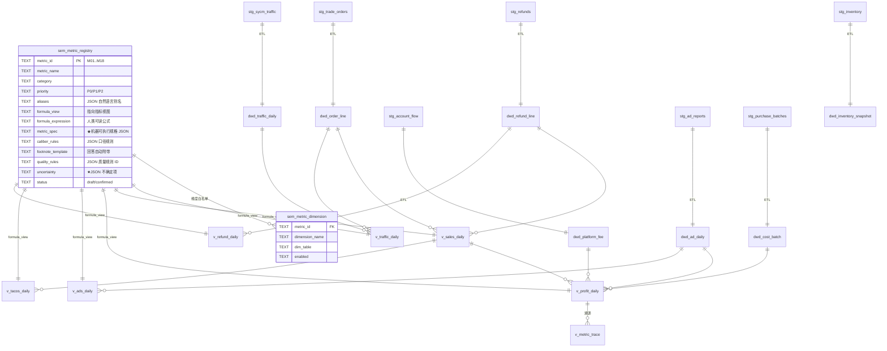

> **本语义层四列最关键**：
> - `caliber_rules` —— 口径变更是 `UPDATE` 一行而非改代码
> - `footnote_template` —— 每条回答自动带口径说明
> - **`metric_spec`** —— 机器可执行规格，SQL 渲染器的唯一输入（v1.0 新增）
> - **`uncertainty`** —— 不确定项显式披露，报告自动加"待确认"提示（v1.0 新增）

### 指标视图（7 个，已实现）

| 视图 | 粒度 | 服务指标 |
|---|---|---|
| `v_traffic_daily` | 日期 × 店铺/商品 × 渠道 | M01-M05 |
| `v_sales_daily` | 日期 × 商品 × 商家编码 | M06-M07 |
| `v_profit_daily` | 日期 × 商品 × 商家编码 | M10-M14 |
| `v_ads_daily` | 日期 × 渠道 × 计划 | M15 |
| `v_tacos_daily` | 日期 | M16 |
| `v_refund_daily` | 日期 × 商品 × 原因 | M17-M18 |
| `v_metric_trace` | 日期 × 商品 | **数字溯源（门2 第4条）** |

### 从 STG 到指标的数据流（淘宝版）

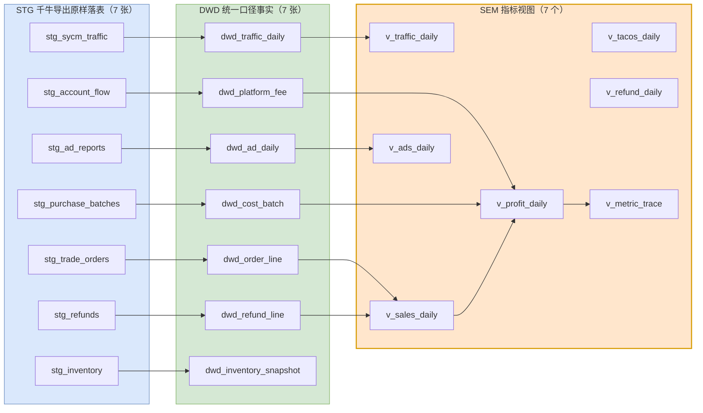

> **ETL 里修掉的一个真实 bug**：`S5.3 退款行` 曾引用 `confirm_time` / `ship_time`
> —— 这两个字段属于 `stg_trade_orders`，不在 `stg_refunds` 里。
> 用 SQLite 代理验证时**没跑到这段 ETL** 所以漏掉了，换真实 DuckDB 才暴露。
> 修法：`LEFT JOIN` 订单表取确认收货时间。

---

## 13. 运行时选型：DuckDB + SQLite 并存（v0.3 新增）

```mermaid
graph TB
    subgraph APP["应用元数据"]
        S1["SQLite · app.db<br/>租户/任务/计费/映射确认"]
    end

    subgraph SEMDB["语义层 + 数据分析"]
        S2["DuckDB · per-tenant<br/>tenants/id/semantic.duckdb<br/>STG / DWD / DIM / SEM"]
    end

    subgraph FS["文件系统"]
        F1["tenants/id/inbox/<br/>卖家导出文件"]
        F2["tenants/id/reports/<br/>HTML 报告"]
    end

    F1 -->|"DuckDB 直接读 Excel/CSV"| S2
    S2 -->|"指标结果"| F2
    S1 -.->|"租户配额/任务状态"| S2

    style S2 fill:#ffe6cc,stroke:#d79b00,stroke-width:2px
    style S1 fill:#d5e8d4,stroke:#82b366
```

| 用途 | 选型 | 理由 |
|---|---|---|
| 语义层 + 数据分析 | **DuckDB** | 列存、**直接读 Excel/CSV**、`FULL OUTER JOIN`、分析函数 |
| 应用元数据 | **SQLite** | 单文件、零配置、事务写、小并发够用 |

> **不冲突**：DuckDB 每租户一个文件，SQLite 全局一个。**两者都不需要外部服务。**

---

## 14. LLM 接入链路（端点已实测，⚠️ 尚未进入分析循环）

> ⚠️ **v1.0 重要说明**：当前指标计算是**确定性 SQL 渲染**，**不调 LLM**。
> 好处是**数字 100% 可复现、零幻觉**；代价是**没有自然语言归因**。
> 下面的链路是**为二期归因功能准备的**，端点与能力已全部验证可用。

```mermaid
sequenceDiagram
    participant E as 二期：归因服务
    participant R as ProviderRouter（待实现）
    participant C as LLMClient（待实现）
    participant Q as LLM 服务商网关

    Note over E,Q: ⚠️ 以下链路尚未接入，仅端点已验证
    E->>R: complete(messages, tools)
    R->>C: 按优先级选 provider
    C->>C: _clean_messages() 规整格式
    C->>Q: POST /chat/completions
    Note over Q: model-flash<br/>tool calling 实测支持<br/>会临时限流 429
    alt 429 / 5xx
        C->>C: _jittered_backoff() 去相关抖动
        C->>Q: 重试（最多 3 次）
    end
    Q-->>C: content + tool_calls + usage
    C-->>R: 统一格式
    R-->>E: response + provider_name

    Note over E: reasoning tokens 需单独统计<br/>占 completion 绝大部分
```

**三条实测结论**（详见 `01-DESIGN.md` §7.5）：
1. 必须用 `model-flash`（`model-plus` 会 404）
2. **这是推理模型**：reasoning token 可达可见输出的 3–43 倍
3. 端点会限流 → 依赖 `client.py:122-125` 已有的抖动重试

---

## 15. 淘宝适配层（✅ 已实现）

> **v1.0 更新**：适配层已实现，且语义层**不是"零改动"** —— 已整体重写为淘宝结构。
> 原设计的"亚马逊 STG + 适配器映射"方案被放弃，改为**语义层直接对齐淘宝**。

```mermaid
graph LR
    subgraph KN["千牛导出（7 种）"]
        C1["已卖出的宝贝<br/>订单"]
        C2["生意参谋<br/>流量"]
        C3["账房<br/>收支明细"]
        C4["退款售后"]
        C5["直通车/万相台"]
        C6["采购成本<br/>（自录）"]
        C7["库存"]
    end

    subgraph ADP["适配器 app/adapters/ ★已实现"]
        A1["识别（7 规格打分）"]
        A2["读取（编码探测 + 表头定位）"]
        A3["字段映射（别名 + 置信度）"]
        A4["类型驱动转换"]
    end

    subgraph STD["标准 STG 层（淘宝结构）"]
        S1[stg_trade_orders]
        S2[stg_sycm_traffic]
        S3[stg_account_flow]
        S4[stg_refunds]
        S5[stg_ad_reports]
        S6[stg_purchase_batches]
        S7[stg_inventory]
    end

    C1 --> A1
    C2 --> A1
    C3 --> A1
    C4 --> A1
    C5 --> A1
    C6 --> A1
    C7 --> A1
    A1 --> A2 --> A3 --> A4
    A4 --> S1
    A4 --> S2
    A4 --> S3
    A4 --> S4
    A4 --> S5
    A4 --> S6
    A4 --> S7

    style ADP fill:#ffe6cc,stroke:#d79b00,stroke-width:2px
    style STD fill:#d5e8d4,stroke:#82b366
```

### 适配器的四道处理

```mermaid
flowchart TD
    F["客户上传的文件"] --> A["① 识别<br/>按列名打分选最匹配的规格"]
    A --> B{"识别置信度 > 0.5?"}
    B -->|否| X["422 请确认这是千牛报表"]
    B -->|是| C["② 读取<br/>编码探测 + 表头行定位"]
    C --> D["③ 字段映射<br/>别名精确匹配 → 子串匹配"]
    D --> E{"低置信度<br/>或缺必填?"}
    E -->|是| Y["前端高亮，要求人工确认"]
    E -->|否| Z["④ 类型驱动转换<br/>按目标表列类型转换"]
    Y --> Z
    Z --> W["写入 STG 表"]

    style X fill:#ffcccc,stroke:#cc0000
    style Y fill:#fff2cc,stroke:#d6b656
    style Z fill:#d5e8d4,stroke:#82b366
```

**四个实测能力**：

| 能力 | 实测 |
|---|---|
| **编码探测** | GBK / UTF-8-BOM 正确识别，中文不乱码 |
| **表头定位** | 跳过"订单导出报表 / 导出时间：xxx"等前置行（实测跳 2 行） |
| **数值归一化** | `1,234.56` / `¥1,234` / `45.0%` / `(123.45)` / `1.5万` 全对 |
| **日期归一化** | `2026/10/01`、`2026.10.01`、`2026年10月1日` → ISO |

> **类型驱动转换是 v1.0 的修正**（见 `01-DESIGN.md` §8 偏差 11）：
> 早期用字段名关键词（`amount`/`price`/`fee`）判断是否转数值，
> 结果 `seller_income` 不含任何关键词 → `'6,000.00'` 原样进库
> → DuckDB 转 DOUBLE 失败。改为按 `FIELD_TYPES` 表声明的类型转换。

---

## 15.5 样例数据与多工作表拆分（v1.1 新增）

### 获客漏斗：从"没有数据"到"看到报告"

```mermaid
flowchart LR
    A["陌生访客<br/>未注册"] -->|"GET /samples/download<br/>(公开)"| B["下载样例 Excel<br/>7 个工作表"]
    B -->|"注册<br/>(赠送 1 次体验)"| C["拖入上传区"]
    C -->|"prepare_all<br/>逐表嗅探"| D["自动拆分 6 个数据源<br/>(说明页跳过)"]
    D -->|"零人工映射<br/>(列名精确匹配)"| E["开始诊断"]
    E --> F["报告:卡片+趋势图<br/>看出第 3 周的故事"]
    F -->|"体验额度用完"| G["购买 ¥A/¥B/¥C"]

    style A fill:#ffcccc,stroke:#cc0000
    style D fill:#ffe6cc,stroke:#d79b00
    style F fill:#d5e8d4,stroke:#82b366
    style G fill:#d5e8d4,stroke:#82b366
```

### 多工作表拆分（`taobao.prepare_all`）

```mermaid
flowchart TD
    X["一个 xlsx 上传"] --> P["prepare_all(path)"]
    P --> S1["'说明' 页 → 认不出 → 跳过"]
    P --> S2["'订单明细' → trade_orders"]
    P --> S3["'生意参谋流量' → sycm_traffic"]
    P --> S4["其余 4 表 → 各自规格"]
    S2 & S3 & S4 --> R["sources 表 N 行<br/>(sha256+sheet_name 去重)"]
    S1 --> Q["全部认不出才 422"]

    style S1 fill:#fff2cc,stroke:#d6b656
    style R fill:#d5e8d4,stroke:#82b366
```

**样例数据自洽性约束**（`app/services/sample_data.py`）：
流量表 `支付金额` 与订单逐日合计一致；账房费用 = 当日支付 × 固定费率；
退款申请日 = 付款日 + 2~6 天（体现按申请日归属口径）。
确定性随机（`Random(42)`），测试可精确断言（模块 8，48 项）。

---

## 15.6 对话式分析数据流（v1.4：形态 A + B）

### 一次归因提问的完整链路（形态 B）

```mermaid
sequenceDiagram
    participant U as 用户
    participant C as chat.ask（路由）
    participant Q as 形态A qa_engine
    participant E as agent_engine（循环）
    participant L as LLM（服务商网关）
    participant D as 租户 DuckDB

    U->>C: "为什么第 3 周转化率跌了？"
    C->>Q: 先试查数（零 LLM）
    Q-->>C: NeedsAgentError（归因类）
    C->>C: 配额检查（×5/诊断额度；admin 免）
    C->>E: system prompt（纪律+数据上下文）+ 历史 + 问题

    loop 最多 8 轮（LoopGuard 3/3/8 / 超 60k 压缩）
        E->>L: chat(messages, tools=5个)
        L-->>E: tool_calls: weekly_compare
        E->>D: 确定性 SQL 聚合（★原始数据不进上下文）
        D-->>E: 聚合结果（每周 5 个数字）
        E->>L: tool 消息回填 → 模型看结果定下一步
    end
    L-->>E: 最终自然语言回答（数字全部来自工具返回）
    E->>C: 回答 + 工具轨迹 + tokens/成本
    C-->>U: 落库（route=agent）+ 前端标签（轮次/工具数/成本）
```

### ★ 上下文里有什么、没有什么（"数据不进大模型"的准确含义）

| 进 LLM 上下文 | 永不进上下文 |
|---|---|
| 消息文本（问题/历史/回答） | **原始数据行**（1299 行订单明细等） |
| 工具规格（5 个工具的 JSON schema，~600 token） | 完整数据画像 |
| **工具返回的聚合结果**（"第 3 周 访客 17,294 净销 ¥59,294…"，单个结果截断 4000 字符） | 任何明细级查询结果 |
| 数据上下文摘要（几个文件/周期/诊断时间） | 文件内容本身 |

数据访问的唯一通道：模型**只能通过工具**间接读库，工具只做确定性聚合 ——
这就是"数据不进上下文，模型拿到的是数"的落地方式（成本可控 + 数字可溯源 + 防注入）。

---

## 16. 验证结果（v1.1）

```mermaid
graph TB
    subgraph SUITE["18 个测试模块 / 688 项断言（全绿）"]
        M1["模块 1 配置+存储<br/>13 断言"]
        M2["模块 2 语义层接口<br/>34"]
        M3["模块 3 淘宝适配器<br/>28"]
        M4["模块 4 SQL 渲染器<br/>47"]
        M5["模块 5 密码与令牌<br/>41"]
        M6A["模块 6a 认证<br/>38"]
        M6B["模块 6b 额度订单<br/>46"]
        M6C1["模块 6c1 租户沙箱<br/>53"]
        M6C["模块 6c 诊断服务<br/>56"]
        M6DE["模块 6d/e API<br/>83"]
        M8["模块 8 样例全流程<br/>48"]
        SMOKE["全栈冒烟(经代理)<br/>33"]
        DDB["DuckDB 方言+端到端<br/>11"]
    end

    SUITE --> CMD["python tests/run_all.py"]

    style SUITE fill:#d5e8d4,stroke:#82b366,stroke-width:2px
```

**关键验证维度**：

| 维度 | 验证方式 |
|---|---|
| **数值正确性** | 手工核算 vs 系统输出逐项比对（M01=1900、M13=56.17% 等） |
| **口径正确性** | 淘宝官方口径（支付转化率、退款归属）逐条核对 |
| **安全** | 路径穿越 ×6、符号链接逃逸、SQL 注入 ×4、跨租户越权 ×7 |
| **隔离** | 两租户文件/额度/诊断/报告互不可见 |
| **原子性** | 额度扣到 0 不再变负；支付回调幂等；失败退还 |
| **全链路** | 经 Vite 代理跑完整用户流程（注册→购买→上传→诊断→报告） |