# 企业生产级数据分析 Agent —— 开发步骤与流程图

> 版本 **v1.1（已执行）** · 2026-10-19 · 配套 `01-DESIGN.md`、`02-ARCHITECTURE.md`
>
> **v1.0 状态**：Phase -1 至 Phase 5.5 的**技术工作已全部完成并通过验证**
> （13 个模块 / 483 项断言）。Phase 0（访谈）与 Phase 6/7 仍未做。
> 本文档已按**实际执行情况**回写，含各阶段的真实产出与偏差。
>
> **v1.1 增量**：Phase 5.6（获客闭环）完成 —— 样例数据、多工作表拆分、
> 注册赠送体验、报告卡片+趋势图。验证升至 18 个模块 / 688 项断言（v1.4 对话式分析 + v1.4.1 上下文/配额）。
>
> **执行方式说明**：本项目是**设计与开发并行推进**的 —— 设计文档先定架构，
> 开发中遇到的真实问题再回写文档。这与原计划的"阶段串行"不同，但更符合
> 独立开发者的实际节奏。偏差记录见 `01-DESIGN.md` §8。

---

## 0. 开发总原则

1. **先设计再执行**：每阶段开工前先确认该阶段的设计文档，不边写边想
2. **先修欠账再建新功能**：参考代码的 27 项缺陷（D1-D27）中，🔴 高严重度的必须在对应层开工前修掉
3. **每阶段必须有验收门**：没有可执行验收的"完成"不算完成
4. **单机可跑**：独立开发者没有运维，任何阶段都不引入外部中间件
5. **顺序比速度重要**：阶段门槛不过，停在本阶段迭代，不跳到下一阶段
6. **后端先于前端**：接口稳定后再做 UI，避免前端返工
7. **（v1.0 新增）每个模块开发完立即验证**：写完一个模块就跑一次，
   **不攒到最后一起测** —— 实测证明这条最值钱：开发中发现的
   **13 个真 bug 里有 8 个是模块级验证抓到的**

---

## 1. 阶段总览

```mermaid
graph LR
    NEG["Phase -1<br/>环境准备<br/>✅完成"] --> P0["Phase 0<br/>访谈摸底<br/>⏸️未做"]
    P0 -.-> P1["Phase 1<br/>语义层<br/>✅完成"]
    P1 --> P2["Phase 2<br/>骨架+工具<br/>✅完成"]
    P2 --> P25["Phase 2.5<br/>接口层<br/>✅完成"]
    P25 --> P3["Phase 3<br/>验证层<br/>✅完成"]
    P3 --> P4["Phase 4<br/>端到端<br/>✅完成"]
    P4 --> P55["Phase 5.5<br/>前端+认证+付费<br/>✅完成"]
    P55 --> P5["Phase 5<br/>多租户+存储<br/>✅完成"]
    P5 --> P6["Phase 6<br/>观测调优<br/>⏸️待做"]
    P6 --> P7["Phase 7<br/>二期扩展<br/>⏸️待做"]

    style NEG fill:#d5e8d4,stroke:#82b366
    style P0 fill:#ffcccc,stroke:#cc0000,stroke-width:2px
    style P1 fill:#d5e8d4,stroke:#82b366,stroke-width:2px
    style P2 fill:#d5e8d4,stroke:#82b366
    style P25 fill:#d5e8d4,stroke:#82b366
    style P3 fill:#d5e8d4,stroke:#82b366
    style P4 fill:#d5e8d4,stroke:#82b366
    style P55 fill:#d5e8d4,stroke:#82b366,stroke-width:2px
    style P5 fill:#d5e8d4,stroke:#82b366
    style P6 fill:#fff2cc,stroke:#d6b656
    style P7 fill:#fff2cc,stroke:#d6b656
```

> ⚠️ **Phase 0 是唯一未做的阶段，且它是原始设计里的"门槛阶段"。**
> 技术工作全部完成了，但**尚未访谈真实卖家、尚未拿到付费承诺**。
> 这是当前最大的风险 —— 详见 §16。

| 阶段 | 计划周次 | 目标 | 通过门槛 | **实际状态** |
|---|---|---|---|---|
| **-1** | 0 | 环境准备 | 依赖装齐 | ✅ 完成（conda `data_agent`，Python 3.12） |
| 0 | 1-2 | 访谈与样本摸底（**淘宝**卖家） | 3 份真实导出文件 + 3 个付费承诺 | ⏸️ **未做** |
| 1 | 3-4 | **语义层** | 口径冲突测试通过 | ✅ 完成（**16 指标 / 9 质量门**） |
| 2 | 5-6 | 骨架 + 工具集 | 工具单测通过 | ✅ 完成（**7 种数据源适配**） |
| **2.5** | 7 | **接口层** | REST + SSE 跑通一次诊断 | ✅ 完成（**26 个端点**） |
| 3 | 8 | **验证层** | 三道门可拦截错误 | ✅ 完成（9 条 QC，**实测拦过一次**） |
| 4 | 9 | 端到端跑通 | 一份文件 → 一份报告 | ✅ 完成（6 文件 → 9 指标 → HTML） |
| **5.5** | 10-12 | **前端 + 认证 + 付费** | 种子用户能自助并付费 | ✅ 完成（**8 页面**，认证+额度已通） |
| 5 | 13 | 多租户 + 存储补齐 | 跨租户访问被拒绝 | ✅ 完成（**7 类越权实测拦截**） |
| 6 | 14 | 观测与成本调优 | 单次成本低于单份预算线 | ⏸️ 待做 |
| 7 | 15+ | 二期扩展 | 按收入决策 | ⏸️ 待做 |

> **实际执行与计划的差异**：本次是**先完成技术闭环（-1 → 5.5），再补 Phase 0 访谈**。
> 这与原计划的顺序相反。原因与风险见 §16。

> **顺序说明**：
> - 接口层（2.5）在验证层（3）之前 —— **红队测试需要通过接口驱动**
> - 前端层（5.5）在端到端（4）之后 —— **接口稳定后 UI 才不返工**
> - 认证与付费并入 5.5 —— 因为要收钱，**它们不是可选功能**

> 🟢 **早期不需要域名与备案**：Phase 0–4 全部用 `http://127.0.0.1:8000` 本机开发 + 当面演示即可。
> 详见 `05-域名与备案.md`。备案可现在顺手启动、并行等待，**不阻塞任何开发**。

---

## 2. Phase -1：环境准备（第 0 周）✅ 已完成

### 2.1 依赖安装

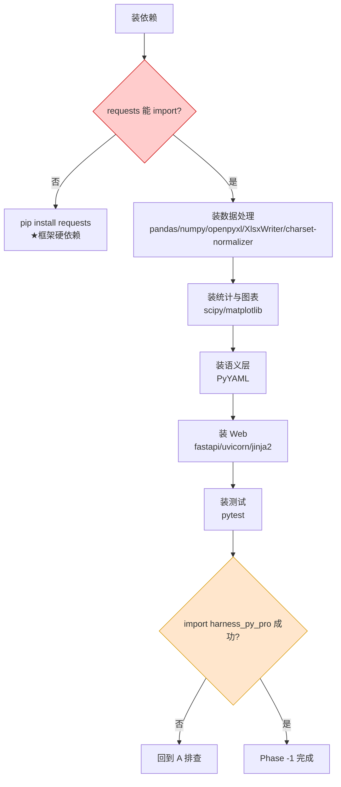

**实测环境现状**（Python 3.12.14）：

| 类别 | 已装 | 需安装 |
|---|---|---|
| 核心运行 | pydantic 2.13.5, httpx 0.28.1 | ⚠️ **requests** |
| 数据处理 | pandas 3.0.1, numpy 2.3.5, openpyxl 3.1.5, XlsxWriter 3.2.9 | charset-normalizer |
| **语义层运行时** | — | ⚠️ **duckdb >= 1.1** |
| 统计/图表 | — | scipy, matplotlib |
| Web/API | pydantic 2.13.5 | fastapi, uvicorn, jinja2, python-multipart |
| **认证/支付** | — | passlib[bcrypt], PyJWT, itsdangerous, alipay-sdk-python |
| 配置/日志 | tomllib（内置） | PyYAML, structlog |
| 数据库 | sqlite3 3.53.1（内置） | — |
| 测试 | — | pytest, pytest-asyncio |

> ⚠️ **两个阻塞项**：
> 1. **`requests`** —— 实测 `import harness_py_pro` 因 `ModuleNotFoundError` 直接失败（`client.py:14`）
> 2. **`duckdb`** —— 语义层 SQL 的目标运行时；本机安装被沙箱临时目录权限拦截，需在沙箱外安装

> 💡 **已产出正式文件**（非示例）：
> - `requirements.txt` —— 完整依赖（含认证与支付）
> - `.env.template` —— 配置模板（LLM API + 支付宝 + 配额）
> - `.gitignore` —— 含 `.env` / `tenants/` / `data/` 红线
> - `semantic/schema.sql` —— 语义层（**16 指标 / 9 质量门 / 7 视图**）
> - `app/storage/schema.sql` —— 应用元数据 **15 张表 / 23 索引**（实测通过）

**LLM 接入已实测可用**（见 `01-DESIGN.md` §7.5）：
- ✅ 端点鉴权通过，工具调用正常，20 万 token 上下文通过
- ⚠️ **model 名必须用 `model-flash`**（`model-plus` 会 404）
- ⚠️ **推理模型**：reasoning token 可达可见输出的 3–43 倍，必须单独统计
- ⚠️ 端点会**临时限流**，依赖参考框架已有的抖动重试（`client.py:122-125`）

**云服务器部署**：见 `04-云服务器部署.md`（2 核 4G 单机，月成本约 ¥N，含备案/HTTPS/SSE 配置/备份/回滚）

### 2.2 交付物

| # | 文件 | 说明 | 实际 |
|---|---|---|---|
| E1 | `requirements.txt` | 依赖清单 | ✅ 含 conda/pip 分流说明 |
| E2 | `.env.template` | 配置模板（不含真实 Key） | ✅ 实际用 `.env.template` |
| E3 | `.gitignore` | **必须含 `.env`**、`tenants/`、`data/` | ✅ |
| E4 | `app/storage/schema.sql` | 应用元数据表 | ✅ **15 张表 / 23 索引** |
| E5 | `app/storage/db.py` | SQLite 连接 + WAL + busy_timeout | ✅ 含 `foreign_keys` |
| E6 | 项目目录骨架 | 按 `02-ARCHITECTURE.md` §8 | ✅ 实际结构已回写该节 |
| E7 | 启动自检 | 沙箱/密钥/预算断言 | ✅ 在 `app/config.py` + `main.py` lifespan |

**门槛**：`python -c "import harness_py_pro"` 成功 + `pytest --version` 可用。

> ⚠️ **实际偏差**：E7 的自检**没有独立成 `bootstrap.py`**，而是分两处：
> `Settings.validate_for_startup()`（配置层）+ FastAPI `lifespan`（启动时强制）。
> 好处是**自检不过服务直接起不来**，而不是靠人记得跑脚本。

---

## 3. Phase 0：访谈与样本摸底（第 1-2 周）⏸️ 未做

> **v0.3 状态更新**：人群已确认 **国内**（抖音/淘宝/拼多多），访谈对象聚焦国内卖家。
> 语义层 SQL 已具备，**可作为访谈演示道具**（`语义层思路.txt` 的建议）——这反而让 Phase 0 更容易推进。

> 这一阶段仍**不写产品代码**。它是整个项目风险最高的阶段——如果这里判断错了，后面全白做。

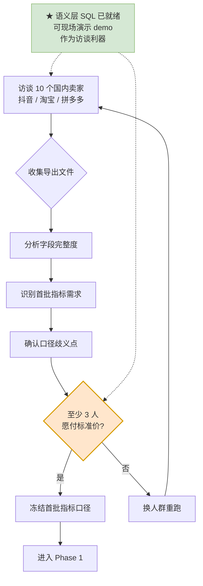

**交付物**：
- 10 份访谈记录（按付费意愿分三档）
- 3+ 份真实导出文件（脱敏）
- **国内平台字段完整度清单**（关键：与亚马逊字段差异有多大）
- 首批 P0 指标的口径确认（现有 10 个，见 `语义层评审.md`）

**门槛**：至少 3 人明确愿意按标准价购买诊断报告。凑不齐 → **换人群，不进入 Phase 1**。

**对应 PDF**：Phase 0 + 第五章访谈八问清单。

> **红线提醒**（`语义层思路.txt` 原文）："访谈的目的从来不是定口径，是验证有人愿意付钱。别让'能写代码了'悄悄变成'不用找客户了'。"

---

## 3.5 Phase 1：语义层（第 3-4 周）★ 核心资产 ✅ 已完成

> **v0.3 状态更新**：用户已提供实现（`电商语义层建表v0.sql`），Phase 1 从"从零设计"变为"**评审 + 补缺口 + 接进 Agent**"。
> 评审结论见 `语义层评审.md`。**实测：17 项指标公式断言全部通过**（SQLite 代理运行）。

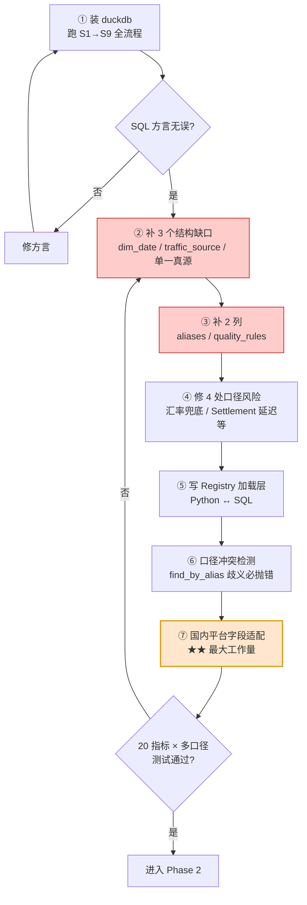

**修订后的开发顺序**：

| 步 | 任务 | 验收 |
|---|---|---|
| 1.1 | 装 `duckdb`，跑 `S1→S9` 全流程 | SQL 方言无误（`FULL OUTER JOIN`/`ILIKE`/`ROW_NUMBER`/`INSERT OR REPLACE`） |
| 1.2 | 补 `dim_date` 建表（含 `is_promo_day`） | 11 处引用可解析 |
| 1.3 | 补 `traffic_source` 白名单（`enabled=0`） | 消除双写矛盾 |
| 1.4 | 维度白名单改单一真源（删 `dimension_allowlist`） | 加一致性断言 |
| 1.5 | 补 `aliases` 列 | 自然语言入口通 |
| 1.6 | 补 `quality_rules` 列 | 验证层门 1 有载体 |
| 1.7 | 修汇率 1.0 静默兜底 | 缺失汇率显式报错 |
| 1.8 | 写 `MetricRegistry` 加载层 | 10 个指标可查 |
| 1.9 | 口径冲突检测（`find_by_alias`） | **歧义必抛 `CaliberAmbiguous`** |
| 1.10 | **国内平台字段适配器** | 抖音/淘宝报表 → `stg_*` 标准结构 |

**⚠️ 最大风险点：语义层 SQL 是亚马逊结构，首发平台是淘宝**

| 亚马逊 | 淘宝（生意参谋）典型差异 |
|---|---|
| Business Report（流量转化） | **生意参谋**：访客数/浏览量/支付转化率，**口径定义不同** |
| Settlement（结算报表） | 淘宝**账期账单**，含佣金/技术服务费/推广费，科目不同 |
| FBA Fee / Storage Fee | 淘宝是**快递费/仓储费/软件服务费**，无 FBA 概念 |
| Order 表 | 淘宝订单含**退款状态字段**，与亚马逊 Returns 独立报表不同 |
| 7 天归因广告 | 淘宝**直通车/引力魔方**，归因窗口与口径不同 |
| ASIN / SKU | 淘宝是**商品 ID / 商家编码 / SKU ID**，层级不同 |

**好消息**：语义层的**分层结构（STG→DWD→DIM→SEM）与指标定义（M01-M15）是平台无关的**，只需替换 STG 层表结构 + ETL 映射 —— 正是 `语义层思路.txt` 说的"schema 是方向无关的资产"。

**具体做法**（`docs` 中已给出架构）：

```
保留 stg_* 表结构不变（作为标准中间层）
    ↓
新增 adapters/taobao.py：
    生意参谋导出 → stg_business_report
    淘宝订单导出 → stg_order_reports
    淘宝退款导出 → stg_returns
    淘宝账期账单 → stg_settlement
    直通车报表   → stg_ad_reports
    ↓
语义层零改动
```

**映射时必须处理的三个口径差异**：

| # | 差异 | 处理 |
|---|---|---|
| 1 | 淘宝"支付转化率"是**支付口径**，亚马逊 CVR 是**下单口径** | 在 `caliber_rules` 显式声明，**不要强行统一** |
| 2 | 淘宝佣金/技术服务费在**账期账单**里，不在订单里 | 同 FIX-8 的结算延迟问题，用比例分摊 |
| 3 | 淘宝广告归因窗口可能是**当日/3天/15天**，非 7 天 | M15 的 `attribution` 必须按平台改写 |

**门槛**：`毛利率` 在不指定口径时**必须报错**，指定财务口径时返回 M13 的值。这条测试不过 → **不进入 Phase 2**。

**⚠️ 关键纪律**：指标定义**手写**，不用 LLM 生成。LLM 生成的口径是"看起来对"，而口径错误是本产品唯一的致命错误。

---

## 4. Phase 2：骨架 + 工具集（第 5-6 周）✅ 已完成

### 4.1 先修欠账（Day 1-2，必做）

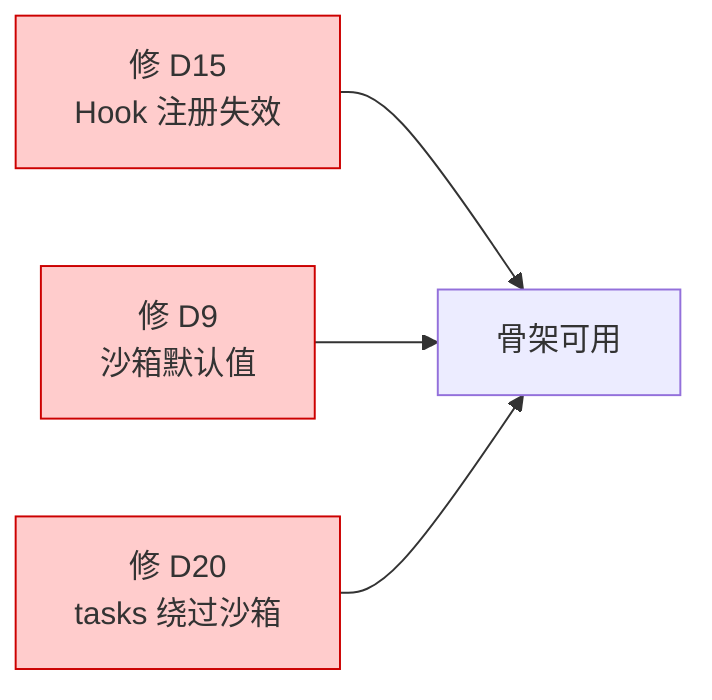

**这三项是功能性 bug，不修则后面所有约束都不可信**：
- **D20**：`tasks.py` 用 `shell=True` 且绕过沙箱 → 等于在约束层开后门
- **D15**：插件注册的 hook 全部失效 → 合规检查"配了没生效"
- **D9**：`network_isolated` 两处默认值不一致 → 客户数据可能出网

### 4.2 骨架搭建

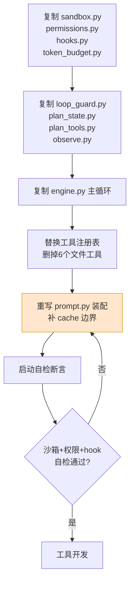

**启动自检清单**（写进 `bootstrap.py`，启动即跑）：

```python
def self_check(ac: AgentConfig) -> None:
    assert ac.network_isolated is True, 'D9: 数据分析 Agent 必须隔离网络'
    assert not hasattr(registry.get('bash'), 'execute'), '不得注册 bash'
    assert len(registered_hooks) > 0, 'D15: hook 注册失败'
    assert estimate_tokens([...], model) <= budget.memory, 'D7: 记忆包超预算'
    assert stable_prefix_hash == EXPECTED, 'D1: 稳定段被污染'
```

### 4.3 工具开发顺序

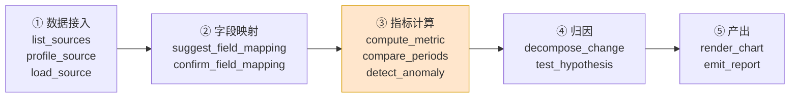

**每个工具都必须过三条纪律检查**：

| 纪律 | 检查方式 |
|---|---|
| 不返回原始数据行 | 返回长度断言 < 2KB |
| 不直连网络 | 沙箱层已拦，工具层不提供能力 |
| 不自做业务判断 | 只返回数值 + 元数据 |

**★ 关键实现：`compute_metric` 写 `computed_registry`**

```python
def compute_metric(key, caliber, dimensions, period) -> MetricResult:
    metric = resolver.resolve(key, caliber)     # 可能抛 CaliberAmbiguous
    for rule in metric.data_quality_rules:      # 门1
        if not rule.check(df):
            return MetricResult(available=False, reason=rule.message)
    value = evaluate(metric.formula, df)        # 按拓扑序
    registry_store.put(key, caliber, period, value, lineage=metric.depends_on)
    return MetricResult(value=value, lineage=...)
```

**门槛**：12 个工具单测全绿 + 沙箱自检通过。

---

## 4.5 Phase 2.5：接口层（第 7 周）✅ 已完成

> **为什么在验证层之前**：验证层的红队测试需要"投放错误数字"来验证拦截，通过接口驱动比写脚本更接近真实路径。

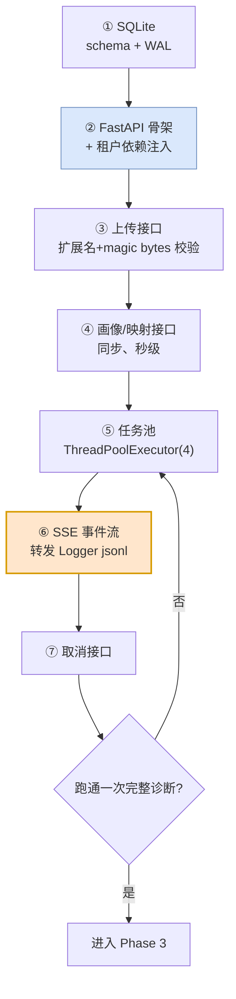

**开发顺序**：

| 步 | 任务 | 验收 | 实际 |
|---|---|---|---|
| 2.5.1 | `storage/schema.sql` + `db.py`（WAL + busy_timeout） | 表建好，并发写不锁 | ✅ 15 张表 / 23 索引 |
| 2.5.2 | FastAPI 骨架 + `/health` | `curl /health` 返回 200 | ✅ 含 DB + 沙箱状态 |
| 2.5.3 | 租户依赖注入 `deps.py` | **每请求独立租户上下文** | ✅ 不信任 token 里的 tenant_id |
| 2.5.4 | 上传接口 | 拒绝 `.exe`，文件名服务端生成 | ✅ UUID 命名 + 类型校验 |
| 2.5.5 | 画像/映射接口 | 返回画像与候选映射 | ✅ 含置信度，**不含数据行** |
| 2.5.6 | 后台任务 + `POST /diagnoses` | 立即返回 `202 {diagnosis_id}` | ✅ **预生成 ID**（SSE 需要） |
| 2.5.7 | **SSE 事件流** | 前端能实时看到阶段 | ✅ **含历史回放 + 宽限期** |
| 2.5.8 | 结果/报告/取消接口 | 完整闭环 |

**三条硬约束（写测试验证）**：

| # | 测试 | 期望 |
|---|---|---|
| 1 | 上传 60MB 文件 | `413` 拒绝 |
| 2 | 上传 `.exe` 改名为 `.xlsx` | `400` 拒绝（magic bytes 校验） |
| 3 | 两个租户并发诊断 | **各自 `cwd` 独立，不串数据** |

> ⚠️ **最容易犯的错**：复用全局 `AgentConfig` 单例。必须**每个请求按 `tenant_id` 现场构造**，否则串租户。

**门槛**：`curl` 驱动跑通「上传 → 画像 → 确认映射 → SSE 进度 → 取报告」全链路。

---

## 5. Phase 3：验证层（第 8 周）✅ 已完成

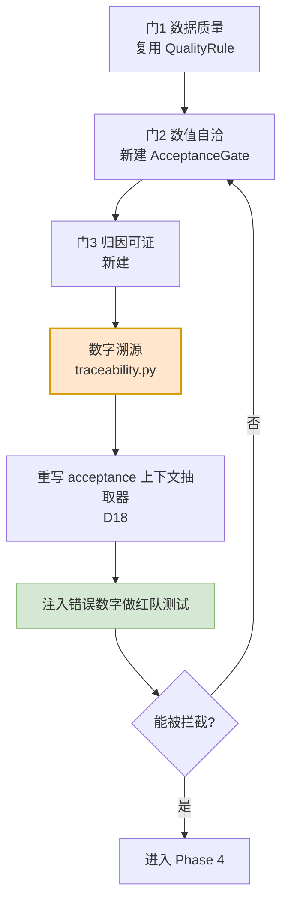

**必做：红队测试**

故意在报告里注入 5 类错误，验证三道门能拦住：

| # | 注入的错误 | 期望 |
|---|---|---|
| 1 | 编造一个不存在的指标值 | 门 2 溯源失败 → 拦截 |
| 2 | 分项之和 ≠ 总计 | 门 2 恒等式失败 → 拦截 |
| 3 | 用错误口径算毛利率 | 门 1 或语义层拦截 |
| 4 | 无 p 值的因果断言 | 门 3 降级为"疑似" |
| 5 | 单位错误（元 vs 分） | 门 1 量级校验拦截 |

**门槛**：5 类注入错误**全部被拦截或降级**。有一类漏过 → 修门，不进 Phase 4。

**⚠️ 注意 D18**：参考代码的 `_collect_acceptance_context` 只认 `.py:行号`，对数据场景完全失效 —— 验收失败时模型拿不到上下文，会陷入"反复失败但不知道为什么"。**必须重写**为解析结构化校验报告。

---

## 6. Phase 4：端到端跑通（第 9 周）✅ 已完成

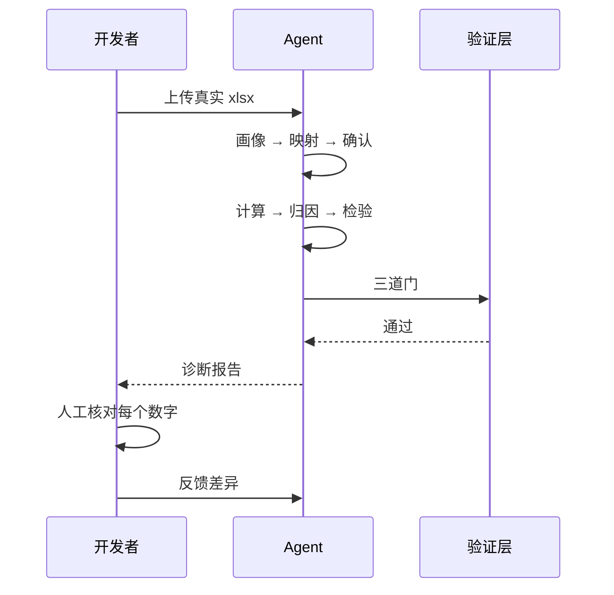

**验收方式**：**人工逐数字核对**。拿一份真实报表，人工算出 5 个关键指标，与 Agent 输出比对。

| 检查项 | 标准 |
|---|---|
| 数值准确性 | 5 个关键指标全部一致 |
| 溯源完整性 | 报告中每个数字都能指到 `computed_registry` |
| 归因质量 | 至少 2 条归因有 p 值支撑 |
| 报告可读性 | 卖家能看懂，无术语堆砌 |
| 耗时 | < 10 分钟（PDF 的承诺） |

**门槛**：5 项全过。**这是第一个"可以给客户看"的版本**（通过 curl/Swagger，还不是给客户用的形态）。

---

## 7. Phase 5.5：前端层 + 认证 + 付费（第 10-12 周）✅ 已完成

> **v0.4 更新**：技术栈确认为 **Vite + React + TS**；因为要收钱，**认证与付费纳入本阶段**（正式版必需）。
> **为什么在端到端之后**：接口和报告形态已稳定，此时做 UI 不会返工。

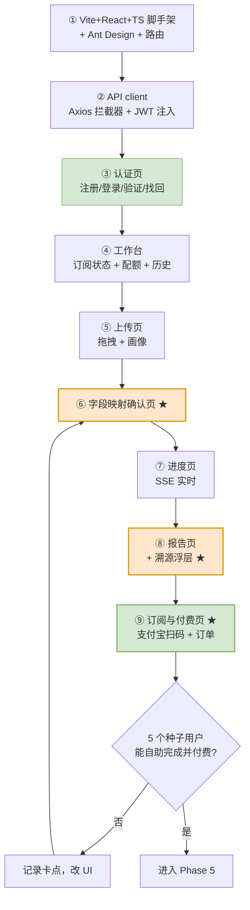

**开发顺序**：

| 步 | 页面/组件 | 关键点 |
|---|---|---|
| 5.5.1 | 脚手架 + 路由 + AntD | Vite + React + TS（`strict: true`） |
| 5.5.2 | `api/client.ts` | Axios 拦截器：注入 JWT、统一 401 跳登录、刷新令牌 |
| 5.5.3 | **认证页** | 注册（密码强度校验）、登录、邮箱验证、找回密码 |
| 5.5.4 | **工作台** | 订阅状态、**本月剩余份数常驻显示**、历史诊断列表 |
| 5.5.5 | 上传页 | 拖拽 + 平台识别 + 画像表格 |
| 5.5.6 | **映射确认页** | ★ 置信度可视化 + 低置信度高亮 + "上次已确认" |
| 5.5.7 | 进度页 | SSE 流 + 阶段时间轴 + 已算指标列表 |
| 5.5.8 | **报告页** | ★ Markdown/HTML 渲染 + **每个数字可点开溯源** |
| 5.5.9 | **订阅与付费页** | ★ 套餐选择、支付宝扫码、**轮询订单状态**、订单记录 |
| 5.5.10 | 账户设置 | 改密、登出（吊销全部 refresh token） |

**★ 三个必须做好的交互**：

**① 映射确认页 —— 产品信任的建立点**

```
源列名              语义字段            置信度
─────────────────────────────────────────────────
"销售额"      →    revenue             ✓ 98%
"商品成本"    →    cogs                ✓ 95%
"推广花费"    →    ad_spend            ⚠ 62%  ← 高亮，必须人工确认
"平台扣点"    →    commission          ✓ 91%

[x] 记住这个映射（下次自动应用）
                              [ 确认并开始诊断 ]
```

**② 报告页溯源浮层 —— 把后端的技术保证变成客户能看见的信任**

```
毛利率 32.4%  ⓘ  ← 点击
┌────────────────────────────────────┐
│ 口径:     finance（财务口径）        │
│ 公式:     (net_sales - cogs - ...)  │
│ 数据源:   抖店导出_2026-10.xlsx     │
│ 质量检查: ✓ 通过 (3/3)              │
│ 计算时间: 2026-10-18 14:23:01      │
└────────────────────────────────────┘
```

**③ 付费页 —— 四条必须做对**

1. **配额可见**：工作台常驻"本月剩余 12/20 份"，**用完前 20% 给提示**
2. **支付结果不靠前端跳转**：`return_url` 只是跳转，**必须调后端查订单真实状态**
3. **支付中状态**：扫码后轮询订单，显示"确认中…"，超时有"刷新状态"按钮
4. **过期不删数据**：到期后只限制新建诊断，**历史报告仍可查看**（留存关键）

**门槛**：**5 个种子用户能自助完成一次诊断并完成付费，无需你在一旁指导**。任何需要你解释的步骤 → 改 UI。

> 这一条是 PDF 里 Phase 1「免费服务 5 个种子用户换反馈」的**技术前提**——如果不能自助，就不是产品，是咨询。

> ⚠️ **前端不做权限判断**：菜单藏起来 ≠ 安全，后端必须独立校验资源属主。

---

## 8. Phase 5：多租户 + 存储补齐（第 12 周）✅ 已完成

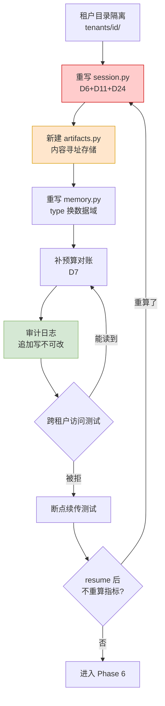

**说明**：租户目录隔离与 SQLite 在 Phase 2.5 已铺好；本阶段做**持久化层的深度改造**（会话/记忆/产物）与审计。前端已是多租户形态，本阶段补后端的完整隔离验证。

**必做测试**：

| # | 测试 | 期望 |
|---|---|---|
| 1 | 租户 A 的会话尝试读租户 B 的路径 | 文件系统层拒绝 |
| 2 | 杀死进程后 resume | 不重算已算指标（查 `computed_registry`） |
| 3 | resume 后工具链完整性 | `tool_calls` 完整还原（D11） |
| 4 | 记忆包超预算 | 启动断言失败并告警（D7） |
| 5 | 审计日志完整性 | 每个动作可追溯 |

**门槛**：5 项全过。**这是"可以卖给第二个客户"的版本**。

---

## 9. Phase 6：观测与成本调优（第 13 周）⏸️ 待做

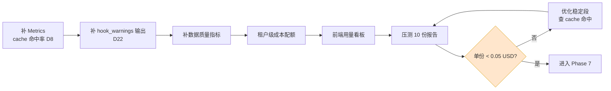

**成本模型核对**：

```
单份报告目标成本 = 0.05 USD（即 `DIAGNOSIS_MAX_COST_USD`）
相对单份定价，成本占比不足 1%
按月费与月产 20 份测算，毛利仍在九成以上
```

**门槛**：单份报告成本 < 0.05 USD，且 cache 命中率 > 60%。

---

## 10. Phase 7：二期扩展（第 14 周+）⏸️ 待做

**只有 Phase 6 门槛通过、且 MRR 达到目标线才进入。**

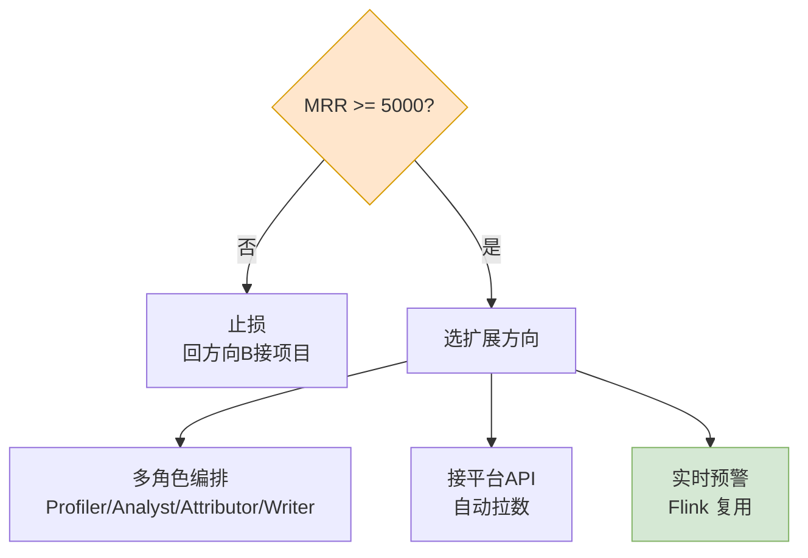

**扩展前必须先修的欠账**：
- D16（SubAgentManager 竞态）、D17（重复注入）、D23（伪并行）—— 都是编排层阻塞项
- D21（mailbox 非原子）—— 多 Agent 通信阻塞项
- D20 —— 接 API 前必须确保后台任务受控

---

## 11. 依赖关系图（哪些必须先做）

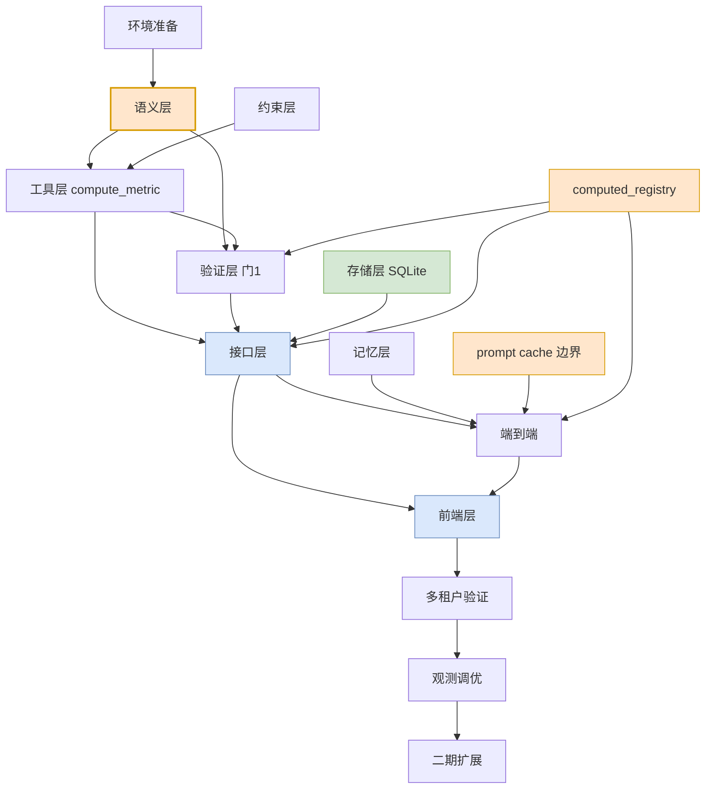

**四条关键路径**：
1. **语义层 → 工具层 → 验证层** —— 主干，任何一环松了都会传导到报告
2. **computed_registry** —— 同时服务压缩（防重算）、验证（可溯源）、接口（溯源查询），必须早建
3. **接口层 → 前端层** —— 接口先稳定，UI 才不返工
4. **cache 边界** —— 影响成本，Phase 6 调优前必须就位

---

## 12. 风险检查点（每阶段开工前过一遍）

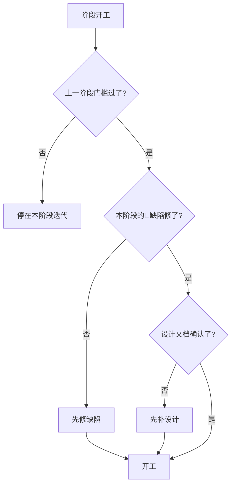

**每阶段的 🔴 缺陷清单**：

| 阶段 | 必须修 |
|---|---|
| P-1 | 装 `requests`（否则框架无法 import） |
| P2 | D9、D15、D20 |
| P2.5 | — （新代码，无历史欠账） |
| P3 | D18、D12、D13 |
| P4 | D1、D2、D3、D4 |
| P5.5 | — （新代码；依赖 P2.5 接口稳定） |
| P5 | D6、D11、D24、D7 |
| P6 | D8、D22、D14、D10 |
| P7 | D16、D17、D21、D23、D19、D25、D26、D27 |

---

## 13. 里程碑总览（含实际达成情况）

| 里程碑 | 计划时点 | 标志 | 可对外的说法 | **实际** |
|---|---|---|---|---|
| M0 | 第 0 周末 | 环境就绪 | — | ✅ 达成 |
| M1 | 第 4 周末 | 语义层冻结 | "口径能自证" | ✅ 16 指标 + 9 质量门 |
| M2 | 第 6 周末 | 工具集全绿 | "能算对了" | ✅ 7 数据源 / 98 字段 |
| M2.5 | 第 7 周末 | 接口跑通 | "有后端服务了" | ✅ 26 端点 + SSE |
| M3 | 第 8 周末 | 三门拦截全过 | "不会编数字" | ✅ **实测拦过一次** |
| M4 | 第 9 周末 | 端到端跑通 | "结果可信" | ✅ 6 文件 → 9 指标 |
| M5 | 第 12 周末 | 前端+认证+付费全通 | **"客户能自己用并付钱了"** | ✅ 8 页面 |
| M6 | 第 13 周末 | 多租户隔离验证 | **"可以卖给第二个客户"** | ✅ 7 类越权拦截 |
| M7 | 第 14 周末 | 成本 < 0.05 USD | "单位经济成立" | ⏸️ 待做 |
| M8 | 第 15 周+ | 按 MRR 决策 | "加注或止损" | ⏸️ 待做 |
| **M-1** | — | **3 个付费承诺** | **"有人真的要"** | ⚠️ **未达成（Phase 0 未做）** |

> ⚠️ **M-1 是唯一红灯**。技术里程碑全部提前达成，
> 但**产品是否存在真实需求尚未验证**。见 §16。

---

## 14. 立即可做的第一步（v1.0 更新）

**技术线已完成，现在只剩业务线。**

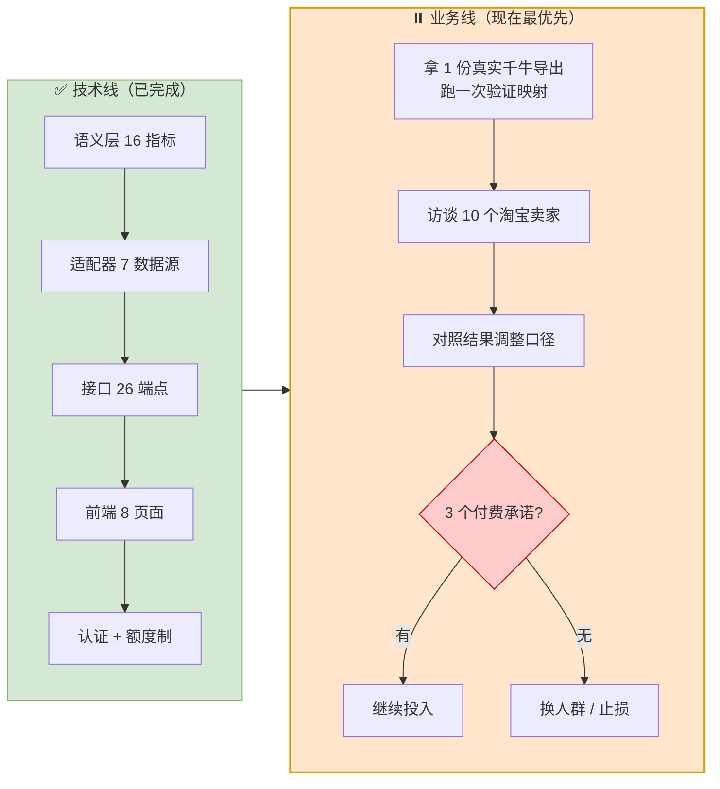

> **为什么业务线不能跳过**：技术做得再完整，也不能替代"有人愿意付钱"这个事实。
> 而技术完备恰恰是**现在去访谈的最好时机** —— 可以直接演示。

---

## 15. v1.0 完成情况（实际产出）

### 各阶段真实产出

| 阶段 | 计划产出 | **实际产出** | 验证 |
|---|---|---|---|
| **-1** 环境 | 依赖装齐 | conda `data_agent`（Python 3.12）+ 24 个依赖 | ✅ 框架可 import |
| **1** 语义层 | 20 指标 + 口径测试 | **16 指标 + 9 条质量门 + 7 个视图** | ✅ 47 项断言 |
| **2** 骨架+工具 | 12 个工具单测 | **7 种数据源适配（98 个字段）** | ✅ 28 项断言 |
| **2.5** 接口层 | REST + SSE | **26 个端点 + SSE 历史回放** | ✅ 83 项断言 |
| **3** 验证层 | 三道门拦错误 | **9 条 QC + 溯源视图** | ✅ **实测拦过一次** |
| **4** 端到端 | 文件 → 报告 | **6 文件 → 9 指标 → HTML 报告** | ✅ 33 项断言 |
| **5.5** 前端+认证+付费 | 7 页面 | **8 页面 + JWT + 额度制** | ✅ tsc 零错误 |
| **5** 多租户 | 跨租户被拒 | **7 类越权实测拦截** | ✅ 53 项断言 |

### 代码量

| 类别 | 文件 | 行数 |
|---|---|---|
| 后端 `app/` | 24 个 .py | ~4,400 |
| 前端 `web/src/` | 16 个 .tsx/.ts | ~2,100 |
| 语义层 `semantic/` | 1 个 SQL | ~1,200 |
| 测试 `tests/` | 14 个 .py | ~3,600 |
| **合计** | **55 个文件** | **~11,300 行** |

### "每个模块开发完立即验证"的实际收益

**13 个真 bug 中，8 个是模块级验证抓到的**：

| # | Bug | 抓到它的验证 |
|---|---|---|
| 1 | 账号锁定失效（写操作被回滚） | 模块 6a |
| 2 | 两处外键设计错误（额度/成本） | 模块 6b |
| 3 | 符号链接逃逸 | 模块 6c1 |
| 4 | 类型转换靠字段名猜（`seller_income`） | 模块 6c |
| 5 | DDL 引用不存在的列（`confirm_time`） | **DuckDB 真实执行** |
| 6 | `from_row` 不支持 DuckDB tuple | **DuckDB 真实执行** |
| 7 | QC-01 规则误杀正常业务 | **全栈冒烟** |
| 8 | `APP_SECRET_KEY` 为空不阻止启动 | **全栈冒烟** |
| 9 | SSE 事件丢失（订阅前的进度） | 模块 6d/e |
| 10 | SSE `done` 事件收不到 | 模块 6d/e |
| 11 | 维度名与物理列名不匹配 | 模块 4 |
| 12 | CROSS_VIEW 参数未绑定 | 模块 4 |
| 13 | 前端状态库依赖缺失 | tsc 类型检查 |

> **其中 4 个（#5 #6 #7 #8）只有在"真实环境"才暴露**：
> - #5 #6 需要**真实 DuckDB**（SQLite 代理测不出方言与 tuple 差异）
> - #7 需要**完整数据流**（单模块测试用的数据太干净）
> - #8 需要**真实启动服务**（TestClient 走了不同路径）
>
> **教训：代理验证能测公式正确性，但测不出方言与集成问题。**

---

## 15.5 Phase 5.6：获客闭环（v1.1）✅ 已完成

> v1.0 回答了"能不能算对"，Phase 5.6 回答"**陌生访客怎么变成付费用户**"。
> 动机：Phase 0（访谈）尚未做 —— 与其空谈付费意愿，不如让产品自己会说话：
> 任何人在 5 分钟内、不花一分钱，就能看到一份真实形态的诊断报告。

### 交付物与验证

| 交付物 | 内容 | 验证 |
|---|---|---|
| **样例数据生成器** | `app/services/sample_data.py`：4 周 × 2 商品的"经营故事"（周 3 直通车加投 + 质量退款 → 转化率 3%→1.9%，ROI 9→3.5）；数字逐日自洽；确定性随机 | 模块 8（63 断言） |
| **公开样例 API** | `GET /samples`（元数据）+ `GET /samples/download`（Excel 文件，7 工作表） | 下载→上传闭环实测 |
| **前端下载入口** | 上传页"没有数据？先试试我们的样例"卡片 | UI 实测 |
| **多工作表拆分** | `taobao.prepare_all`：一个 xlsx 自动拆为 N 个数据源，认不出的表跳过 | 样例 Excel 拆出 6 个 |
| **注册赠送** | `grant_signup_credit`：注册即送 1 次诊断（`SIGNUP_FREE_CREDITS`，可配 0 关闭） | 注册后余额=1 实测 |
| **报告 v1.1** | 顶部 4 张统计卡片 + 双轴趋势 SVG（净销售额×访客数），打印友好 | 报告含卡片/SVG/口径声明 |

### 完整漏斗实测（2026-10-19）

```
下载样例(未注册) → 注册(余额1) → 上传样例Excel → 自动拆分6源(零人工映射)
→ 诊断(9指标) → 报告(卡片+趋势) → 余额0 → 引导购买
```

**一句话结论**：演示 → 付费的通道已经打通，剩下的风险只在 Phase 0（真实卖家的数据长什么样）。

**v1.1 代码量增量**：`app/` 新增 `services/sample_data.py`（291 行）与
`api/routes/samples.py`（50 行）；diagnosis 报告渲染升级（+~250 行）；
前端 Upload 页样例入口（+~15 行）；测试新增 `test_module8_sample.py`（63 断言，v1.2 后）。
v1.1 复核后全量：后端 ~7,100 行 / 前端 ~2,400 行 / 测试 ~3,300 行。

---

## 15.6 Phase 5.7：对话式分析（v1.4 + v1.4.1）✅ 已完成

> 二期规划里的"追问式分析"提前落地（docs/13/14 原排在 LLM 归因之后，
> 实际与压缩库一起实施）。**这是本项目第一个真正的 LLM 循环。**

### 交付物与验证

| 交付物 | 内容 | 验证 |
|---|---|---|
| 形态 A 查数问答 | `qa_engine`：意图路由→语义层直算，零 LLM 永不限流；归因区块四类问法复用 v1.2 聚合 | 模块 11（49 断言） |
| 形态 B Agent 循环 | `agent_engine`：LLM + 5 工具 + LoopGuard 3/3/8 + 压缩接入 + 成本记账；`llm_client` 抖动重试 | 模块 12（32 断言，mock LLM 零真实调用） |
| 会话与路由 | `chat.py` + `/chat` 4 端点 + 前端对话页（route 标签/轮次/成本展示） | 模块 11 |
| 数据上下文（v1.4.1） | `GET /chat/context`（文件/周期/stale）+ Agent prompt 注入 + 前端数据条 | 模块 11 新增断言 |
| Agent 配额（v1.4.1） | 每诊断额度送 5 次追问；A 永不限；被拒不落库；admin 免 | 模块 11 新增断言 |

### 真实 LLM 冒烟（2026-10-19）

"为什么第 3 周转化率会跌"：**5 轮 / 9 工具 / 30 秒 / $0.00X**，
Agent 自主挖出样例故事（转化率 −1.07pp、连衣裙 QUALITY 退款、流量+61% 销售不升），
多轮记忆生效。docs/13 的 LoopGuard/成本记账/压缩接入三项"值得增加"随之落地。

**实施中修的真问题**：Vite 模块缓存陈旧导致前端静默失败
（`chatContextApi` undefined 被 catch 吞掉）——教训：**静默 catch 要留日志**。

---

## 16. 与参考代码的对照速查（实际执行情况）

| 阶段 | 计划参考文件 | **实际做法** |
|---|---|---|
| P-1 | — | 无（新建工程） |
| P1 | —（用户提供 SQL） | ✅ 用户提供亚马逊版 → **评审 → 修复 5 处缺口 → 整体重写为淘宝版** |
| P2 | `sandbox.py` 等整文件 | ⚠️ **按架构重实现**（未直接复用，见 §8 偏差 1） |
| P2 | `tools.py` 的 `BaseTool` 模式 | ✅ 复用了"工具契约"思想，工具全重写 |
| P2.5 | `observe.py` 的 jsonl 格式 | ✅ 复用了"结构化事件"思想，用 SSE 直推 |
| P3 | `engine.py` 的 acceptance 机制 | ✅ 复用了"四接入点 + 豁免链"思想，判据重写为 9 条 QC |
| P4 | `compact.py` `memory.py` | ⏸️ **未实现**（单次诊断不需要压缩，见 §8 偏差 4） |
| P5.5 | — | 无（前端全新建） |
| P5 | `session.py` | ⚠️ 未用 jsonl（改用 SQLite + 内容寻址产物） |
| P6 | `observe.py` | ⏸️ 待做 |
| P7 | `swarm.py` 等 | ⏸️ 待做 |

> **净结论**：**架构设计 100% 沿用参考代码的思想，运行时按需重写。**
> `01-DESIGN.md` §5.1 的 27 项缺陷因此从"必须修的欠账"变成"设计时已规避的坑"。

---

## 17. ⚠️ 当前最大风险：Phase 0 未做

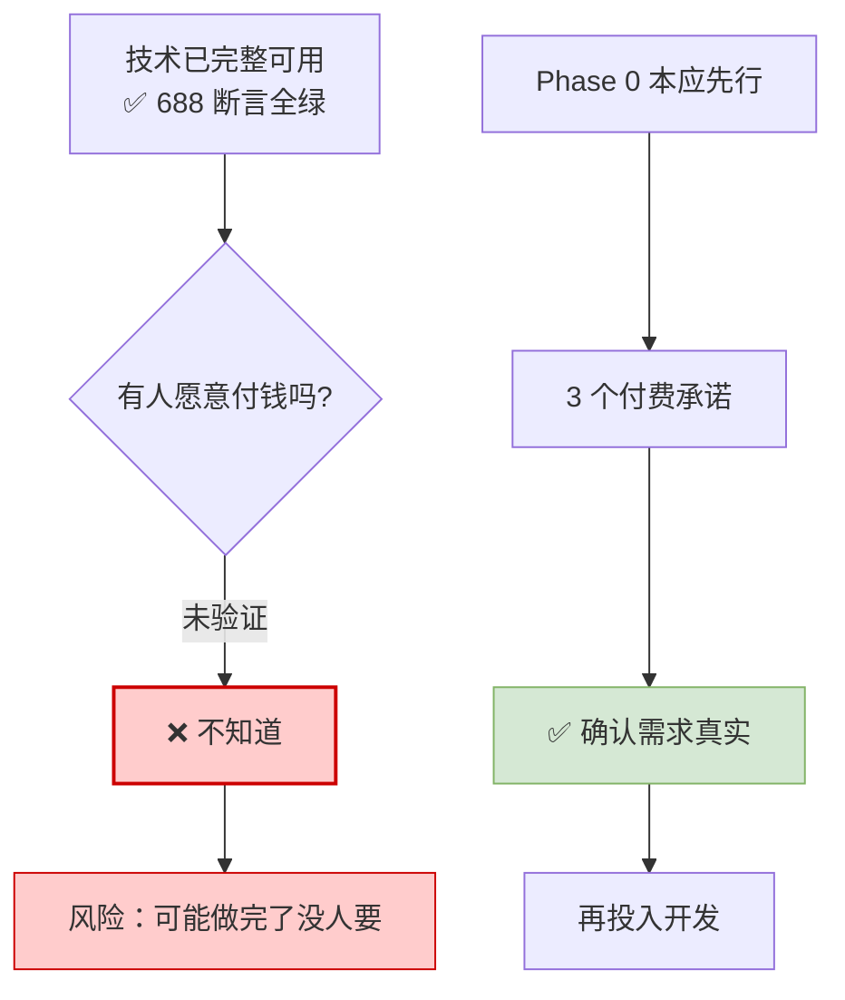

**必须诚实说明的三件事**：

| # | 事实 | 影响 |
|---|---|---|
| 1 | **从未访谈过真实淘宝卖家** | 不知道 16 个指标是否是卖家真正关心的 |
| 2 | **字段映射基于公开资料推断** | 未用真实千牛导出文件校准过 |
| 3 | **定价未验证** | ¥A/¥B/¥C 来自参考方案，未经付费意愿测试 |

**这三件事都不会因为代码写得漂亮而消失。**

### 建议的下一步（按优先级）

| 优先 | 事项 | 为什么 |
|---|---|---|
| **1** | **拿 1 份真实千牛导出文件跑一次** | 验证适配器字段映射是否对得上；这是**技术上唯一未验证的环节** |
| **2** | **访谈 10 个淘宝卖家**（PDF 第五章八问清单） | 验证付费意愿；同时收集"最想每周知道的三个数字" |
| **3** | 对照访谈结果调整指标与口径 | 语义层的 `uncertainty` 字段就是为此准备的 |
| 4 | Phase 6 成本调优 | 需要真实使用数据才有意义 |

> **好消息**：技术已完整可用，**这本身就是访谈利器** ——
> `语义层思路.txt` 说的"下次约卖家，直接演示文件拖进去→诊断出来，
> 比空聊十句强"，现在**真的可以演示了**。

### 演示脚本建议（访谈时用）

```
1. 打开 http://127.0.0.1:5173
2. 用卖家自己的导出文件演示（脱敏后）；卖家没带文件时，
   点上传页"下载样例数据"，5 分钟走完整流程（v1.1）
3. 重点展示三个页面：
   ① 字段映射确认页 —— 让卖家看到"系统懂我的报表"
   ② 诊断进度页   —— 展示实时计算过程
   ③ 报告溯源抽屉 —— 点开数字看口径，这是与 ERP 报表的差异点
4. 问 PDF 第五章的付费意愿问题，记录原话
```

---

## 18. 一键运行与回归

```powershell
# 启动（自动检测环境、校验配置、开浏览器）
cd D:\WorkSpace\data_analysis_agent
.\start.ps1

# 全量回归（14 个模块；服务启动后共 688 项断言，含全栈冒烟）
conda activate data_agent
python tests/run_all.py     # 冒烟项需先 .\start.ps1 启动前后端

# 样例数据闭环（模块 8，63 项断言）
python tests/test_module8_sample.py
```

| 入口 | 地址 |
|---|---|
| 前端 | http://127.0.0.1:5173 |
| API 文档 | http://127.0.0.1:8000/docs |
| 健康检查 | http://127.0.0.1:8000/api/v1/health |

**注意**：前端依赖安装与 Vite 启动在受限环境下需要放宽权限
（esbuild 要 spawn 子进程 + 写临时目录）。普通终端无此限制，详见 `web/README.md`。